# GPT: GPT-5.5 Thinking · 18.09.2026 / 01:38 Uhr · Topic: Enterprise Retrieval-to-Execution Harness Architecture

**Research Cut-off:** 18. September 2026  
**Forschungsfrage:** Wie müssen Retrieval Graph und Execution Graph in einem professionellen Enterprise-LLM-Agent-Harness getrennt und durch maschinenlesbare Skill-/Capability-Contracts verbunden werden, damit Discovery, Composition, Authorization, Execution, State, Validation, Recovery, Versioning, Reproducibility, Observability und Graph Evolution sicher und überprüfbar werden? Der Scope und die Hypothesen H1–H20 folgen dem bereitgestellten Research Brief. fileciteturn0file0

## Executive Research Conclusion und Forschungsbasis

### Executive Research Conclusion

Die zentrale Antwort auf das im Brief markierte `?`

```text
TASK
→ RETRIEVAL
→ RETRIEVAL BUNDLE
→ ?
→ AUTHORIZED EXECUTION PLAN
→ EXECUTION
→ VALIDATION
→ STATE UPDATE
```

lautet nach der vorliegenden Evidenz **nicht „Planner“ und nicht „Execution DAG“**, sondern:

> **PROPOSED_STANDARD — eine Contract-Resolving Compilation Boundary, deren persistiertes Ergebnis ein versionierter `Resolved Execution Manifest` ist.**

Ich würde dabei zwei Begriffe sauber trennen:

- **CapabilityIR** = die maschinenlesbare Zwischensprache beziehungsweise das Schema, in dem aufgelöste Capabilities, Bindings, Dependencies, Effects, State-Zugriffe und Kontrollstruktur beschrieben werden.
- **Resolved Execution Manifest, REM** = die konkrete, unveränderliche Instanz dieser IR für *einen* Run beziehungsweise eine Manifest-Revision.

Damit lautet die präzisere Transformation:

```text
Retrieved Capability Candidates
+ exact Skill/Tool Contracts
+ current State Snapshot
+ Runtime/Tool Inventory
+ Policy Snapshot
+ Domain Preset
+ Task Inputs
+ Planner Proposal, falls nötig
          │
          ▼
  CONTRACT RESOLVER / COMPILER
          │
          ├─ resolve exact versions
          ├─ dependency closure
          ├─ bind inputs/outputs/state/resources
          ├─ verify compatibility
          ├─ check preconditions
          ├─ derive effects + authorization requests
          ├─ policy preflight
          ├─ compile control topology
          ├─ static graph/type/invariant validation
          └─ provenance + canonicalization + digest
          │
          ▼
 RESOLVED EXECUTION MANIFEST
          │
          ▼
 EXECUTION RUNTIME
   ├─ re-check state
   ├─ JIT authorization
   ├─ execute
   ├─ validate
   └─ commit / compensate / abort
```

Diese Schlussfolgerung ist **eine Architektur-Synthese, kein existierender Industriestandard**. Direkte Präzedenz existiert jedoch: PlanCompiler trennt LLM-Planerzeugung von statischer Typ-/Graphvalidierung und deterministischer Compilation; TraceCompiler unterscheidet evidenzgestützte harte Dependencies von bloß vermuteten Beziehungen und verweigert bei unterbestimmten irreversiblen Aktionen die Compilation. Das sind starke, aber noch domänenspezifische 2026-Preprints. citeturn18academia2turn18academia3

Der wichtigste semantische Schnitt ist daher:

> **Retrieval liefert Evidenz und Kandidaten. Compilation erzeugt Verpflichtungen. Runtime Enforcement erzeugt Autorität.**

Das ist mehr als Terminologie. Graph-of-Skills zeigt, dass strukturelles Retrieval gegenüber Vollbeladung und einfachem Vector Retrieval bei Skill-Libraries Vorteile haben kann; gleichzeitig zeigen ToolRet und SkillRouter, dass bereits die Retrieval-Qualität bei großen Katalogen schwierig ist und der vollständige Skill-Body ein entscheidendes Signal sein kann. Ein Retrieval-Resultat ist deshalb weder vollständig noch notwendigerweise korrekt genug, um daraus direkt Ausführungsautorität abzuleiten. citeturn18academia0turn17search5turn19academia3

Die Sicherheitsliteratur verstärkt diese Trennung. IPIGuard verbessert Robustheit gegen indirekte Prompt Injection gerade dadurch, dass Planning strukturell von untrusted Tool-Interaktion entkoppelt wird. ToolSafe prüft einzelne Tool-Aktionen *vor* ihrer Ausführung und reduziert in seinen Experimenten schädliche Tool Invocations im Mittel um 65 %. AttriGuard geht noch weiter und prüft vorgeschlagene Tool Calls zur Laufzeit kausal gegen den Nutzerauftrag. Gleichzeitig demonstriert MCP-ITP, dass manipulierte Tool-Metadaten Agenten zur Benutzung legitimer hochprivilegierter Tools verleiten können. citeturn20search8turn20search1turn21search1turn21academia24

Daraus folgt mit hoher Sicherheit:

> **Discovery ≠ Permission. Retrieval ≠ Authority. Planning ≠ Authorization. Model Choice ≠ Authorization Decision.**

Für das Enterprise-Harness ergibt sich deshalb ein **kleinerer Kernel als zunächst naheliegend**:

| Kernel-Bestandteil | Status | Warum |
|---|---|---|
| Advisory Retrieval Layer | **SUPPORTED** | Retrieval skaliert schlecht über große Kataloge; struktur- und planabhängiges Retrieval kann helfen. citeturn18academia0turn20search0turn17search4 |
| Machine-readable Capability Contract | **PARTIAL / DESIGN_RECOMMENDATION** | MCP besitzt bereits Input-/Output-Schemas, heutige Agent Skills jedoch keine hinreichende Ausführungssemantik; der volle Enterprise-Contract ist noch nicht empirisch als Einheit abliert. citeturn5view0turn5view1 |
| Contract Resolver / Compiler | **PARTIAL** | Direkte Präzedenz durch PlanCompiler und TraceCompiler; noch kein allgemeiner Standard. citeturn18academia2turn18academia3 |
| Immutable Resolved Execution Manifest | **DESIGN_RECOMMENDATION** | SLSA, PROV, Build-/Workflow-Systeme liefern Präzedenz für materialisierte Provenance und aufgelöste Dependencies; agentenspezifische Evidenz ist begrenzt. citeturn11search1turn10search0 |
| Policy Gate / JIT Authorization | **SUPPORTED** | Schrittweise Guards, kausale Runtime-Kontrolle und klassische PDP/PEP-Trennung sprechen klar gegen Prompt-basierte Autorisierung. citeturn20search1turn21search1turn16search10turn16search15 |
| Explicit State + Validation Boundary | **PARTIAL–SUPPORTED** | AgentSys, Workflow Engines und aktuelle Agent-Evaluationsarbeit stützen explizite Zustands- und Validierungsgrenzen. citeturn9academia24turn15search9turn15search7 |
| Gated Graph Evolution | **PARTIAL** | SkillDAG und SE-GoS zeigen Nutzen lernender Graphen; langfristige Drift-/Security-Evidenz fehlt. citeturn19academia0turn19academia1 |

**Die stärkste Vereinfachung:** Nicht jede Aufgabe braucht einen Graphen. Ein einzelner sicherer Tool Call sollte nicht in einen künstlichen DAG verwandelt werden. DAGs sind sinnvoll, sobald echte Daten-/Ordnungsdependencies oder Parallelität vorliegen; State Machines werden nötig, sobald Loops, externe Events, Human Approval oder langlaufende Zustände auftreten; dynamisches Replanning sollte erst hinzukommen, wenn statische beziehungsweise zustandsmaschinenbasierte Ausführung nachweislich nicht ausreicht. Vergleichsstudien zu Multi-Agent-Systemen zeigen zudem ausdrücklich, dass zusätzliche Agenten nicht universell helfen: CRAB fand in seinem Setting die beste Completion Ratio mit einem GPT-4o-Single-Agent; eine EACL-2026-Studie fand Vorteile für Multi-Agent-Setups bei offenen Modellen, aber teilweise bessere Single-Agent-Leistung bei Gemini; eine ACL-Industrystudie berichtet für kleine Modelle das beste Performance-Kosten-Verhältnis bei Single-Agent-plus-Tools. citeturn14search4turn14search3turn17search7

Daher bleibt die **Complexity Gate**-Hypothese bestehen:

```text
atomic & safe?
    │
    ├─ yes → direct single-node execution
    │
    └─ no
        │
        ├─ static dependencies? → DAG
        │
        ├─ branches / loops / waits? → State Machine
        │
        ├─ environment changes unpredictably? → bounded replanning
        │
        └─ genuinely distributed cognition/data? → test Multi-Agent
```

**Nicht**:

```text
Complex task → automatically build graph → automatically use multi-agent
```

### Research Method und Source Quality

Die Recherche priorisiert peer-reviewte ACL/EMNLP/USENIX-Arbeiten, anschließend experimentelle Primär-Preprints, offizielle Standards und Spezifikationen und erst danach Runtime-Dokumentation. Beispiele der ersten Gruppe sind Dynamic Tool Dependency Retrieval und ToolSafe aus Findings of ACL 2026 sowie IPIGuard aus EMNLP 2025 und AttriGuard aus USENIX Security 2026. citeturn20search0turn20search1turn20search8turn21search1

Die besonders relevanten Arbeiten zu Graph-of-Skills, SkillDAG, SkillWeaver, CaSKG, SE-GoS, PlanCompiler und TraceCompiler stammen dagegen überwiegend aus 2026 und sind zum Recherchezeitpunkt teilweise **Preprints**. Ihre Ergebnisse sind deshalb als empirische Evidenz ernst zu nehmen, aber nicht als replizierter Konsens. citeturn18academia0turn19academia0turn19academia2turn18academia1turn19academia1turn18academia2turn18academia3

Die zentrale Evidenzlücke ist erheblich: **Keine gefundene Studie evaluiert die gesamte Kette Retrieval → Contract Resolution → Authorization → Execution → Validation → State Commit → Versioning → Graph Evolution als integriertes Enterprise-System.** Daher sind Aussagen über die Gesamtarchitektur Synthesen aus Teilbefunden und etablierten Systems-Engineering-Präzedenzfällen, nicht Resultate einer einzigen Ablation. Die Skalen sind ebenfalls ungleich: GoS evaluiert bis 2.000 Skills, SkillWeaver 2.209 Skills, ToolRet etwa 43.000 Tools, FinToolSyn 43.066 Tools und SkillRouter ungefähr 80.000 Skills; daraus lässt sich **keine empirisch validierte Aussage zu strukturellem Graph Retrieval bei 100.000 Capabilities** ableiten. citeturn18academia0turn19academia2turn17search5turn17search0turn19academia3

**ABLATION_EVIDENCE_MISSING:** Der konkrete Enterprise-Mehrwert eines vollständigen Contracts mit Preconditions, Postconditions, State Read/Write Sets, Failure Classes, Rollback, Provenance und Policy Semantics gegenüber einem kleineren `I/O + permissions + effects`-Contract wurde bislang nicht als gemeinsames Feldset kontrolliert abliert.

## Ontologie, Hypothesen und Evidenzmatrix

### Terminologie und semantische Grenzen

Der Begriff „Graph“ allein beschreibt fast nichts. Für ein Harness sollte deshalb bereits die Typbezeichnung festlegen, **welche Semantik eine Kante besitzt**.

| Artefakt | Semantik | Darf probabilistisch sein? | Erzeugt Execution Authority? |
|---|---|---:|---:|
| **Retrieval Graph** | Welche Capabilities könnten für eine Query relevant sein oder gemeinsam benötigt werden? | Ja | **Nein** |
| **Dependency Graph** | Generischer Oberbegriff für Abhängigkeiten; ohne Edge-Typ semantisch unzureichend | Kommt auf Subtyp an | Nicht automatisch |
| **Capability Graph** | Beziehungen zwischen Fähigkeiten, z. B. requires/provides/conflicts/similarity | Ja, wenn Discovery-Graph | Nein |
| **Skill Graph** | Ambiguer Begriff; GoS/SkillDAG verwenden ihn primär für Skill Discovery/Relations | Ja | Nein |
| **Execution Graph** | Konkrete gebundene Runtime-Aktionen plus Kontroll-/Daten-/State-Abhängigkeiten | Harte Edges sollten nicht probabilistisch interpretiert werden | Nur über Policy Gate |
| **Execution DAG** | Azyklischer Spezialfall eines Execution Graph | Nein für harte Edges | Nur über Policy Gate |
| **Workflow Graph** | Breiter Orchestrierungsbegriff; kann Branches, Parallelität, Fehlerpfade enthalten | Üblicherweise nein | Nicht selbst |
| **State Machine** | Explizite Zustände + Transitionen auf Events/Conditions | Transitionentscheidung kann modellgestützt sein, Transition Contract nicht | Nicht selbst |
| **Control Flow Graph** | Welche Operation kann welcher folgen? | Nein | Nein |
| **Data Flow Graph** | Welche Outputs speisen welche Inputs? | Nein | Nein |
| **Task Graph** | Zerlegung des abstrakten Problems | Häufig ja | Nein |
| **Plan Graph** | Vorgeschlagene zukünftige Aktionen | Ja | Nein |
| **Provenance Graph** | Herkunft/Ableitung von Artefakten, Aktionen, Agenten | Nein im Audit-Sinn | Nein |
| **Authorization Graph** | Principals, Ressourcen, Beziehungen beziehungsweise Entitlements | Policyabhängig | Liefert Policy-Input |
| **Tool Dependency Graph** | Überladener Begriff: kann Retrieval-Hinweis oder gebundene Execution-Abhängigkeit meinen | Nur ersteres | Nicht per se |
| **Knowledge Graph** | Wissens-/Entity-Relationen | Ja/Nein | Nein |

GoS benutzt einen Dependency-aware Skill Graph gerade als **Retrievalstruktur**, während SkillDAG ebenfalls typisierte Skill-Beziehungen zur Auswahl und Evolution verwendet. Das reicht nicht aus, um irgendeinen dieser Graphen als konkrete Execution DAG zu interpretieren. citeturn18academia0turn19academia0

TraceCompiler zeigt die andere Seite der Grenze besonders klar: Eine harte Runtime-Abhängigkeit wird dort erst zugelassen, wenn ein Consumer-Argument eindeutig einem Producer-Wert zugerechnet werden kann; ambige Beziehungen werden lediglich als „suspected“ behandelt und erzwingen keine Reihenfolge. Das ist semantisch deutlich strenger als ein Retrieval Edge. citeturn18academia3

**Daraus folgt als DESIGN_RECOMMENDATION:** Ein Retrieval Edge sollte beispielsweise

```text
A --[prerequisite_hint, confidence=.82]--> B
```

bedeuten dürfen, während die Execution IR erst nach Resolution daraus gegebenenfalls

```text
node_B.output.account_id
        └── DATA_DEPENDENCY ──► node_A.input.account_id
```

macht. Erst der zweite Edge ist eine harte Ausführungsconstraint.

### Status der Hypothesen H1–H20

| H | Urteil | Evidenz und Einschränkung |
|---|---|---|
| **H1** Retrieval Graph ≠ Execution Graph | **SUPPORTED** | Retrievalarbeiten optimieren Candidate Discovery; PlanCompiler, TraceCompiler und IPIGuard legen deutlich strengere Execution-Semantik zugrunde. citeturn18academia0turn18academia2turn18academia3turn20search8 |
| **H2** Retrieval optimiert Discovery/Budget; Execution sichere valide Ausführung | **SUPPORTED**, aber cross-literature | GoS reduziert Kontext und verbessert Reward; Runtime-Sicherheitsarbeiten bewerten dagegen erlaubte/schädliche Tool Calls. Keine gemeinsame End-to-End-Ablation. citeturn18academia0turn20search1turn21search1 |
| **H3** Retrieval Bundle niemals direkt Execution Plan | **SUPPORTED als Safety-Prinzip** | Poisoning und Prompt-Injection zeigen, warum retrieved metadata/content nicht Autorität tragen darf; direkte universelle Ablation fehlt. citeturn21academia24turn21search0turn20search8 |
| **H4** Compilation/Resolution zwischen Retrieval und Execution | **PARTIAL** | PlanCompiler und TraceCompiler sind starke direkte Präzedenz, aber noch keine universelle Agent-Architektur. citeturn18academia2turn18academia3 |
| **H5** Machine-readable Contract als zentrale Schnittstelle | **PARTIAL** | MCP zeigt Nutzen maschinenlesbarer Schemas; Agent Skills zeigt zugleich die Lücke. Der „zentrale Contract“ selbst ist Architektur-Synthese. citeturn5view0turn5view1 |
| **H6** Umfangreiches Contract-Feldset | **MIXED** | Identity/I/O/effects/permissions/version sind stark begründbar; für `conflicts`, `evals`, `rollback` etc. fehlt universelle Ablation. |
| **H7** Retrieval Dependencies ≠ Execution Dependencies | **SUPPORTED** | GoS/CaSKG nutzen inferred procedural relevance; TraceCompiler verlangt konkrete Def-use-Evidenz für harte Edges. citeturn18academia0turn18academia1turn18academia3 |
| **H8** Retrieval Edges brauchen Confidence/Provenance/Version und keine Authority | **PARTIAL–SUPPORTED** | CaSKG zeigt empirischen Nutzen kalibrierter Edges; TraceCompiler evidenztragende Edges; Versionierung/Authority-Trennung ist Systems-Synthese. citeturn18academia1turn18academia3 |
| **H9** Planner muss State/Permissions/Preconditions/Runtime erneut prüfen | **SUPPORTED** | DTDR zeigt Nutzen evolving context; MCP kann verfügbare Tools abhängig von Auth variieren; PlanBench zeigt starken Einbruch bei Runtime-Blockaden. citeturn20search0turn5view1turn12academia20 |
| **H10** Authorization vor side effects, nicht durch LLM allein | **SUPPORTED** | ToolSafe, AttriGuard, NIST-PDP/PEP und Cedar unterstützen unabhängige Laufzeitentscheidungen. citeturn20search1turn21search1turn16search4turn16search10 |
| **H11** Nodes brauchen explizite Success/Failure/Postcondition Semantik | **PARTIAL** | Workflow-Systeme implementieren Retry/Catch/Timeout; direkte Agent-Ablation des ganzen Contracts fehlt. citeturn15search9turn15search6 |
| **H12** Node-Level + E2E Validation | **PARTIAL–SUPPORTED** | ToolSafe zeigt Step-Level-Nutzen; Taskbenchmarks bewerten Endzustände; direkter Vergleich aller Validierungsmodi fehlt. citeturn20search1turn14academia13 |
| **H13** Graph Evolution: candidate→validate→evaluate→approve→version→release | **PARTIAL** | SkillDAG verwendet propose-then-commit; SE-GoS evaluiert trace-basierte Evolution. Human approval/release lifecycle ist Enterprise-Ableitung. citeturn19academia0turn19academia1 |
| **H14** Graphen versionier-/diff-/rollbackfähig | **PARTIAL** | PROV/SLSA/SemVer liefern Präzedenz; direkte Agent-Graph-Evidenz ist dünn. citeturn10search0turn11search1turn10search1 |
| **H15** Reproduzierbarkeit = gleiche Resolution + statistische Outcomes | **PARTIAL** | ReliabilityBench motiviert repeated-run consistency; exakte Enterprise-Definition ist vorgeschlagen. citeturn14academia13 |
| **H16** Complexity Gate | **PARTIAL–SUPPORTED** | Multi-Agent liefert kontextabhängige Gewinne und teils Nachteile; kein universeller Vorteil. citeturn14search3turn14search4turn17search7turn14search7 |
| **H17** Graph-, Contract- und Documentation-Quality gekoppelt | **PARTIAL** | SkillRouter zeigt starken Einfluss des Skill-Bodys; CaSKG zeigt Einfluss der Edge-Qualität. Gemeinsame faktoriell kontrollierte Studie fehlt. citeturn19academia3turn18academia1 |
| **H18** Falscher Edge kann gefährlicher als fehlender Edge sein | **PARTIAL / BOUNDARY-CONDITIONED** | Falsche Dependency kann Fehlplanung bewirken; besonders gefährlich würde sie erst, wenn sie Authority beeinflusst. Genau das sollte die Architektur verbieten. citeturn18academia1turn18academia3 |
| **H19** Retrieval Graph advisory; Authority aus Policy/Contracts | **SUPPORTED als Security Design Principle** | Tool poisoning und IPI liefern starke Gegenbeispiele für metadata-derived authority. citeturn21academia24turn21search0turn20search8 |
| **H20** Resolver erzeugt deterministisch ein Resolved Manifest | **PARTIAL** | PlanCompiler/TraceCompiler plus SLSA-artige resolved dependency/provenance Modelle liefern klare Präzedenz; der konkrete Agent-Standard existiert nicht. citeturn18academia2turn18academia3turn11search1 |

### Claim–Evidence–Counterevidence Matrix

| Claim | Support | Gegenbeweis / Boundary | Ergebnis |
|---|---|---|---|
| Graph Retrieval ist generell besser als Flat Retrieval | GoS schlägt einfache Vector-/Full-Load-Baselines in seinen Settings. citeturn18academia0 | SkillRouter erreicht bei ~80K Skills hohe Routing-Qualität mit Retrieve/Rerank ohne Skill Graph; Skill Body ist entscheidend. citeturn19academia3 | **Nicht universal** |
| Dependencies verbessern Retrieval | GoS, DTDR und CaSKG berichten Gewinne durch Dependency-/Graphinformation. citeturn18academia0turn20search0turn18academia1 | Schlechte Graph Edges schaden; CaSKG motiviert gerade deshalb Edge Calibration. citeturn18academia1 | **Ja, bei ausreichend guter Edge-Qualität** |
| Top-k Retrieval reicht für Komposition | — | ToolQP und SkillWeaver zeigen Probleme komplexer/compositional Queries und Nutzen iterativer Decomposition. citeturn17search4turn19academia2 | **CHALLENGED** |
| LLM kann Retrieved Skills direkt ausführen | Flexibel und einfach | IPI/Tool Poisoning zeigen strukturelle Gefahr; IPIGuard profitiert von Plan/Interaction-Separation. citeturn21academia24turn20search8 | **Für privilegierte Enterprise-Aktionen nicht vertretbar** |
| Vollständiger statischer DAG genügt | Stark bei stabilen, azyklischen Flows | Severe runtime blocking lässt PlanBench-Ergebnisse stark einbrechen; State/branch/event semantics erfordern mehr. citeturn12academia20 | **Nur bounded workflows** |
| Multi-Agent ist notwendige nächste Evolutionsstufe | Manche Aufgaben profitieren. citeturn14search2 | Andere Benchmarks zeigen Single-Agent-Vorteile oder begrenzte Gewinne; bei großer Agentenzahl können Koordinationsprobleme stark wachsen. citeturn14search4turn14search7 | **Nein** |
| Autonomous Graph Evolution sollte Standard sein | SkillDAG/SE-GoS zeigen frühe positive Ergebnisse. citeturn19academia0turn19academia1 | Security-, Drift- und Langzeitregressionsdaten fehlen. | **Experimentell** |
| Ein Compiler/IR ist unnötiger Overhead | Für atomare read-only Calls plausibel | Structured multi-step workflows profitieren in PlanCompiler stark von Typ-/Graphvalidierung und Compilation. citeturn18academia2 | **Complexity-gated IR** |

Die wesentliche Bias-Gefahr in dieser Literatur ist **architecture confirmation bias**: Die jüngsten „Graph-of-X“-Arbeiten evaluieren typischerweise Aufgaben, bei denen strukturelle Abhängigkeiten absichtlich relevant sind. SkillRouter und ToolRet sind wichtige Gegenpole: Vieles am Retrievalproblem ist weiterhin ein klassisches Ranking-, Dokumentations- und Representation-Problem und nicht zwingend ein Graphproblem. citeturn19academia3turn17search5

## Retrieval, Compilation Gap und Contract-Semantik

### Was beim Retrieval empirisch trägt

GoS baut offline einen Skill Graph auf und kombiniert semantisch-lexikalisches Seeding, reverse-weighted Personalized PageRank sowie budgetbegrenztes Hydration. Auf SkillsBench und ALFWorld berichtet die Arbeit gegenüber Vanilla Full Skill Loading im Mittel 43,6 % höheren Reward bei 37,8 % weniger Input Tokens; Ablationen reichen von 200 bis 2.000 Skills. citeturn18academia0

Das ist relevante Evidenz, aber **kein Beweis für Graph Retrieval als universellen Retrieval-Standard**. SkillRouter untersucht etwa 80.000 Skills und findet, dass das vollständige Skill-Dokument ein besonders starkes Routing-Signal ist: Entfernen des Bodys kostet je nach Methode 29–44 Prozentpunkte; das vorgeschlagene Retrieve/Rerank-System erreicht 74,0 % Top-1 Accuracy. citeturn19academia3

ToolRet liefert einen zusätzlichen Gegenpol: Auf 7.600 Retrieval-Aufgaben und einem Corpus von ungefähr 43.000 Tools schneiden selbst Retriever, die auf konventionellen IR-Benchmarks stark sind, beim Tool Retrieval schlecht genug ab, dass die nachgelagerte Task-Passrate leidet. citeturn17search5

Für komplexe Requests ist zudem „eine Query → top-k Skills“ zu simpel. ToolQP modelliert Retrieval iterativ über Query Planning. DTDR konditioniert Retrieval sowohl auf den ursprünglichen Auftrag als auch auf den sich entwickelnden Tool-Call-Plan und berichtet gegenüber statischen Retrievern 23–104 % bessere Function-Calling-Success-Rates über die untersuchten Datensätze und Backbones. citeturn17search4turn20search0

SkillWeaver unterstützt dasselbe Problem aus einer anderen Richtung: Bei 300 kompositionellen Queries über 2.209 MCP Skills war Task Decomposition der Hauptengpass; Standard-LLM-Decomposition erreichte nur 34,2 % Step-Level Category Recall. Skill-Aware Decomposition verbesserte in einem Iterationsschritt die berichtete Decomposition Accuracy von 51,0 auf 67,7 %. citeturn19academia2

Damit erscheint folgende Retrieval-Hierarchie derzeit am plausibelsten:

```text
Lexical / semantic retrieval
        │
        ├── sufficient? ──► stop
        │
        ▼
Hybrid retrieve + rerank
        │
        ├── compositional dependencies absent? ──► stop
        │
        ▼
Structural / dependency expansion
        │
        ├── task still under-specified? ──► iterative query planning
        │
        ▼
Budgeted retrieval bundle
```

Das ist eine **DESIGN_RECOMMENDATION**, keine publizierte universelle Policy. Sie folgt aus der unterschiedlichen Stärke einfacher und struktureller Retriever und vermeidet, Graph Traversal auch dort zu erzwingen, wo Ranker bereits genügen. citeturn18academia0turn19academia3turn17search4

### Welche Graph-Mechanismen schon belastbar sind

CaSKG ist besonders relevant für H8/H18, weil es den Graph nicht als gegeben behandelt. Es konstruiert zunächst einen high-recall Candidate Graph aus semantischer, lexikalischer, I/O- und struktureller Evidenz und kalibriert Beziehungen anschließend mit counterfactual probes und Bayesian smoothing. Im berichteten Sechs-Modell-Makromittel steigt ScienceWorld gegenüber GoS von 72,62 auf 80,50, ALFWorld von 80,01 auf 86,79 %. Es ist jedoch ein sehr junger Preprint vom August 2026. citeturn18academia1

SkillDAG nutzt typisierte gerichtete Relationen wie Dependencies und Conflicts und erlaubt über ein `propose-then-commit`-Verfahren execution-backed Graph Updates. Es berichtet 67,1 % Success und 27,3 Reward sowie höhere Retrieval-Recall-Werte als die verwendete GoS-Baseline. Auch das ist Preprint-Evidenz, keine unabhängige Replikation. citeturn19academia0

SE-GoS entwickelt im September 2026 den Graph aus Ausführungstraces weiter und unterscheidet Topology-, Edge-Weight- und Description-Evolution. In einer repräsentativen Konfiguration steigt der Reward nach einer Evolutionsrunde von 52,4 auf 59,4 %, und auf einem disjunkten Holdout wird ein Plus von 5,4 Punkten gegenüber static GoS berichtet. citeturn19academia1

Das rechtfertigt **nicht** autonome Runtime-Selbstmodifikation. Die evidenzkonforme Interpretation lautet lediglich:

> **EMPIRICAL_RESULT:** Execution Feedback kann Retrieval Graphs verbessern.  
> **INSUFFICIENT_EVIDENCE:** Ein Agent sollte seine produktiven Retrieval- oder Execution-Graphen ohne kontrollierten Release-Prozess selbst umschreiben dürfen.

### Scaling Boundary

Die vorhandenen Arbeiten decken unterschiedliche Größenordnungen ab:

| System / Benchmark | Größenordnung | Mechanismus | Aussage |
|---|---:|---|---|
| GoS | 200–2.000 Skills in Scaling-Ablations | Hybrid + Graph/PPR | Direkte Graph-Evidenz bis 2K. citeturn18academia0 |
| SkillWeaver | 2.209 Skills | Decompose + retrieve + DAG planning | Kompositionelle Routing-Evidenz. citeturn19academia2 |
| ToolSense/ToolBench | ~47K Tools | Retrieval diagnostics | Große Kataloge bleiben schwierig. citeturn17academia12 |
| ToolRet | ~43K Tools | diverse Retriever | IR-Modelle kämpfen mit Tool Retrieval. citeturn17search5 |
| FinToolSyn | 43.066 Tools | dynamic retrieval data | Large-catalog Training/Evaluation. citeturn17search0 |
| SkillRouter | ~80K Skills | retrieve + rerank | Starke Flat/Body-aware Gegenbaseline. citeturn19academia3 |
| Structural graph at 100K | — | — | **INSUFFICIENT_EVIDENCE** |

Damit ist jede Behauptung, der vorgeschlagene Graphmechanismus skaliere „problemlos auf 100k Enterprise Capabilities“, derzeit nicht belegt.

### Was das Retrieval Bundle enthalten sollte

**PROPOSED_STANDARD:** Ein Retrieval Bundle sollte nur *Kandidaten und Evidenz* materialisieren:

```yaml
retrieval_bundle:
  query_id: q-...
  graph_snapshot: rg@sha256:...
  candidates:
    - capability_id: crm.customer.lookup
      candidate_version_range: ">=2,<3"
      retrieval_score: 0.91
      retrieval_sources:
        - semantic
        - prerequisite_hint
      edge_evidence:
        - edge_id: ...
          type: prerequisite_hint
          confidence: 0.78
          provenance: ...
  budget:
    tokens_used: ...
  retrieval_algorithm:
    id: hybrid-ppr
    version: ...
```

Es sollte **keine** Felder wie `permission_granted: true` oder `execute: true` enthalten. Diese würden probabilistische Discovery-Semantik mit Autorität vermischen.

### Der Retrieval→Execution Gap

Die fehlende Phase besitzt mindestens sechs semantisch unterschiedliche Aufgaben:

**Resolution** bestimmt exakte Versionen und erfüllt `requires/provides`-Constraints.

**Binding** macht aus abstrakten Typen konkrete Werte und Ressourcen, etwa `customer_id → customer/8372`.

**State Validation** prüft, ob Annahmen des Plans noch gegenüber aktuellem Zustand gelten.

**Policy Evaluation** beantwortet die Autorisierungsfrage für Principal × Action × Resource × Context; Cedar modelliert genau diese vier Dimensionen und trennt Policy Evaluation von Anwendungslogik. citeturn16search3turn16search4

**Planning/Compilation** bildet die abstrakte Task-/Capability-Komposition auf eine konkrete Kontrollstruktur ab.

**Static Validation** prüft vor dem Start Typen, unresolved inputs, unauflösbare Dependencies, verbotene Effekte, fehlende Validatoren, Cycles bei DAG-Anforderung und unzulässige State Writes.

PlanCompiler ist der direkteste Präzedenzfall: Ein LLM erzeugt einen typed JSON Plan über ein festes Registry-Vokabular, anschließend folgen statische Graph-/Type-Checks und deterministic compilation. Auf einem 300-Task-Benchmark berichtet die Arbeit 278/300 erfolgreiche Tasks gegenüber 202/300 für GPT-4.1 und 187/300 für Claude in den gewählten Free-Form-Code-Baselines. Der Scope ist aber strukturierte Datenpipelines, nicht allgemeine Enterprise Agents. citeturn18academia2

TraceCompiler ist noch relevanter für die Edge-Semantik: Auf 15.775 Def-use-Edges berichtet die mechanisierte Dependency-Regel Precision 0,928 und Recall 0,943, während einfache adjacency/frequency-Methoden deutlich schlechter abschneiden. Bei einer unterbestimmten irreversiblen Workflow-Situation verweigert das System die Compilation. citeturn18academia3

### Skill/Capability Contract Evidence Matrix

Der aktuelle Agent-Skills-Standard verlangt im `SKILL.md` im Wesentlichen Name und Beschreibung; Lizenz, Compatibility, Metadata und experimentell `allowed-tools` können hinzukommen. Der Body ist primär prozeduraler Inhalt und unterliegt keiner umfassenden Execution-Contract-Semantik. citeturn5view0

MCP ist auf Tool-Ebene strikter: Tools besitzen einen Namen, eine obligatorische `inputSchema`, optional eine `outputSchema` und Annotations; Clients sollten Outputs gegen deklarierte Output-Schemas prüfen. Die MCP-Spezifikation warnt gleichzeitig, dass Tool-Anmerkungen nicht als vertrauenswürdig behandelt werden sollten, sofern der Server selbst nicht vertrauenswürdig ist. citeturn5view1

Daher ist die Trennung

```text
SKILL.md
= human/model-facing procedural documentation

CAPABILITY CONTRACT
= machine-enforced execution semantics
```

**primär eine Engineering-Ableitung**, wird aber durch die unterschiedlichen Semantiken dieser Standards stark motiviert.

| Feld | Einstufung | Begründung |
|---|---|---|
| `SKILL_ID` | **ESSENTIAL** | Stabile Auflösung/Audit braucht eindeutige Identität. |
| `VERSION` | **ESSENTIAL** | Compatibility und reproduzierbare Resolution benötigen konkrete Version. SemVer bietet etablierte API-Versionssemantik. citeturn10search1 |
| `DIGEST` | **ESSENTIAL** | Version allein garantiert keine Content-Identität; Content identity ist für reproduzierbare Manifest-Snapshots erforderlich. SLSA liefert Provenance-Präzedenz. citeturn11search1 |
| `PROVENANCE` | **ESSENTIAL Enterprise** | PROV/SLSA zeigen standardisierte Provenance-Modelle. citeturn10search0turn11search1 |
| `DESCRIPTION` | **ESSENTIAL DiscoveryFacet** | Agent Skills verlangt Description; SkillRouter zeigt starken Einfluss der Dokumentation. citeturn5view0turn19academia3 |
| `ACTIVATION` | **STRONGLY_RECOMMENDED DiscoveryFacet** | Unterstützt Auswahl; nicht als Autorisierung interpretieren. |
| `INPUTS` | **ESSENTIAL** | MCP verlangt Tool Input Schema. citeturn5view1 |
| `OUTPUTS` | **ESSENTIAL als deklarierter Typ** | MCP unterstützt Output Schema und Client Validation. citeturn5view1 |
| `REQUIRES` | **ESSENTIAL für komponierbare Skills**, sonst `[]` | Grundlage für deterministische Dependency Resolution; Graph Retrieval allein reicht dafür nicht. |
| `PROVIDES` | **ESSENTIAL für komponierbare Skills**, sonst `[]` | Ermöglicht Matchen von Anforderungen zu Leistungen. |
| `CONFLICTS_WITH` | **CONTEXT_DEPENDENT** | Nützlich für inkompatible Capabilities; wenig direkte Ablation. |
| `PRECONDITIONS` | **ESSENTIAL für stateful/effectful Skills**, sonst `[]` | Schutz gegen stale state und ungültige Aktionen. |
| `POSTCONDITIONS` | **STRONGLY_RECOMMENDED**, bei kritischen Effects **ESSENTIAL** | Macht Erfolg überprüfbar statt „Tool returned 200“. |
| `PERMISSIONS` | **ESSENTIAL**, explizit `[]` möglich | Discovery darf keine Permission implizieren. citeturn20search1turn21search1 |
| `SIDE_EFFECTS` | **ESSENTIAL**, explizit `none` möglich | Policy und Rollback müssen vor Execution Effects kennen. |
| `STATE_READS` | **ESSENTIAL bei State-Zugriff**, sonst `[]` | Für Konflikt-/Staleness-Analyse. |
| `STATE_WRITES` | **ESSENTIAL bei State-Zugriff**, sonst `[]` | Für Isolation und Transition Validation. |
| `FAILURE_MODES` | **ESSENTIAL** | Ohne Klassifikation kann der Runtime keine sichere Retry-Entscheidung treffen. |
| `VALIDATORS` | **ESSENTIAL für kritische Outputs/Effects** | Mindestens Schema-Validation; semantische Validatoren kontextabhängig. |
| `COMPATIBILITY` | **STRONGLY_RECOMMENDED** | Runtime/Tool/Schema-Abhängigkeiten müssen resolvierbar sein. |
| `TIMEOUT` | **STRONGLY_RECOMMENDED** | Workflow Engines behandeln Timeouts explizit, um festhängende Tasks zu begrenzen. citeturn15search6 |
| `IDEMPOTENCY` | **ESSENTIAL für retrybare Effects** | Blinde Retries nicht-idempotenter Actions können zusätzliche Effects erzeugen. |
| `RETRY_POLICY` | **CONTEXT_DEPENDENT** | Nur für klassifizierte, sichere Failure Modes. |
| `ROLLBACK/COMPENSATION` | **CONTEXT_DEPENDENT** | Manche Aktionen sind nicht reversibel; fehlende Kompensation muss explizit sein. |
| `RESOURCE_REQUIREMENTS` | **CONTEXT_DEPENDENT** | Wichtig für Sandbox/GPU/Memory/Network Limits. |
| `EVALS` | **STRONGLY_RECOMMENDED im Release Control Plane**, nicht Kern der Invocation | Regression Gates, aber keine unmittelbare Execution-Semantik. |
| universeller `confidence_threshold` | **UNSUPPORTED** | Keine Evidenz für einen domainunabhängigen Schwellenwert. |

Wichtig ist die Unterscheidung zwischen **Pflichtfeld** und **nichtleerem Pflichtwert**. Ein read-only Skill kann beispielsweise verpflichtend `side_effects: none`, `permissions: []`, `state_writes: []` deklarieren. Gerade diese Explizitheit verhindert, dass „fehlendes Feld“ mit „kein Risiko“ verwechselt wird.

## Execution, Trust, State, Validation und Evolution

### Welche Execution-Topologie wann sinnvoll ist

| Topologie | Sinnvoll, wenn | Nicht ausreichend, wenn | Evidenzstatus |
|---|---|---|---|
| **Direct execution** | ein isolierter, vollständig gebundener Schritt | Dependencies, Branches, Recovery erforderlich | **Engineering baseline** |
| **Execution DAG** | Dependencies azyklisch, Inputs/Outputs bekannt, Parallelität möglich | Loops, langlaufende Waits, Ereignisse, dynamische Branches | Workflow-/Compiler-Präzedenz. citeturn18academia2turn15search1 |
| **State Machine** | explizite Branches, Waits, Retries, Human Approval, Wiederaufnahme | unvorhersehbare neue Subgoals dominieren | Step Functions implementiert Choice-/Parallel-/Retry-/Catch-/Human-in-the-loop-artige Muster. citeturn15search9turn15search11 |
| **Event-driven workflow** | externe Ereignisse lösen Transitionen aus | starke lokale Planabhängigkeiten allein | **Engineering practice** |
| **Dynamic Planner** | Environment verändert sich während des Runs oder Dependencies werden erst sichtbar | hochkritische Effects ohne unabhängige Validierung | PlanBench zeigt Schwäche statischer Agentpläne bei Runtime-Blockaden. citeturn12academia20 |
| **Multi-Agent** | echte Informations-/Rollenpartitionierung bietet messbaren Zusatznutzen | Coordination Overhead überwiegt | Evidenz ist stark taskabhängig. citeturn14search3turn14search4turn14search7 |

Eine **DAG ist also kein allgemeines Agent-Ausführungsmodell**. Sie ist eine kontrollierbare Teilmenge. Für eine State Machine darf der zugrundeliegende Graph Zyklen besitzen; ein Execution DAG gerade nicht.

Ein sinnvoller Harness kann deshalb dieselbe IR besitzen, aber mehrere Compiler Targets:

```text
CapabilityIR
   ├── DirectExecutor
   ├── DAGExecutor
   ├── StateMachineExecutor
   └── BoundedDynamicExecutor
```

**DESIGN_RECOMMENDATION:** Der Planner sollte die semantische Topologie nicht frei erfinden dürfen. Er kann eine Kandidatenstruktur erzeugen; der Compiler entscheidet anhand zugelassener Konstrukte, ob daraus ein gültiges Direct-, DAG- oder State-Machine-Programm entsteht.

### Execution Node Contract

Minimal würde ich einen gebundenen Node so definieren:

```text
Node:
  capability_ref
  exact_contract_digest

  inputs
  outputs

  state_reads
  state_writes

  preconditions

  execution_target

  effects
  authorization_request

  timeout
  idempotency
  retry_class

  postconditions
  validators

  on_success
  on_failure
```

Die **Execution Edges** sollten enger typisiert sein als Retrieval Edges:

```text
DATA_DEPENDENCY
CONTROL_DEPENDENCY
STATE_ORDERING
RESOURCE_ORDERING
APPROVAL_DEPENDENCY
```

Ich würde **keinen generischen `AUTHORIZATION_DEPENDENCY`-Edge in den Kern aufnehmen**. Authorization ist semantisch ein Gate über eine konkrete Aktion, Principal, Resource und Runtime Context und nicht bloß eine topologische Vorgängerrelation. Cedar formuliert Autorisierungsanfragen explizit als Principal × Action × Resource × Context, während NIST zwischen Policy Decision Point und Policy Enforcement Point unterscheidet. citeturn16search4turn16search10turn16search15

Ein Approval Node kann dagegen sehr wohl ein kontrollflussrelevanter Vorgänger sein.

### Authorization und Trust Architecture

MCP selbst behandelt Autorisierung als Host-/Protocol-Verantwortung und erlaubt, dass die per `tools/list` sichtbaren Tools abhängig von den für eine Anfrage präsentierten Berechtigungen variieren. Die Spezifikation empfiehlt außerdem, Nutzern Sichtbarkeit und Kontrolle über Tool-Nutzung zu geben. citeturn5view1

Damit reicht selbst eine beim Compile-Zeitpunkt erlaubte Capability nicht als dauerhafte Autorisierung.

Die stärkere Lifecycle-Regel lautet:

```text
RETRIEVAL
   ↓
no authority

RESOLUTION
   ↓
derive required permissions

POLICY PREFLIGHT
   ↓
"plan is potentially admissible"

PLAN / COMPILE
   ↓
concrete principal/action/resource/effect

RUNTIME PRECONDITION CHECK
   ↓

JIT POLICY DECISION
   ↓
short-lived scoped credential / PEP

EXECUTE SIDE EFFECT
```

Die Doppelung ist Absicht:

1. **Preflight Authorization** verhindert, dass offensichtlich unzulässige Pläne weiterverarbeitet werden.
2. **Just-in-time Authorization** verhindert Time-of-check/Time-of-use-Probleme und berücksichtigt konkrete Parameter und aktuellen State.

ToolSafe liefert direkte peer-reviewte Evidenz für die Nützlichkeit einer Action-Level-Prüfung vor Tool Invocation. AttriGuard zeigt ebenfalls, dass Runtime-Prüfung vorgeschlagener Actions eine wirksame Sicherheitsgrenze sein kann. citeturn20search1turn21search1

MCP-ITP zeigt gleichzeitig, warum die benötigten Permissions **nicht aus Tool-Metadaten oder retrieved text abgeleitet und automatisch gewährt** werden dürfen: manipulierte Metadaten konnten legitime hochprivilegierte Tools triggern, mit bis zu 84,2 % berichteter Attack Success Rate im untersuchten Benchmark. citeturn21academia24

AttriGuard und die USENIX-Arbeit zu „Retrieval Barrier“ sprechen außerdem gegen die Annahme, Prompt-Level-Schutz allein reiche aus. Letztere demonstriert near-100%-Retrieval optimierter malicious content über die untersuchten Benchmarks/Embeddings und über 80 % erfolgreiche SSH-Key-Exfiltration in einem konkreten Multi-Agent-Szenario. citeturn21search0turn21search1

### State- und Memory-Semantik

Nicht jede Information im Agenten darf als derselbe „State“ behandelt werden.

| State-Art | Semantik | Schreibrecht von Nodes | Vertrauensniveau |
|---|---|---|---|
| **Working Context** | Prompt-/Inference-Kontext | indirekt | niedrig bis mittel |
| **Run State** | strukturierte Werte dieses Runs | nur deklarierte `state_writes` | hoch |
| **Workflow State** | Node-/Transition-/Retry-/Approval-Status | Runtime-owned | sehr hoch |
| **Artifact State** | Dateien, Datensätze, Outputs | über Artifact API | hoch mit Digest |
| **Environment State** | externe Systeme | ausschließlich über Tools/Adapters | extern/untrusted |
| **Episodic Memory** | historische Ereignisse/Trajektorien | kontrollierte Memory Pipeline | advisory |
| **Semantic Memory** | extrahierte Fakten/Wissen | kontrollierte Memory Pipeline | advisory, provenance nötig |
| **Procedural Memory** | Skills, Instructions, Playbooks | Release Control Plane | versioniert |

AgentSys liefert eine direkte Sicherheitsmotivation für diese Isolation: Tool Outputs werden dort nicht ungefiltert in denselben Hauptspeicher aufgenommen; schema-validierte Werte überschreiten explizite Grenzen. Die Arbeit berichtet deutlich reduzierte Attack Success Rates für ihre Isolation-/Systemvarianten. citeturn9academia24

MAGE liefert dagegen frühe Evidenz dafür, Memory explizit als Execution-State-Management-Problem zu behandeln und aktive State-Pfade statt eines undifferenzierten Kontextes zu verwenden; auch dies ist ein 2026-Preprint und deshalb noch keine Norm. citeturn9academia27

**DESIGN_RECOMMENDATION:** Memory Retrieval darf Preconditions informieren, aber **persistent memory darf nicht implizit dieselbe Autorität wie Run State besitzen**.

Beispiel:

```text
memory says customer tier = GOLD
              │
              ▼
        advisory evidence
              │
              ▼
precondition requires tier == GOLD
              │
              ▼
 authoritative CRM read
              │
        ┌─────┴─────┐
      true         false
       │             │
    continue      abort/replan
```

### Validation und Recovery

Validation sollte auf mindestens fünf Ebenen stattfinden:

| Ebene | Prüft | Zeitpunkt |
|---|---|---|
| **Contract Validation** | Schema, IDs, Versionsyntax, undeclared effects | Veröffentlichung |
| **Compile Validation** | Types, bindings, dependencies, graph legality, compatibility | vor Run |
| **Pre-Execution Validation** | State freshness, Preconditions, Authorization | vor jedem kritischen Node |
| **Post-Execution Validation** | Output schema, Postconditions, invariants | nach Node |
| **End-to-End Validation** | Taskziel und globaler Endzustand | Run-Ende |

AWS Step Functions ist kein Beweis für Agentenüberlegenheit, aber eine robuste Engineering-Präzedenz dafür, Fehlersemantik explizit zu machen: Retry, Catch, Timeout, Parallelität, Redrive und isoliertes Testen von Error Handling sind maschinenlesbare Workflow-Konzepte. citeturn15search9turn15search3turn15search7

Die vorgeschlagene Failure Taxonomy:

| Failure | Default-Reaktion |
|---|---|
| `TRANSIENT` | bounded Retry mit Backoff, **nur** wenn Effect/Idempotency sicher |
| `CONTRACT_VIOLATION` | Stop; Capability quarantänen/evaluieren |
| `PRECONDITION_FAILED` | Refresh State → re-resolve/replan |
| `AUTHORIZATION_DENIED` | kein automatischer Retry ohne Policy-/Identity-Änderung |
| `TOOL_FAILURE` | transient/permanent klassifizieren |
| `VALIDATION_FAILED` | kein Commit; ggf. repair oder compensation |
| `STATE_DIVERGENCE` | Abort aktuelle Revision; State reload |
| `DEPENDENCY_MISSING` | Resolver erneut ausführen |
| `POLICY_BLOCK` | Fail closed oder Human Approval |
| `UNRECOVERABLE` | Stop/Eskalation |

Ein wichtiges Detail: **Retry ist keine universelle Recovery-Strategie.** Bei einem nicht-idempotenten Side Effect kann Wiederholung gefährlicher sein als der ursprüngliche Fehler. Workflow-Systeme behandeln Retry deshalb als explizite Policy und nicht als versteckte globale Schleife. citeturn15search6turn15search9

### Versioning und Reproducibility

Für Enterprise-Reproduzierbarkeit müssen mindestens diese Objekte separat identifizierbar sein:

```text
task/input snapshot
domain preset
skill package
capability contract
retrieval graph
retrieval algorithm/config
resolved dependency set
execution manifest
tool/server version
policy bundle
model/model alias
runtime/container
state snapshot/version
validator/evaluator
compiler/resolver
```

W3C PROV liefert ein etabliertes Modell für Entities, Activities und Agents sowie Pläne und Provenance-Bundles; SLSA Build Provenance materialisiert unter anderem resolved dependencies und Build-/Run-Information. Diese Standards wurden nicht für LLM Agents entworfen, liefern aber starke Systems-Engineering-Präzedenz. citeturn10search0turn11search1

SemVer ist für **Kompatibilität** sinnvoll, aber nicht hinreichend für Identität: Eine genaue Ausführung sollte zusätzlich über einen Content Digest pinnen. SemVer verlangt zwar, veröffentlichte Versionen nicht nachträglich zu verändern, doch ein Harness sollte diese Annahme technisch verifizieren, nicht nur vertrauen. citeturn10search1

Ich würde drei Reproduzierbarkeitsbegriffe normieren:

**STRUCTURAL REPRODUCIBILITY**

> Identische *vollständige* Compiler Inputs erzeugen dieselbe kanonische Resolved Architecture beziehungsweise denselben Manifest Digest.

Dabei reicht **nicht** „gleicher Preset-/Contract-Snapshot“. Auch Task Input, Retrieval Bundle beziehungsweise dessen Snapshot, Runtime Inventory, Policy Snapshot und relevanter State müssen fixiert sein.

**BEHAVIORAL REPRODUCIBILITY**

> Wiederholungen erfüllen dieselben extern beobachtbaren Invarianten/Endzustände innerhalb definierter Toleranzen, obwohl interne Text-/Reasoning-Trajektorien variieren dürfen.

**STATISTICAL REPRODUCIBILITY**

> Über wiederholte Runs bleiben Erfolgs-, Safety-, Cost- und Latency-Verteilungen innerhalb vorab definierter Konfidenz-/Regression-Bänder.

ReliabilityBench kritisiert gerade Single-Run-Success als unzureichendes Produktionsmaß und führt repeated execution, Perturbationen und Tool-Fault-Injection als zusätzliche Reliability-Dimensionen ein. Die Arbeit ist allerdings selbst ein Preprint. citeturn14academia13

### Graph Evolution

Die derzeitige Evidenz spricht für Graph Evolution als **Control-Plane-Prozess**, nicht als direkte Runtime Mutation.

Empfohlener Lifecycle:

```text
execution evidence
      │
      ▼
CANDIDATE EDGE / WEIGHT / DESCRIPTION CHANGE
      │
      ▼
provenance + confidence
      │
      ▼
offline structural validation
      │
      ▼
counterfactual / replay evaluation
      │
      ▼
holdout regression suite
      │
      ▼
human/policy approval where risk requires
      │
      ▼
VERSIONED GRAPH SNAPSHOT
      │
      ▼
shadow / canary
      │
      ├── regression → rollback
      │
      └── pass → release
```

SkillDAG liefert dafür die engste existierende Präzedenz durch `propose-then-commit`; SE-GoS zeigt, dass Ausführungshistorien Topologie, Gewichte und Beschreibungen verbessern können; CaSKG zeigt wiederum, dass Edge Reliability explizit kalibriert werden sollte. citeturn19academia0turn19academia1turn18academia1

**Nicht evidenzgestützt** ist dagegen:

```text
agent observes success
→ permanently adds edge
→ edge affects future authorization/execution
```

Das wäre ein Feedback Loop, in dem die eigene vergangene Interpretation zukünftige Autorität erzeugt.

## Architekturvergleich, IR und maschinenlesbare Contracts

### Architekturvarianten A–H

Die folgende Tabelle ist bewusst **keine Ranking-Tabelle**. Die Eigenschaften „hoch/mittel/niedrig“ sind Engineering-Inferences auf Basis der zuvor genannten Evidenz und keine vergleichbaren Benchmark-Scores.

| Variante | Stärken | Hauptproblem | Evidenzurteil |
|---|---|---|---|
| **A — Flat Retrieval → LLM Execution** | geringe Infrastruktur, niedrige Latenz | Dependencies, Policy und Effects bleiben Modellentscheidung | Sinnvolle simple Baseline, ungeeignet für hochprivilegierte Flows |
| **B — Structural Retrieval → LLM Execution** | bessere Dependency Discovery möglich | besseres Retrieval löst Authorization/State/Validation nicht | **Retrieval-Verbesserung ja; Execution-Grenze fehlt**. citeturn18academia0turn21academia24 |
| **C — Structural Retrieval → Resolver → deterministic DAG** | auditierbar, reproduzierbar, leicht testbar | unpassend für Loops/Events/dynamische Umwelten | Gute Wahl für bounded workflows; Compilation-Präzedenz. citeturn18academia2 |
| **D — Structural Retrieval → Resolver → State Machine** | Branches, retries, waits, approvals | höhere Runtime-Komplexität | Starke Workflow-Engineering-Präzedenz. citeturn15search9turn15search11 |
| **E — Structural Retrieval → Planner → Policy Gate → DAG** | flexible Planung plus strukturelle Execution | Plan kann nach Environment-Change veralten | Gute kontrollierte Planner-Architektur; PlanBench warnt vor statischer Fragilität. citeturn12academia20 |
| **F — Decompose → Retrieve/Subtask → Resolver → Graph** | geeignet für Compositional Skill Routing | Fehler in Decomposition propagieren | SkillWeaver/ToolQP liefern direkte Retrieval-Evidenz. citeturn19academia2turn17search4 |
| **G — Evolving Retrieval Graph → dynamic Execution Graph** | maximale Adaptivität | Drift, feedback loops, geringe Reproduzierbarkeit | **EXPERIMENTAL**. citeturn19academia0turn19academia1 |
| **H — Hybrid Complexity-Gated Enterprise Model** | einfache Tasks bleiben einfach; komplexe bekommen stärkere Mechanismen | Orchestrierung und Policy Design | **DESIGN_RECOMMENDATION**, nicht direkt benchmark-validiert |

Variante H ist damit **nicht „Gewinner“ einer empirischen Vergleichsstudie**, sondern die kleinste Architektur, die die gegenläufige Evidenz ernst nimmt: Graph Retrieval kann helfen, aber nicht immer; DAGs helfen in strukturierten Workflows, sind aber nicht ausreichend dynamisch; Multi-Agent hilft taskabhängig, aber nicht generell. citeturn18academia0turn12academia20turn14search3turn14search4

### Proposed Retrieval→Execution IR

Die semantische Funktion kann formal als partieller Compiler beschrieben werden:

\[
\Gamma(T,R,C,S,U,P,D,E) \rightarrow M \;|\; Diagnostics
\]

mit

- \(T\): Task + user inputs
- \(R\): Retrieval Bundle
- \(C\): Capability-/Tool-Contracts
- \(S\): State Snapshot
- \(U\): aktuell verfügbare Runtime-/Tool-Capabilities
- \(P\): Policy Snapshot
- \(D\): Domain Preset
- \(E\): Execution environment constraints
- \(M\): Resolved Execution Manifest.

**Partiell** bedeutet: Nicht jede Eingabekombination muss ein ausführbares Manifest ergeben. `FAIL_CLOSED` ist ein gültiges Compiler-Ergebnis.

Die Transformation:

```text
R
│
├─ candidate identities
├─ weak dependencies
└─ relevance evidence
        │
        ▼
NORMALIZE
        │
        ▼
RESOLVE EXACT CONTRACTS
        │
        ▼
DEPENDENCY CLOSURE
        │
        ▼
BIND INPUTS / OUTPUTS / STATE / TOOL TARGETS
        │
        ▼
CHECK COMPATIBILITY + PRECONDITIONS
        │
        ▼
DERIVE EFFECTS + AUTH REQUESTS
        │
        ▼
POLICY PREFLIGHT
        │
        ▼
PLAN / TOPOLOGY COMPILATION
        │
        ▼
STATIC VALIDATION
        │
        ▼
CANONICALIZE + HASH
        │
        ▼
RESOLVED EXECUTION MANIFEST
```

Das Konzept `ResolvedCapabilitySet` bezeichnet sinnvollerweise nur ein Zwischenstadium nach Dependency Resolution; `BoundSkillGraph` eine mögliche interne graphische Sicht; `ValidatedPlan` einen Status. **`CapabilityIR` + `Resolved Execution Manifest`** unterscheiden dagegen Sprache und konkrete Instanz und sind deshalb semantisch präziser.

### IR-Felder

| IR-Feld | Bewertung |
|---|---|
| `task_id` | **ESSENTIAL** |
| `task_input_digest` | **ESSENTIAL** |
| `preset_version/digest` | **ESSENTIAL falls Preset verwendet** |
| `retrieval_bundle_digest` | **STRONGLY_RECOMMENDED** |
| `selected_capabilities` | **ESSENTIAL** |
| `skill_versions + digests` | **ESSENTIAL** |
| `resolved_dependencies` | **ESSENTIAL bei Komposition** |
| `input_bindings` | **ESSENTIAL** |
| `output_bindings` | **ESSENTIAL** |
| `state_snapshot` | **ESSENTIAL bei State-Abhängigkeit** |
| `state_reads` / `state_writes` | **ESSENTIAL für stateful Nodes** |
| `permissions_required` | **ESSENTIAL** |
| `policy_snapshot` | **ESSENTIAL für effectful Runs** |
| `authorization_preflight_refs` | **STRONGLY_RECOMMENDED** |
| `permissions_granted` als statische Vollmacht | **CHALLENGED** |
| `execution_order/control_graph` | **ESSENTIAL bei Multi-Step** |
| `branches` | **CONTEXT_DEPENDENT** |
| `validators` | **ESSENTIAL für kritische Nodes** |
| `retry_policy` | **CONTEXT_DEPENDENT** |
| `rollback/compensation` | **CONTEXT_DEPENDENT** |
| `approval_gates` | **CONTEXT_DEPENDENT** |
| `tool_bindings` | **ESSENTIAL** |
| `environment_requirements` | **STRONGLY_RECOMMENDED** |
| `compiler/resolver_version` | **ESSENTIAL für Reproduktion** |
| `provenance` | **ESSENTIAL Enterprise** |
| `manifest_hash` | **ESSENTIAL für unverwechselbaren Snapshot** |

Besonders wichtig: Das Manifest sollte **keine langlebigen Credentials enthalten**. Es sollte Authorization Requirements und Decision References dokumentieren; tatsächliche Credentials sollten so spät, kurzlebig und eng gescoped wie möglich vom Enforcement Layer bezogen werden. Diese Trennung folgt aus PDP/PEP- und Least-Privilege-Prinzipien. citeturn16search10turn16search11turn16search15

### Evidence-Based Runtime Lifecycle

Die im Brief vorgeschlagene Sequenz benötigt eine kleine Präzisierung:

```text
DISCOVER
→ RETRIEVE
→ RESOLVE
→ BIND
→ AUTHORIZE_PREFLIGHT
→ PLAN / COMPILE
→ STATIC_VALIDATE
→ FREEZE MANIFEST

for each runnable node:
    REFRESH RELEVANT STATE
    → CHECK PRECONDITIONS
    → AUTHORIZE_JIT
    → EXECUTE
    → VALIDATE OUTPUT
    → CHECK POSTCONDITIONS
    → COMMIT / COMPENSATE / ROLLBACK
    → TRACE

after run:
→ E2E_VALIDATE
→ EVALUATE
→ PROPOSE GRAPH/CONTRACT CHANGES
```

Damit bleibt die ursprüngliche Idee `AUTHORIZE → PLAN` als Preflight erhalten, ohne den Fehler zu machen, eine abstrakte Genehmigung als ausreichende Autorisierung des später vollständig parametrisierten Calls zu behandeln.

### Machine-readable Skill Capability Contract Candidate

**PROPOSED_STANDARD — `CapabilityContract/v0alpha1`**

```yaml
apiVersion: harness.enterprise.ai/v0alpha1
kind: CapabilityContract

metadata:
  id: com.example.crm.customer.update
  version: 2.3.1
  digest: "sha256:<content-digest>"
  provenance:
    source: "signed-registry://enterprise-skills"
    publisher: "crm-platform-team"
    buildRef: "build:<id>"

discovery:
  description: >
    Updates approved mutable attributes of an existing CRM customer.
  activation:
    intents:
      - customer.update
  documentationRef: "./SKILL.md"

interface:
  inputs:
    schemaRef: "./schemas/customer-update.input.json"
  outputs:
    schemaRef: "./schemas/customer-update.output.json"

composition:
  requires:
    - capability: com.example.crm.customer.read
      version: ">=2.0.0 <3.0.0"
      provides: customer.snapshot
  provides:
    - customer.updated
  conflictsWith: []

state:
  reads:
    - resource: "crm.customer/{customer_id}"
      consistency: "fresh"
  writes:
    - resource: "crm.customer/{customer_id}"
      mode: "conditional"

conditions:
  pre:
    - type: expression
      expr: "input.expected_revision == state.customer.revision"
  post:
    - type: expression
      expr: "output.revision > input.expected_revision"

effects:
  class: external_write
  resources:
    - "crm.customer/{customer_id}"
  irreversible: false

authorization:
  required:
    - action: "crm.customer.update"
      resource: "crm.customer/{customer_id}"
  approval:
    mode: policy

execution:
  target:
    type: mcp_tool
    serverRef: crm-production
    tool: customer_update
  timeoutMs: 15000
  idempotency:
    mode: key
    keyFrom: "run.node.id"

failureSemantics:
  mappings:
    TIMEOUT: TRANSIENT
    REVISION_CONFLICT: PRECONDITION_FAILED
    ACCESS_DENIED: AUTHORIZATION_DENIED
    INVALID_RESPONSE: CONTRACT_VIOLATION
  retry:
    allowedFor:
      - TRANSIENT
    maxAttempts: 2

validation:
  outputSchema: true
  validators:
    - ref: validator://crm/customer-update-postcondition@1

compensation:
  mode: capability
  capabilityRef: com.example.crm.customer.restore
  whenSupported: true

compatibility:
  contractSchema: "v0alpha1"
  runtime:
    min: "0.4.0"

release:
  evalSuiteRef: "eval://crm/customer-update@5"
```

Das Beispiel ist absichtlich strenger als Agent Skills oder MCP. Diese beiden Standards liefern interoperable Bausteine, aber nicht die gesamte hier benötigte Semantik. citeturn5view0turn5view1

### Machine-readable Resolved Execution Manifest Candidate

```yaml
apiVersion: harness.enterprise.ai/v0alpha1
kind: ResolvedExecutionManifest

metadata:
  runId: run-0187
  manifestRevision: 3
  createdBy:
    resolver: resolver@1.4.2
    compiler: compiler@0.9.0
  manifestDigest: "sha256:<canonical-manifest-digest>"

inputs:
  taskDigest: "sha256:<task>"
  preset:
    id: crm-service
    version: 4.2.0
    digest: "sha256:<preset>"
  retrievalBundleDigest: "sha256:<retrieval>"
  retrievalGraphDigest: "sha256:<graph>"
  stateSnapshot:
    id: state-93271
    revision: 517

policy:
  bundle:
    version: 17
    digest: "sha256:<policy>"
  preflightDecisionRefs:
    - authz-decision-817

capabilities:
  - id: com.example.crm.customer.read
    version: 2.4.0
    contractDigest: "sha256:<...>"
  - id: com.example.crm.customer.update
    version: 2.3.1
    contractDigest: "sha256:<...>"

runtimeBindings:
  crm-production:
    protocol: mcp
    serverIdentity: "spiffe://example/crm-prod"
    toolCatalogDigest: "sha256:<catalog>"

graph:
  mode: dag

  nodes:
    readCustomer:
      capability: com.example.crm.customer.read@2.4.0
      inputs:
        customer_id:
          from: task.customer_id
      stateReads:
        - "crm.customer/{task.customer_id}"
      validators:
        - schema
      effects: none

    updateCustomer:
      capability: com.example.crm.customer.update@2.3.1
      inputs:
        customer_id:
          from: task.customer_id
        expected_revision:
          from: readCustomer.output.revision
        patch:
          from: task.approved_patch
      authorization:
        requestTemplate:
          action: crm.customer.update
          resource: "crm.customer/{task.customer_id}"
        mode: just_in_time
      effects:
        - external_write
      validators:
        - schema
        - postcondition
      onFailure:
        PRECONDITION_FAILED: RE_RESOLVE
        AUTHORIZATION_DENIED: STOP
        VALIDATION_FAILED: COMPENSATE

  edges:
    - from: readCustomer.output.revision
      to: updateCustomer.input.expected_revision
      type: DATA_DEPENDENCY
      evidence:
        source: contract_binding

commit:
  strategy: validated_commit
  invariantSuite: "crm-invariants@8"

trace:
  schema: "otel-genai+harness/v0alpha1"
  provenanceEnabled: true
```

Das Manifest ist der **Execution Boundary Object**. Planner, Model oder Retriever dürfen anschließend keine neue side-effectful Node „einfach hinzufügen“. Jede semantische Planänderung erzeugt eine **neue Manifest Revision**, die erneut Resolution, Policy und Validation durchläuft.

## Enterprise Runtime, Evaluation, Threat Model und Designprinzipien

### C4-/Mermaid-artige Architektur

```mermaid
flowchart LR
    U[User / Task] --> DP[Domain Preset]

    subgraph Discovery_Plane[Discovery Plane - advisory]
        RG[(Retrieval Graph)]
        IDX[(Lexical / Vector Index)]
        RET[Retriever]
        RB[Retrieval Bundle]
        IDX --> RET
        RG --> RET
        RET --> RB
    end

    DP --> RET
    U --> RET

    subgraph Contract_Plane[Contract / Compilation Boundary]
        REG[(Signed Capability Registry)]
        TI[(Runtime Tool Inventory)]
        SS[(State Snapshot)]
        POL[(Policy Snapshot)]
        RES[Contract Resolver]
        PLAN[Bounded Planner]
        COMP[Compiler + Static Validator]
        REM[(Resolved Execution Manifest)]
        RB --> RES
        REG --> RES
        TI --> RES
        SS --> RES
        DP --> RES
        RES --> PLAN
        PLAN --> COMP
        POL --> COMP
        COMP --> REM
    end

    subgraph Runtime_Plane[Execution / Enforcement Plane]
        SCHED[Scheduler / State Machine]
        PRE[Precondition Gate]
        PDP[Policy Decision Point]
        PEP[Policy Enforcement Point]
        SANDBOX[Sandbox / MCP / Tool Adapter]
        VAL[Output + Postcondition Validator]
        COMMIT[State Commit / Compensation]
        TRACE[(Trace + Provenance)]
        REM --> SCHED
        SCHED --> PRE
        PRE --> PDP
        PDP --> PEP
        PEP --> SANDBOX
        SANDBOX --> VAL
        VAL --> COMMIT
        COMMIT --> SCHED
        SCHED --> TRACE
        PDP --> TRACE
        VAL --> TRACE
    end

    subgraph Evolution_Plane[Offline Evolution Control Plane]
        EVAL[Regression + Safety Evals]
        CAND[Candidate Graph / Contract Changes]
        APPROVE[Validate / Approve]
        RELEASE[Versioned Release]
        TRACE --> EVAL
        EVAL --> CAND
        CAND --> APPROVE
        APPROVE --> RELEASE
        RELEASE --> RG
        RELEASE --> REG
    end
```



Die Trennung des Policy Decision Point vom Enforcement Point besitzt direkte klassische Security-Präzedenz bei NIST; das Agentenspezifische hier ist, diese Grenze zwischen kompiliertem Manifest und jedem side-effectful Tool Call einzuziehen. citeturn16search10turn16search15

### Repository-/Package-Struktur

**PROPOSED_STANDARD:**

```text
enterprise-harness/
├── kernel/
│   ├── contracts/
│   │   ├── capability.schema.json
│   │   ├── manifest.schema.json
│   │   ├── state-transition.schema.json
│   │   └── failure.schema.json
│   ├── resolver/
│   ├── compiler/
│   ├── scheduler/
│   └── validators/
│
├── discovery/
│   ├── lexical/
│   ├── semantic/
│   ├── graph/
│   └── retrieval-bundle/
│
├── policy/
│   ├── adapters/
│   ├── preflight/
│   └── runtime-enforcement/
│
├── runtime/
│   ├── direct/
│   ├── dag/
│   ├── state-machine/
│   ├── sandbox/
│   └── tool-adapters/
│       └── mcp/
│
├── state/
│   ├── run-state/
│   ├── artifacts/
│   ├── checkpoints/
│   └── memory-gateway/
│
├── observability/
│   ├── traces/
│   ├── provenance/
│   └── metrics/
│
├── evolution/
│   ├── edge-candidates/
│   ├── replay/
│   ├── graph-evals/
│   ├── approvals/
│   └── releases/
│
├── presets/
├── skills/
│   └── <skill>/
│       ├── SKILL.md
│       ├── CAPABILITY.yaml
│       ├── schemas/
│       ├── validators/
│       └── evals/
│
└── tests/
    ├── contracts/
    ├── security/
    ├── retrieval/
    ├── execution/
    ├── fault-injection/
    └── reproducibility/
```

OpenTelemetry besitzt inzwischen GenAI-Observability-Konventionen und zeigt `invoke_agent`-Spans mit untergeordneten Modell- und Tool-Execution-Spans sowie Modell-/Token-Metadaten. Das ist ein sinnvoller Transport-/Tracing-Standard, ersetzt aber die harness-spezifische Provenance-, Contract- und Manifest-Semantik nicht. citeturn15search13

### Enterprise Properties

| Eigenschaft | Mechanismus | Failure ohne Mechanismus | Test | Evidenz |
|---|---|---|---|---|
| **SECURITY** | JIT policy gate, scoped credentials, sandbox, effect declaration | retrieved/prompted data kann privilegierte Actions triggern | IPI/tool-poisoning red team, unauthorized-action rate | ToolSafe, AttriGuard, MCP-ITP. citeturn20search1turn21search1turn21academia24 |
| **RELIABILITY** | explicit failure classes, retries, postconditions | silent partial success/retry amplification | chaos/fault injection | ReliabilityBench + workflow precedent. citeturn14academia13turn15search9 |
| **AUDITABILITY** | immutable manifest + provenance + policy decision refs | nicht erklärbar, welcher Contract/Policy ausgeführt wurde | reconstruct run from trace | PROV/SLSA. citeturn10search0turn11search1 |
| **OBSERVABILITY** | node/tool/model spans + state transition events | Failure nur als finaler Task Fail sichtbar | trace completeness | OpenTelemetry GenAI spans. citeturn15search13 |
| **REPRODUCIBILITY** | exact versions/digests, frozen inputs, compiler version | gleiche Task erzeugt nicht rekonstruierbare Topologie | manifest hash + repeated-run tests | SLSA + ReliabilityBench analogy. citeturn11search1turn14academia13 |
| **PORTABILITY** | adapters für MCP/tool/runtime; core contract vendor-neutral | Contract an Framework gebunden | execute same manifest semantics on second adapter | MCP bietet interoperable Tool-Schnittstelle. citeturn5view1 |
| **MAINTAINABILITY** | separate Discovery/Execution facets, schema versioning | SKILL.md-Text wird de-facto API | compatibility suite | Agent Skills + SemVer. citeturn5view0turn10search1 |
| **TESTABILITY** | deterministic resolver, validator interfaces, TestState-artige unit tests | nur E2E-Agententest möglich | node/transition/contract tests | Step Functions zeigt isolierte State Tests. citeturn15search7 |
| **SCALABILITY** | staged retrieval, bounded hydration, late binding | gesamte Capability Library im Prompt | retrieval recall vs token/latency as N grows | GoS/SkillRouter/ToolRet. citeturn18academia0turn19academia3turn17search5 |
| **FAILURE ISOLATION** | node boundaries, state ownership, sandbox | ein Tool contaminates gesamten Context/Run | injected fault per node | AgentSys zeigt Nutzen isolierter Boundary. citeturn9academia24 |
| **ROLLBACK** | immutable revisions, checkpoints, compensation contracts | partial external effects bleiben unkontrolliert | forced failure after each side effect | Workflow redrive/compensation precedent, direkte Agent-Evidenz begrenzt. citeturn15search3 |
| **VERSIONING** | SemVer compatibility + content digest identity | mutable semantics unter gleichem Namen | old-manifest replay | SemVer/SLSA. citeturn10search1turn11search1 |
| **COST CONTROL** | budgets in resolver/manifest; context-bounded retrieval | skill/tool exposure wächst linear mit Katalog | tokens/cost per success | GoS/SkillWeaver zeigen starke Kontextreduktion in ihren Settings. citeturn18academia0turn19academia2 |
| **LATENCY CONTROL** | complexity gate, timeouts, bounded planner rounds | unnecessary planner/agent/graph overhead | p50/p95/p99 by topology | Workflow timeout practice + multi-agent cost evidence. citeturn15search6turn17search7 |

### Evaluation & Regression Framework

Ein Enterprise-Testsystem sollte mindestens fünf orthogonale Scorecards besitzen:

```text
Retrieval
Composition
Execution/State
Security
Reliability/Cost
```

Empfohlene Metriken:

| Metrik | Operationalisierung | Standardisiert? |
|---|---|---|
| **Task success** | Anteil Runs mit verifiziertem Endzustand | üblich, Definition taskabhängig |
| **Dependency recall** | erforderliche Dependencies retrieved / erforderliche Dependencies | etabliertes IR-artiges Konzept, Agent-Definition taskabhängig |
| **Dependency-pair co-recovery** | Anteil notwendiger `(consumer, prerequisite)`-Paare, bei denen beide gefunden werden | **PROPOSED_METRIC** |
| **Skill precision/recall** | relevante Skills innerhalb des Bundles | üblich |
| **Composition correctness** | Anteil Plan-Nodes/Edges, die Ground-Truth-/Constraint-Oracle erfüllen | nicht einheitlich |
| **Precondition satisfaction** | ausgeführte Nodes mit erfüllten Preconditions / ausgeführte Nodes | **PROPOSED_METRIC** |
| **Postcondition satisfaction** | erfolgreiche Nodes mit bestätigter Postcondition | **PROPOSED_METRIC** |
| **Unauthorized-action rate** | tatsächlich ausgeführte, Policy-Oracle-verbotene Actions / ausgeführte Actions | Safety-spezifisch, Definition anpassen |
| **Policy violation rate** | Runs mit mindestens einer Policy Violation | übliches Risikomaß |
| **Validator precision/recall** | gegen labeled valid/invalid outputs | etabliert |
| **State divergence** | checkpoints, die von deklarierter/authoritativer State-Invariante abweichen | **PROPOSED_METRIC** |
| **Repair success** | recoverable Failures mit korrektem Endzustand nach Repair / alle recoverable Failures | **PROPOSED_METRIC** |
| **Retry amplification** | zusätzliche Effects/Calls durch Retries / ursprüngliche Calls | **PROPOSED_METRIC** |
| **Graph edge precision/recall** | released edges gegen human/execution oracle | klassisches Graph-Maß, Oracle problematisch |
| **Graph churn** | hinzugefügte+entfernte+stark geänderte Edges / Gesamtgraph pro Release | **PROPOSED_METRIC** |
| **Regression rate** | zuvor bestandene Tasks, die neue Release-Version nicht mehr besteht | üblich |
| **Repeated-run variance** | Varianz von Success/utility/cost über N kontrollierte Runs | ReliabilityBench motiviert repeated runs. citeturn14academia13 |
| **Latency** | p50/p95/p99 end-to-end sowie je Stage | etabliert |
| **Tokens / cost** | pro Run und pro erfolgreichem Run | etabliert |

Die entscheidende Evaluationsregel lautet:

> **Graph Quality darf nicht nur mit Retrieval Recall gemessen werden.**

Ein Graph könnte Recall erhöhen und dennoch schlechte Pläne erzeugen. Deshalb benötigt man sowohl **intrinsic retrieval metrics** als auch **downstream verified execution metrics**.

### Priorisierte Ablations

Die wichtigste zukünftige Experimentmatrix wäre:

| Achse | Ablation |
|---|---|
| Retrieval | lexical vs dense vs hybrid vs hybrid+graph |
| Traversal | none vs forward vs reverse vs bidirectional |
| Composition | top-k vs dependency closure vs planner vs compiled DAG |
| Contract | description-only vs structured I/O vs I/O+effects+permissions vs full contract |
| Authorization | prompt instruction vs preflight policy vs JIT runtime gate |
| Validation | none vs LLM critic vs deterministic validator vs hybrid |
| State | context-only vs explicit run state vs versioned state |
| Execution | direct vs DAG vs State Machine vs bounded replanning |
| Agents | single agent vs role-separated multi-agent |
| Evolution | static vs offline-gated vs propose/commit vs autonomous |

Besonders wichtig wäre eine **Contract Ablation**, weil genau dort die aktuelle Evidenz am schwächsten ist. Ohne sie besteht die Gefahr, Enterprise-Komplexität aufgrund architektonischer Eleganz einzuführen, nicht aufgrund messbarer Reliability-Gewinne.

### Security Threat / Failure Model

| Threat | Eintrittspunkt | Architekturelle Kontrolle |
|---|---|---|
| **Prompt injection** | retrieved documents/tool output | context isolation + action-level policy gate |
| **Tool poisoning** | tool descriptions/metadata | metadata untrusted; signed contracts; no metadata-derived authority |
| **Skill poisoning** | SKILL.md/package | signed registry + provenance + release eval |
| **Dependency poisoning** | Retrieval Graph edge | confidence/provenance; advisory only; compiler re-resolution |
| **Memory poisoning** | episodic/semantic memory | memory advisory; authoritative state revalidation |
| **Privilege escalation** | planner/tool chaining | explicit permission requirements + JIT PDP/PEP |
| **Hidden side effect** | inaccurate capability description | machine contract + sandbox/effect audit |
| **State race** | parallel nodes/external environment | versioned state + read/write sets + commit check |
| **Retry amplification** | network/tool failure | idempotency + failure-specific retry |
| **Validation bypass** | LLM declares success | independent deterministic validators |
| **Graph feedback loop** | self-evolution | offline candidate/release separation |
| **Supply-chain substitution** | skill/tool update | exact digest + provenance + lock manifest |
| **Unbounded replanning** | dynamic planner | plan budget + manifest revisions + policy re-evaluation |
| **Cross-tool exfiltration** | untrusted read followed by outbound write | causal/action guards + information-flow policy |

Die Security-Literatur zeigt inzwischen klar, dass der Retrieval Layer selbst ein Angriffsvektor ist. Die USENIX-2026-Arbeit zur Retrieval Barrier demonstriert gezielte Manipulation des Retrievalprozesses; MCP-ITP manipuliert Tool-Metadaten; AttriGuard und IPIGuard verlagern die Verteidigung deshalb auf strukturelle beziehungsweise action-level Grenzen. citeturn21search0turn21academia24turn21search1turn20search8

### Offene Forschungsfragen

Die größten offenen Punkte sind nicht primär weitere Diagramme, sondern fehlende kontrollierte Evidenz:

**ABLATION_EVIDENCE_MISSING — Contract Complexity.** Es fehlt ein Benchmark, der `description only → I/O → I/O+effects+permissions → full pre/post/state contract` kontrolliert vergleicht.

**INSUFFICIENT_EVIDENCE — Graph scale >10K structural capabilities.** Die großen Tool-Katalog-Studien zeigen Retrieval bei Zehntausenden Tools, aber keine ausreichend belastbare strukturelle Dependency-Graph-Evaluation auf 100K Capabilities. citeturn19academia3turn17search5

**OPEN_QUESTION — Edge Oracle.** Bei realen Skill-Systemen ist oft nicht eindeutig, ob eine Dependency „wahr“ ist. TraceCompiler kann Def-use-Edges mechanisch prüfen, aber abstrakte prozedurale Dependencies sind schwieriger. citeturn18academia3

**OPEN_QUESTION — Authorization-aware planning versus authorization-after-planning.** Preflight spart Planungskosten, während parametergenaue Autorisierung erst nach Binding/Planning möglich wird. Die optimale mehrstufige Policy-Strategie ist agentenspezifisch nicht ausreichend abliert.

**OPEN_QUESTION — Static IR versus dynamic replanning.** PlanCompiler zeigt starke Ergebnisse für bounded structured workflows; PlanBench zeigt zugleich starke Fragilität bei Environment Disruption. Die Grenze lässt sich derzeit nicht mit einem universellen Threshold bestimmen. citeturn18academia2turn12academia20

**OPEN_QUESTION — Evolution drift.** SkillDAG und SE-GoS zeigen kurzfristige Gewinne, aber Langzeitverhalten, adversarial evolution, graph churn und Rollback-Effektivität sind weitgehend offen. citeturn19academia0turn19academia1

**OPEN_QUESTION — Statistical reproducibility.** Es fehlen allgemein akzeptierte Kriterien, wie viel repeated-run variance für Agenten in unterschiedlichen Risk Classes tolerierbar ist. ReliabilityBench ist ein Schritt in diese Richtung, aber kein Standard. citeturn14academia13

### Enterprise Design Principles

| Principle | Evidence | Confidence | Anwenden wenn | Nicht anwenden wenn / Falsifier |
|---|---|---:|---|---|
| **Retrieval is advisory, never authoritative.** | Poisoning/IPI. citeturn21academia24turn21search0 | sehr hoch | immer bei externen Skills/Tools | Falsifiziert nur durch formal vertrauenswürdigen, vollständig kontrollierten Discovery-Kanal |
| **Compile before consequential execution.** | PlanCompiler/TraceCompiler. citeturn18academia2turn18academia3 | hoch für Multi-Step | mehrstufig/effectful | atomare read-only Calls können Fast Path nutzen |
| **Bind exact versions, not names.** | SemVer/SLSA. citeturn10search1turn11search1 | hoch | reproduzierbare Runs | ephemeral non-audited prototype |
| **Use content digests for identity.** | Supply-chain/provenance precedent. citeturn11search1 | hoch | Produktion | Falsifier: Registry garantiert kryptographisch immutable version identity |
| **Descriptions retrieve; contracts constrain.** | Agent Skills + MCP + SkillRouter. citeturn5view0turn5view1turn19academia3 | hoch | Skill ecosystems | sehr kleine fixed registry |
| **Dependencies discovered by retrieval must be re-proven for execution.** | CaSKG/TraceCompiler. citeturn18academia1turn18academia3 | hoch | structural retrieval | deterministic statically authored workflow |
| **Make effects explicit before authorization.** | ToolSafe/Cedar. citeturn20search1turn16search4 | sehr hoch | side effects | pure computation |
| **Authorize concrete actions just in time.** | ToolSafe/AttriGuard/NIST. citeturn20search1turn21search1turn16search10 | sehr hoch | protected resources | isolated local pure function |
| **Do not equate plan approval with credential possession.** | PDP/PEP separation. citeturn16search10turn16search15 | sehr hoch | enterprise | — |
| **Declare state reads and writes.** | Agent isolation + workflow semantics. citeturn9academia24turn15search9 | mittel-hoch | parallel/stateful runs | truly stateless functions |
| **Retry only classified idempotent operations.** | Workflow failure semantics. citeturn15search6turn15search9 | hoch | unreliable external systems | no retry path |
| **Validation must be independent of the actor being validated where possible.** | ToolSafe/AttriGuard structural guards. citeturn20search1turn21search1 | hoch | consequential actions | deterministic trivial operation |
| **Prefer deterministic validators over LLM judges for deterministic properties.** | Compiler/schema precedent. citeturn18academia2turn5view1 | hoch | schemas/invariants | semantic quality has no deterministic oracle |
| **Use DAG only for actual acyclic dependency structure.** | Workflow semantics. citeturn15search1 | hoch | bounded workflows | loops/events/waits |
| **Escalate to State Machine for durable control state.** | Step Functions patterns. citeturn15search9turn15search11 | hoch | long-lived/branching flows | one-shot flow |
| **Escalate to dynamic planner only on measured need.** | PlanBench. citeturn12academia20 | mittel | unpredictable environments | static workflow satisfies reliability target |
| **Multi-agent is an optimization to prove, not a default.** | mixed single/multi-agent findings. citeturn14search3turn14search4turn17search7 | hoch | partitionable workload with measured gain | no gain after cost-adjusted ablation |
| **Evolve retrieval graphs offline first.** | SkillDAG/SE-GoS early evidence. citeturn19academia0turn19academia1 | mittel-hoch | learned dependencies | fully static regulated workflow |
| **Never let retrieval-edge confidence become permission confidence.** | Tool poisoning + authorization separation. citeturn21academia24turn16search4 | sehr hoch | always | no credible counterexample |
| **Version every object that can change runtime semantics.** | PROV/SLSA/SemVer. citeturn10search0turn11search1turn10search1 | hoch | auditable enterprise | disposable prototype |
| **Evaluate distributions, not one lucky trajectory.** | ReliabilityBench. citeturn14academia13 | hoch | stochastic agents | deterministic executor after fully frozen compilation |

## Source Map, Bibliografie und Enterprise Retrieval-to-Execution Harness Architecture v0.1

### Architecture Decision → Source Map

| Architekturentscheidung | Primärquelle(n) | Evidenzklasse | Revision Trigger |
|---|---|---|---|
| Structural retrieval optional, not mandatory | GoS; SkillRouter; ToolRet. citeturn18academia0turn19academia3turn17search5 | empirical | head-to-head graph vs strong reranker at ≥100K |
| Iterative retrieval for composite tasks | DTDR; ToolQP; SkillWeaver. citeturn20search0turn17search4turn19academia2 | peer-reviewed + preprint | simpler retriever matches downstream success/cost |
| Retrieval edges advisory | CaSKG; poisoning/security work. citeturn18academia1turn21academia24 | empirical + inference | formally verified trusted edge source |
| Compilation boundary | PlanCompiler; TraceCompiler. citeturn18academia2turn18academia3 | experimental | planner-only architecture matches reliability/security with lower complexity |
| Hard execution edges require binding evidence | TraceCompiler. citeturn18academia3 | experimental direct | broader benchmarks show no advantage |
| JIT policy gate | ToolSafe; AttriGuard; NIST/Cedar. citeturn20search1turn21search1turn16search4turn16search10 | empirical + standard | formal capability system provides equivalent enforcement |
| Separate SKILL.md and machine contract | Agent Skills; MCP. citeturn5view0turn5view1 | spec + inference | Agent Skills itself gains sufficient machine execution semantics |
| Version + digest + provenance | SemVer; SLSA; W3C PROV. citeturn10search1turn11search1turn10search0 | standards analogy | unified agent provenance standard supersedes |
| Explicit state boundary | AgentSys; workflow systems. citeturn9academia24turn15search9 | experimental + practice | context-only system matches security/state consistency |
| Gated graph evolution | SkillDAG; SE-GoS; CaSKG. citeturn19academia0turn19academia1turn18academia1 | emerging preprints | long-term autonomous evolution shows equal/better safety |
| Complexity gate | mixed MAS studies. citeturn14search3turn14search4turn17search7 | peer-reviewed mixed evidence | universal MAS advantage emerges under matched cost |
| Statistical reproducibility | ReliabilityBench. citeturn14academia13 | preprint | mature agent reliability standard adopted |

### Ausgewählte Primärbibliografie

**Li et al. — Graph of Skills: Dependency-Aware Structural Retrieval for Massive Agent Skills.** arXiv:2604.05333, 2026. Structural retrieval, PPR, dependency-aware skill selection. citeturn18academia0

**Zheng et al. — SkillRouter: Retrieve-and-Rerank Skill Selection for LLM Agents at Scale.** arXiv:2603.22455, 2026. Etwa 80K Skills; starke Evidenz für Skill-Body-Qualität und nichtgraphische Retrieval-Baseline. citeturn19academia3

**Bai et al. — SkillDAG: Self-Evolving Typed Skill Graphs for LLM Skill Selection at Scale.** arXiv:2606.03056, 2026, Preprint. Typisierte Skill Graphs und propose-then-commit Evolution. citeturn19academia0

**Gao — Compositional Skill Routing for LLM Agents: Decompose, Retrieve, and Compose.** arXiv:2606.18051, 2026, Preprint. SkillWeaver und Kompositions-/Decomposition-Bottleneck. citeturn19academia2

**Li et al. — CaSKG: Counterfactual-Causal Skill Graphs for Scalable Agent Skill Retrieval.** arXiv:2608.25500, 2026, Preprint. Edge calibration und counterfactual evaluation. citeturn18academia1

**Fu et al. — SE-GoS: Self-Evolving Graph-of-Skills for Skill Library at Scale.** arXiv:2609.08228, 2026, sehr neuer Preprint. Trace-basierte Graph Evolution. citeturn19academia1

**Patel et al. — Dynamic Tool Dependency Retrieval for Lightweight Function Calling.** Findings ACL 2026, DOI `10.18653/v1/2026.findings-acl.1680`. Dynamisches Dependency Retrieval. citeturn20search0

**Fang & Glass — Beyond Single-Shot: Multi-step Tool Retrieval via Query Planning.** Findings ACL 2026, DOI `10.18653/v1/2026.findings-acl.2090`. Iteratives Tool Retrieval. citeturn17search4

**Shi et al. — Retrieval Models Aren’t Tool-Savvy.** Findings ACL 2025, DOI `10.18653/v1/2025.findings-acl.1258`. ToolRet, 43K-Tool Retrieval Benchmark. citeturn17search5

**Harikumar — PlanCompiler: A Deterministic Compilation Architecture for Structured Multi-Step LLM Pipelines.** arXiv:2604.13092, 2026, Preprint. Typed Plan → static validation → deterministic execution. citeturn18academia2

**El Yadouni & Li — TraceCompiler: Skill-Guided Mining and Compilation of LLM Agent Traces into Mostly Deterministic Workflows.** arXiv:2608.02680, 2026, Preprint. Evidenztragende harte Dependencies, fail-closed compilation. citeturn18academia3

**IPIGuard — A Novel Tool Dependency Graph-Based Defense Against Indirect Prompt Injection in LLM Agents.** EMNLP 2025, DOI `10.18653/v1/2025.emnlp-main.53`. Strukturelle Trennung von Planning und untrusted Interaction. citeturn20search8

**Mou et al. — ToolSafe: Enhancing Tool Invocation Safety via Proactive Step-level Guardrail and Feedback.** Findings ACL 2026, DOI `10.18653/v1/2026.findings-acl.1850`. Pre-execution Action Guard. citeturn20search1

**He et al. — AttriGuard: Defeating Indirect Prompt Injection in LLM Agents via Causal Attribution of Tool Invocations.** USENIX Security 2026. Runtime Action Attribution. citeturn21search1

**Chang et al. — Overcoming the Retrieval Barrier: Indirect Prompt Injection in the Wild for LLM Systems.** USENIX Security 2026. Retrieval poisoning und End-to-End-Exfiltration. citeturn21search0

**Li et al. — MCP-ITP: An Automated Framework for Implicit Tool Poisoning in MCP.** arXiv:2601.07395, 2026. Tool-Metadata-Poisoning. citeturn21academia24

**Agent Skills Specification.** Offizielle Spezifikation für `SKILL.md` und progressive disclosure. citeturn5view0

**Model Context Protocol — Tools Specification, 2026-07-28.** Offizielle MCP-Spezifikation mit Input-/Output-Schemas und Security Considerations. citeturn5view1

**NIST — Policy Decision Point / Policy Enforcement Point / Zero Trust.** Offizielle Security-Architekturbegriffe und per-request least-privilege principle. citeturn16search10turn16search11turn16search15

**Cedar Policy Language.** Offizielle Authorization-Spezifikation für Principal, Action, Resource, Context und separate Policy Evaluation. citeturn16search3turn16search4

**W3C PROV-O.** W3C Recommendation für maschinenlesbare Provenance. citeturn10search0

**SLSA Build Provenance v1.2.** Provenance-Modell mit BuildDefinition, Run Details und resolved dependencies; als Supply-Chain-Analogie relevant. citeturn11search1

**Semantic Versioning.** Spezifikation für API-bezogene Versionssemantik. citeturn10search1

**OpenTelemetry GenAI Observability.** Offizielle Observability-Präzedenz für Agent-, Model- und Tool-Spans. citeturn15search13

### Final Artifact — Enterprise Retrieval-to-Execution Harness Architecture v0.1

Die folgende Spezifikation ist **PROPOSED_STANDARD**, nicht behaupteter existierender Standard.

| Bestandteil | WHY | INPUT → OUTPUT | Invariants & Failure Semantics | Security / Versioning / Validation | Evidence Status |
|---|---|---|---|---|---|
| **A. Retrieval Graph Contract** | Dependencies können Discovery verbessern, aber Graph Edges sind unsicher | Query + graph snapshot → candidate bundle | Edge darf keinen Execution-Zwang oder Permission erzeugen; stale/untrusted edge → degrade to other retrieval | jeder Edge: type, provenance, confidence, graph version; graph signier-/snapshotfähig | **PARTIAL**, GoS/CaSKG/SkillDAG. citeturn18academia0turn18academia1turn19academia0 |
| **B. Skill Capability Contract** | prose-only Skill Docs reichen nicht für Enforcement | package → typed capability definition | undeclared effect/state access → contract violation | exact ID/version/digest; schema validation; signed provenance | **PARTIAL / proposed extension**. citeturn5view0turn5view1 |
| **C. Contract Resolver** | retrieved Kandidaten müssen exakt und kompatibel aufgelöst werden | bundle+contracts+state+runtime → resolved set/diagnostic | kein unresolved required capability; ambiguity above policy → fail closed | kein Credential access; deterministic tie-breaking where possible | **PARTIAL**, Compiler-/package-resolution analogy. citeturn18academia2turn18academia3 |
| **D. Execution IR / REM** | auditierbarer Übergabepunkt zwischen probabilistischer Planung und Runtime | resolved set → immutable manifest | alle executable nodes vollständig gebunden oder explizit dynamic | hash, provenance, compiler version, policy snapshot | **DESIGN_RECOMMENDATION**, SLSA/PROV precedent. citeturn11search1turn10search0 |
| **E. Execution Graph Semantics** | Dependencies müssen harte Runtime-Bedeutung besitzen | REM → runnable node frontier | harte Edge-Typen nur data/control/state/resource/approval; cycles nur in State-Machine-Mode | graph validation vor execution | **PARTIAL**. citeturn18academia3turn15search1 |
| **F. State Transition Contract** | hidden mutation verursacht Drift/races | node output + expected revision → tentative transition | nur deklarierte writes; stale revision → `STATE_DIVERGENCE/PRECONDITION_FAILED` | optimistic/transactional check; versioned snapshot | **DESIGN_RECOMMENDATION**, isolation/workflow precedent. citeturn9academia24turn15search9 |
| **G. Authorization Contract** | Planner/Model darf keine Autorität sein | principal+action+resource+context → allow/deny | default deny; side effect ohne gültige Entscheidung verboten | PDP getrennt von PEP; JIT scoped credentials | **STRONGLY SUPPORTED**. citeturn20search1turn21search1turn16search4turn16search10 |
| **H. Validation Contract** | Tool Return ≠ Task Success | output/state → validation result | Schema + relevante Postconditions vor Commit | Validator versioniert; deterministic preferred where possible | **PARTIAL–SUPPORTED**. citeturn5view1turn15search7 |
| **I. Failure/Retry/Rollback Contract** | generische Retries sind gefährlich | typed failure → retry/replan/compensate/stop | kein Retry nicht-idempotenter Effect ohne explizite Policy | retry budget, timeout, compensation provenance | **Engineering precedent strong; agent ablation weak**. citeturn15search6turn15search9 |
| **J. Trace/Observability Contract** | Audit/Debug/Evals brauchen Run-Historie | runtime events → trace/provenance graph | jede effectful Invocation korreliert mit node+manifest+auth decision | immutable append/audit controls; OTel adapter | **STANDARD/PRACTICE precedent**. citeturn15search13turn10search0 |
| **K. Version/Compatibility Contract** | Replays und Rollback brauchen exact semantics | artifact/version constraints → exact bindings | released identity immutable; exact digest recorded | SemVer für compatibility, digest für identity | **Strong engineering standard precedent**. citeturn10search1turn11search1 |
| **L. Graph-Evolution Contract** | graph can improve, but direct self-mutation risks drift | traces/evals → candidate release | running agent darf production graph nicht direkt mutieren; failed regression → no release | candidate provenance, diff, version, approval, rollback | **PARTIAL / emerging**. citeturn19academia0turn19academia1turn18academia1 |

### Kerninvarianten von v0.1

**Invariant A — Retrieval non-authority**

```text
∀ retrieval_edge:
    retrieval_edge cannot grant permission
    retrieval_edge cannot create executable hard dependency by itself
```

**Invariant B — Manifest completeness**

```text
No side-effectful node may enter RUNNABLE
unless:
    exact capability contract resolved
    concrete execution target bound
    effects declared
    relevant preconditions evaluable
    authorization request constructible
    validators available
```

**Invariant C — JIT authorization**

```text
side_effect(node) != NONE
⇒ valid_policy_decision(
       principal,
       concrete_action,
       concrete_resource,
       current_context,
       current_policy_version
   )
```

**Invariant D — validated state commit**

```text
EXECUTE
≠
COMMIT

COMMIT only if:
    execution succeeded
    output contract passed
    required postconditions passed
    state version still valid
```

**Invariant E — graph mutation isolation**

```text
runtime observation
→ candidate change

candidate change
≠ production graph change
```

**Invariant F — reproducible architecture**

```text
same:
    task/input snapshot
    retrieval bundle snapshot
    capability contracts + digests
    runtime inventory
    state snapshot
    policy snapshot
    preset
    resolver/compiler versions
    deterministic config

⇒ same canonical Resolved Execution Manifest
```

Dieses letzte Invariant ist bewusst enger als „gleicher Preset + Contracts“. Ohne State, Tool Inventory, Policy und Retrieval Snapshot wäre strukturelle Reproduzierbarkeit nicht garantiert.

### Falsification der eigenen Architektur

**Kann Flat Retrieval genauso gut sein? — Ja, in bestimmten Klassen.** SkillRouter demonstriert, dass ein starker Retrieve/Rerank-Ansatz bei ungefähr 80K Skills leistungsfähig sein kann. Deshalb gehört ein Retrieval Graph **nicht in den unvermeidlichen Kernel**; er ist eine complexity-gated Discovery Extension. citeturn19academia3

**Kann eine einfache State Machine den Execution Graph ersetzen? — Teilweise ja.** Eine State Machine *ist selbst eine Execution-Repräsentation*. Für viele Enterprise-Flows ist sie sogar angemessener als ein DAG. Der vorgeschlagene Kern sollte deshalb keine DAG-First-Runtime sein, sondern eine IR, die Direct/DAG/State-Machine als unterschiedliche Targets zulässt. Workflow-Systeme zeigen die praktische Stärke von expliziten States, Retry, Catch, Parallelität und Human-in-the-loop. citeturn15search9turn15search11

**Braucht man wirklich eine IR? — Nicht immer.** Für einen einzigen read-only, schema-validierten Call könnte `Resolve → Authorize → Execute` ohne materialisierten komplexen Graph reichen. Die IR wird vor allem bei Multi-Step, State, Side Effects, Audit oder Wiederaufnahme wertvoll. PlanCompiler liefert erste direkte Evidenz für strukturierte Multi-Step-Szenarien. citeturn18academia2

**Sind die Contracts zu komplex? — Möglicherweise.** Für Felder wie `conflicts`, `rollback`, `resource requirements` oder umfangreiche Evals fehlt die direkte Ablation. Deshalb dürfen diese nicht universell zwingend sein. Der Minimalcontract sollte leere beziehungsweise `none`-Deklarationen unterstützen und Erweiterungen risk-/taskabhängig aktivieren.

**Erhöht Graph Evolution Drift stärker als Nutzen? — Noch offen.** SE-GoS und SkillDAG zeigen kurzfristige Nutzenindikatoren, aber keine ausreichend lange Produktionsstudie. Daher bleibt automatische produktive Evolution außerhalb des Kernels. citeturn19academia0turn19academia1

**Kann ein Planner Dependency Resolution selbst übernehmen? — Für manche Tasks wahrscheinlich.** Aber TraceCompiler zeigt, dass explizite datenflussbasierte Edge-Evidenz wesentlich präziser sein kann als heuristische Sequenzbeziehungen; Security-Arbeiten zeigen zudem, warum Planner-Outputs nicht gleichzeitig Enforcement-Entscheidungen sein sollten. citeturn18academia3turn20search8

**Ist ein DAG zu rigide? — Ja, sobald relevante Runtime-Ungewissheit existiert.** PlanBench berichtet beispielsweise für GPT-5.4 in dem untersuchten Setting einen Rückgang von 51,90 % ohne Blocking auf 11,36 % unter severe Blocking. Das ist kein allgemeiner Leistungswert, zeigt aber klar eine Boundary Condition statischer Planung. citeturn12academia20

**Ist Multi-Agent unvermeidbar? — Nein.** Kontrollierte Vergleiche zeigen gemischte Resultate bis hin zu Single-Agent-Vorteilen und Koordinationsproblemen. Multi-Agent gehört damit hinter eine experimentelle Complexity Gate, nicht in den Invariant Kernel. citeturn14search3turn14search4turn14search7

### Verdichtetes Architektururteil

Die kleinste derzeit vertretbare Enterprise-Architektur ist daher nicht:

```text
Task
→ Skill Graph
→ LLM chooses nodes
→ Execute
```

sondern:

```text
                          CONTROL PLANE
                  ┌─────────────────────────┐
                  │ graph/contract releases │
                  │ evals / versions / diff │
                  └────────────┬────────────┘
                               │

Task
 │
 ▼
Discovery / Retrieval
 │
 │  advisory candidates only
 ▼
Retrieval Bundle
 │
 ▼
Capability Contract Resolution
 │
 ├── exact versions
 ├── dependency closure
 ├── state/tool binding
 ├── compatibility
 └── effects
 │
 ▼
Policy Preflight
 │
 ▼
Topology Selection / Planning
 │
 ▼
Static Compiler + Validator
 │
 ▼
┌───────────────────────────────────────┐
│       RESOLVED EXECUTION MANIFEST     │
│ exact, versioned, hashable, auditable │
└──────────────────┬────────────────────┘
                   │
                   ▼
            Runtime Scheduler
                   │
                   ▼
            Precondition Check
                   │
                   ▼
          JIT Authorization Gate
                   │
                   ▼
              Tool / Sandbox
                   │
                   ▼
        Output + Postcondition Check
                   │
             ┌─────┴─────┐
             │           │
           VALID       INVALID
             │           │
           COMMIT    compensate /
             │       re-resolve /
             │          stop
             ▼
          Next Node
```

**Final Research Conclusion:** H1, H3, H7, H9, H10 und H19 sind inhaltlich am stärksten gestützt. H4 und H20 haben inzwischen bemerkenswert direkte 2026-Präzedenz, bleiben aber noch nicht allgemein validiert. H5/H6 – der vollständige Enterprise Capability Contract – ist die entscheidende offene Engineering-Hypothese. Genau dort sollte die nächste Forschung ansetzen: **nicht noch einen größeren Graphen bauen, sondern experimentell bestimmen, welche Contract-Felder messbar zusätzliche Execution Correctness, Safety und Reproducibility erzeugen.** citeturn18academia2turn18academia3turn20search1turn21search1

Das architektonisch stärkste Ergebnis der Recherche ist deshalb eine Grenze, nicht ein Graph:

> **RETRIEVAL liefert möglicherweise relevante Möglichkeiten.  
> CONTRACT RESOLUTION beweist, dass sie zusammensetzbar sind.  
> COMPILATION materialisiert eine überprüfbare Ausführungsstruktur.  
> AUTHORIZATION entscheidet, ob eine konkrete Aktion stattfinden darf.  
> VALIDATION entscheidet, ob ihr Ergebnis akzeptiert und State committed wird.**

Jede dieser Entscheidungen sollte eine andere maschinenlesbare Semantik, eine andere Trust Boundary und einen eigenen Failure Mode besitzen.

**Meta-Status:**  
* **Kategorie:** (2) Faktisch + ableitbar; wesentliche Teile der Zielarchitektur sind (3) logisch/indiziell abgeleitete Engineering-Empfehlungen.  
* **Höchste Sicherheit:** Trennung von Retrieval und Authority; Runtime Authorization; explizite Validation; Version-/Provenance-Bindung.  
* **Mittlere Sicherheit:** Contract-Resolving Compilation Boundary und Resolved Execution Manifest als beste Schnittstelle.  
* **Niedrigere Sicherheit / Forschungsbedarf:** vollständiges Contract-Feldset, optimale Graph-Evolution-Strategie, 100K+-Scaling struktureller Skill Graphs, universelle Auswahlgrenzen zwischen DAG/State Machine/Dynamic Planner sowie der messbare Grenznutzen jedes zusätzlichen Contract-Feldes.  
* **Wichtigster möglicher Bias dieser Synthese:** Die aktuelle 2026-Literatur ist überproportional von neuen Graph-/Agent-Architekturen geprägt; positive Resultate stammen häufig aus dafür geeigneten Benchmarks und jungen Preprints. Die Architektur wurde deshalb bewusst auf einen kleineren invariant Kernel zurückgeschnitten, anstatt diese Arbeiten als Beleg für „mehr Graph = besser“ zu interpretieren.