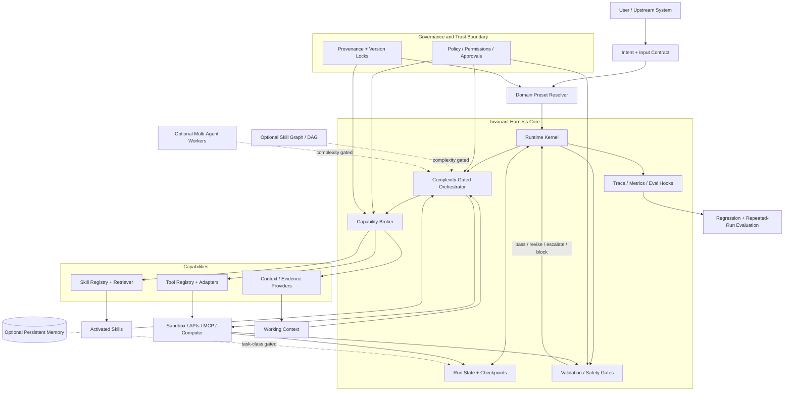

# Evidence-Based Harness Design Base Architecture v0.1

**Date:** 2026-09-18  
**Status:** evidence-backed engineering proposal; not a universal scientific optimum.

## Design thesis

Use a small invariant harness kernel and a versioned domain preset. Default to direct/single-agent execution. Escalate to state machines, dependency DAGs, learned skill composition or multi-agent workers only when task structure and regression evidence justify the marginal complexity.

## Evidence constraints

- Skills can help substantially, but benefits are heterogeneous and may be negative (S001/S003).
- Large catalogs require selective disclosure/routing (S002/S026/S027).
- State machines improve some structured tasks (S015), while simple non-agentic pipelines can outperform complex agents (S016).
- Long-horizon memory helps where task structure demands it (S012/S013/S014), not universally.
- Evaluation and repeated-run reliability are architectural concerns (S018/S019/S020).
- Side-effectful tools and third-party skills require explicit trust boundaries (S021/S022/S023/S028/S029).

## Reference architecture



## Kernel

1. Governance/Trust Contract
2. Runtime Lifecycle
3. Run State + Context Manager
4. Capability Broker
5. Complexity-Gated Orchestrator
6. Validation/Safety Gates
7. Trace/Evaluation Hooks

## Preset

```yaml
apiVersion: hdba/v0.1
kind: HarnessPreset
metadata:
  id: example-domain
  version: 0.1.0
  owner: team-name
  provenance: repo-or-registry-ref
objective:
  statement: "..."
  success_contract: "..."
domain:
  name: "..."
  task_taxonomy: ["..."]
  risk_profile: low|medium|high
orchestration:
  default_mode: direct
  escalation_rules:
    - when: multi_step_state_dependency
      use: state_machine
    - when: multi_skill_dependencies
      use: skill_plan
    - when: heterogeneous_parallel_subtasks
      use: multi_agent   # optional, gated
context:
  sources: []
  untrusted_content_policy: isolate
  max_context_strategy: progressive_disclosure
memory:
  run_state: required
  persistent: none|episodic|semantic|hybrid
  write_policy: "..."
tools:
  registry: tools.lock.yaml
  least_privilege: true
  side_effect_approval: required_by_risk
skills:
  registry: skills.lock.yaml
  discovery: metadata
  routing: direct|retrieval|rerank|composer
  dependency_resolution: optional
policies:
  instruction_hierarchy: "..."
  forbidden_actions: []
  approval_gates: []
outputs:
  schema: schemas/output.schema.json
  validators: []
evaluation:
  suites: []
  repeated_runs: 3
  metrics: [task_success, constraint_adherence, tool_correctness, latency, cost]
observability:
  trace_schema: "..."
  redact_secrets: true
release_gates:
  - no_critical_security_findings
  - regression_suite_passes
  - negative_skill_delta_within_budget
runtime:
  model_lock: models.lock.yaml
  environment_lock: environment.lock.yaml
experimental:
  learned_skill_composer: false
```

## Skill contract extension

Keep standard Agent Skills `SKILL.md`; add this optional harness-grade companion:

```yaml
apiVersion: hdba/v0.1
kind: SkillContract
metadata:
  id: example-skill
  version: 1.2.0
  provenance: "registry/repo/commit"
  digest: "sha256:..."
activation:
  description: "What it does and when to use it"
  exclusions: []
io:
  inputs: []
  outputs: []
requires: []
provides: []
conflicts_with: []
preconditions: []
postconditions: []
permissions:
  tools: []
  network: none|allowlisted|open
  filesystem: none|read|write
execution:
  sandbox: required|optional|none
  timeout_s: 120
validators: []
evals: []
compatibility:
  models: []
  runtime: []
```

## Package tree

```text
harness/
├── HARNESS.yaml
├── kernel/
│   ├── lifecycle/
│   ├── orchestration/
│   ├── validation/
│   └── tracing/
├── domain-packs/
│   └── <domain>/
│       ├── preset.yaml
│       ├── ontology/
│       ├── policies/
│       ├── skill-set.yaml
│       └── evals/
├── skills/
│   └── <skill>/
│       ├── SKILL.md
│       ├── skill.contract.yaml
│       ├── scripts/
│       ├── references/
│       └── assets/
├── tools/
│   ├── contracts/
│   └── adapters/
├── schemas/
├── evaluators/
├── tests/
├── benchmarks/
├── state/
├── observability/
└── lock/
    ├── models.lock.yaml
    ├── tools.lock.yaml
    ├── skills.lock.yaml
    └── environment.lock.yaml
```

## Release invariants

- Resolved preset is versioned and reproducible.
- Model/tool/skill/environment versions are locked.
- Side-effectful actions are authorized before execution.
- Every optional complexity extension has an activation condition.
- Each skill has a no-skill or simpler-baseline regression comparison when feasible.
- Traces record capability selection, state transitions, tool calls, validator outcomes, cost and latency.
- Release gates include task success, constraint adherence, security and negative-regression checks.

## Falsification plan

HDBA v0.1 should be revised if controlled multi-domain ablations show that one of its core contracts contributes no reliability/portability value, or if an omitted mechanism is consistently necessary across task classes. Optional components should be promoted to core only after replicated marginal-value evidence.
