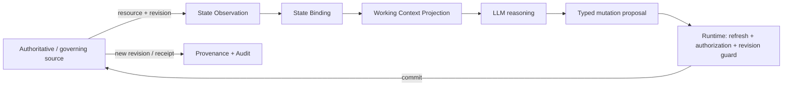

# GPT: GPT-5.5 Thinking · 18.09.2026 / 18:54 Uhr · Topic: State Ownership in Enterprise Agent Harnesses

## Executive Conclusion, Forschungsrahmen und Evidenzlage

**EXECUTIVE CONCLUSION**

Die zentrale Architekturentscheidung lautet nicht „wo speichern wir Agent State?“, sondern:

> **Für welche Aussage über welches logische Objekt, zu welchem Zeitpunkt und für welche Operation besitzt welche Quelle epistemische Autorität – und welche Instanz darf daraus einen autoritativen Zustandswechsel committen?**

Die im Research-Brief formulierte Trennung `Working Context ≠ Authoritative System State ≠ Persistent Memory ≠ External Source of Truth` hält der Prüfung stand, muss aber präzisiert werden: **Working Context sollte überhaupt nicht als eigenständige Autoritätsklasse verstanden werden, sondern als versionierte Projektion bzw. Observation anderer Zustände für eine konkrete Modellinferenz.** fileciteturn0file0 Direkte Agent-Forschung zeigt inzwischen deutlich, dass Langzeitgedächtnis, Zustandsrekonstruktion, Knowledge Updates und zeitliche Konsistenz reale Fehlerquellen sind; LongMemEval berichtet bei langen Interaktionshistorien ungefähr 30 Prozent Genauigkeitsverlust bei bestehenden Systemen, während neuere Benchmarks explizit dynamisches State Tracking und Workflow-Wissen testen. citeturn19view3turn14academia27

Das **kleinste belastbare allgemeine Modell** benötigt aus meiner Sicht sieben semantische Schichten:

| Schicht | Status | Kerngedanke |
|---|---|---|
| Context Projection | **obligatorisch**, aber kein autoritativer State | Was das Modell gerade sieht |
| Run State | **obligatorisch** | Zustand einer konkreten Ausführung bzw. eines Attempts |
| Workflow State | **optional für Profile A, obligatorisch für dauerhafte B/C** | langlebiger Kontrollzustand über Attempts hinweg |
| Resource State | **obligatorische Abstraktion** | Artifacts, externe Business-Ressourcen und Policy-Ressourcen mit je eigener Autorität |
| Memory State | **optional** | episodisch, semantisch, prozedural; standardmäßig advisory |
| Derived State | **optional, aber explizit modellieren, sobald vorhanden** | Cache, Summary, Index, Feature oder Materialized View |
| Provenance / Commit Record | **querschnittlich obligatorisch für B/C** | Belegt Observation, Entscheidung und tatsächlich akzeptierten Effekt |

`Artifact`, `External` und `Policy` sollten **nicht semantisch verschmolzen** werden, obwohl sie dieselbe generische Resource-State-Abstraktion verwenden können. Ihre Autorität, Änderungsrate, Sicherheitsfolgen und Freshness-Anforderungen unterscheiden sich erheblich. `Episodic`, `Semantic` und `Procedural Memory` brauchen dagegen nicht zwingend drei unterschiedliche Storage-Layer; sie können eine gemeinsame Memory-Infrastruktur mit unterschiedlichem `memory_kind`, Authority- und Lifecycle-Profil benutzen. Das ist eine **DESIGN_RECOMMENDATION**, nicht ein existierender Agent-Standard.

Der zweite Kernbefund ist eine strikte Trennung von vier Begriffen:

\[
\text{epistemic authority}
\neq
\text{write authority}
\neq
\text{storage ownership}
\neq
\text{execution authority}
\]

Ein CRM kann beispielsweise die autoritative Quelle für `customer.status` sein; der CRM-Betreiber besitzt den Store; ein Agent-Harness darf eine Änderung ausführen; und das LLM darf lediglich eine Mutation vorschlagen. Dass alle vier Rollen technisch beim selben Dienst liegen *können*, bedeutet nicht, dass sie konzeptionell identisch sind. Der August-2026-Preprint *Beyond Memory* formuliert eine unmittelbar verwandte Trennung: Modelle und Tools erzeugen Kandidaten, während nur ein deterministischer Aktivierungsmechanismus den autoritativen Head fortschreiben darf; bloße Speicherung eines Kandidaten verleiht keine Autorität. Der Beitrag prüft seine Protokollinvarianten in einem beschränkten Zustandsmodell, ist aber **noch ein Preprint und kein Produktionsnachweis**. citeturn17view0

Der dritte Kernbefund betrifft Freshness: **„jünger als X Sekunden“ ist keine tragfähige universelle Definition von frisch.** Datenbanksysteme unterscheiden bereits zwischen Statement-Snapshot, Transaction-Snapshot und serialisierbarer Ausführung; verteilte Systeme bieten zusätzlich Session- und bounded-staleness-Semantiken. citeturn20search0turn7search0turn7academia49 Für Agent Harnesses sollte Freshness daher ein **operationsbezogenes Prädikat** sein:

\[
Fresh(s,o,t) =
Requirement(o)\ \text{is satisfied by evidence about state }s\text{ at decision/use point }t
\]

Das kann beispielsweise bedeuten: `revision == expected_revision`, `event_offset >= min_offset`, `dependency revisions unchanged`, `policy re-evaluated at effect time` oder – wo fachlich begründet – eine Zeitgrenze. Diese Semantik ist **PROPOSED_STANDARD**.

Der vierte Kernbefund ist der bevorzugte Default für side-effectful Agents:

> **Plan on a declared snapshot; commit against revalidated critical state.**

Das ist **kein universelles Pflichtmuster**. Es kombiniert aber die Reproduzierbarkeit eines Snapshots mit einem pre-effect Freshness-/Concurrency-Check. Genau diese TOCTOU-Klasse ist nicht hypothetisch: MITRE beschreibt den generischen Fehler, dass ein Ressourcenzustand zwischen Check und Use verändert wird; eine aktuelle 2026-Arbeit zu LLM-gestützten Guard-Entscheidungen beobachtet über mehrere adaptive Umgebungen nichttriviale Änderungen zwischen Approval und späterem Use und formuliert explizit eine Verdict-Freshness-Anforderung. citeturn6search0turn16academia38

Der fünfte Kernbefund ist: **nicht jeder Read braucht starke Konsistenz.** Linearizability, Serializability, Snapshot Isolation, causal/session guarantees und eventual consistency lösen unterschiedliche Probleme. PostgreSQL demonstriert praktisch, dass stabile Snapshots und Serializability unterschiedliche Garantien und Kosten besitzen; die klassische Session-Guarantees-Arbeit unterscheidet u. a. Read-Your-Writes und Monotonic Reads. citeturn1search20turn1search0turn7search0turn20search0 Für einen einzelnen Harness-Run empfehle ich als minimalen Default **Read-Your-Writes + monotone Observation eigener relevanter Ressourcen**, während konfliktträchtige Writes zusätzlich revision-bound bzw. transaktional abgesichert werden. Auch das ist **PROPOSED_STANDARD**, kein empirisch etablierter Agent-Standard.

Der sechste Kernbefund ist: **Memory darf nicht mit Current State verwechselt werden.** LongMemEval misst explizit Knowledge Updates und zeitliches Reasoning als schwierige Memory-Fähigkeiten. Memory-Injection-Forschung zeigt zudem, dass persistenter Memory-Inhalt eine eigene Trust Surface darstellt. Neuere State-Replay-Forschung warnt davor, Memory-Architekturen allein nach Endpunkt-Benchmarkwerten zu beurteilen. citeturn19view3turn12academia25turn14academia29 Wenn eine aktuellere autoritative Quelle existiert, ist Memory deshalb im Default **advisory evidence**, nicht current truth.

Der siebte Kernbefund ist eine wichtige Begrenzung: **Die wissenschaftliche Agent-Literatur validiert bislang nicht das hier vorgeschlagene Gesamtmodell.** Der 2026-Survey zu Always-On Agents kartiert zwar Memory, Task Ledgers, Permissions, Credentials, Commitments, Provenance und externe Effects als persistenten Zustand, stellt aber selbst fest, dass Governance, Recovery und Forgetting gegenüber Akkumulation und Retrieval unterrepräsentiert sind. citeturn17view5 Ein universeller `StateContract`, ein standardisiertes `FreshnessRequirement` oder eine empirisch bestätigte optimale State-Ontologie wurden in den geprüften primären Quellen nicht gefunden. Diese Teile dieses Reports sind daher bewusst **DESIGN_RECOMMENDATION** bzw. **PROPOSED_STANDARD**.

**Forschungsfrage und Annahmen.** Das ursprünglich „unspezifizierte“ Thema wird durch den bereitgestellten Research-Brief eindeutig spezifiziert. fileciteturn0file0 Drei präzise Forschungsfragen wären:

| mögliche Forschungsfrage | Fokus |
|---|---|
| Welche minimale State-Ontologie und Autoritätssemantik verhindert, dass Context, Memory oder Cache als aktuelle Wahrheit fehlinterpretiert werden? | Ontologie und Authority |
| Welche Freshness-, Versionierungs- und Concurrency-Semantik benötigt ein Harness für zuverlässige Reads und kontrollierte Writes? | Runtime Correctness |
| Wie werden diese Semantiken maschinenlesbar auf Capability Contract, State Contract und Execution Manifest verteilt? | Operationalisierung |

Als **übergreifende Forschungsfrage** verwende ich: **„Was ist das kleinste risikoadaptive State-Ownership-Modell, das aktuelle Entscheidungen, kontrollierte Writes, Concurrency Safety, Recovery, Auditierbarkeit und Reproduzierbarkeit ermöglicht?“** Stichtag der Literatur- und Quellenprüfung ist der 18. September 2026. Die Zielgruppe wird als technisch informierte Enterprise-Architektur-/Runtime-Gruppe angenommen. Numerische TTLs, Implementierungsdauer und konkrete Kosten werden nicht erfunden.

**SOURCE QUALITY MAP**

| Quellenklasse | Beispiele | Aussagekraft | wichtigste Grenze |
|---|---|---|---|
| **PEER_REVIEWED_RESULT** | LongMemEval/ICLR 2025 | direkte Agent-Memory-Evidenz | adressiert Memory, nicht komplette State Governance citeturn19view3 |
| **PREPRINT_RESULT mit direktem Agent-Bezug** | Continuity Kernel, MAGE, LongMemEval-V2, Always-On Agents, LSREP, State Unlearning | sehr aktuell und thematisch direkt | nicht peer-reviewed; häufig prototypische Benchmarks oder abstrakte Modelle citeturn17view0turn16academia37turn14academia27turn17view5turn14academia29turn16academia39 |
| **FORMAL_RESULT / Systems Research** | Linearizability, logical clocks, Session Guarantees, Snapshot Isolation | starke Semantik für Concurrency/Consistency | Übertragung auf Agent Harnesses ist **SYSTEMS_ANALOGY** citeturn1search20turn1search1turn7search0turn1search0 |
| **STANDARD / Security Guidance** | W3C PROV, NIST ABAC, MITRE TOCTOU | belastbar für Provenance und Security-Begriffe | definiert keine Agent-State-Architektur citeturn2search8turn2search9turn6search11turn6search0 |
| **ENGINEERING_PRACTICE** | PostgreSQL, Git, AWS Step Functions, Durable Functions, CDC, OpenTelemetry | starke Produktionspräzedenz | Vendor-/Systemverhalten ist kein Wirksamkeitsbeweis für Agents citeturn20search0turn21search0turn21search2turn3search6turn8search0turn3search1 |
| **Agent Framework Practice** | LangGraph Checkpoints/Store | zeigt reale Trennung von Thread Checkpoints und Long-Term Store | Framework-spezifisch; keine vergleichende Wirksamkeitsstudie citeturn15search2turn15search0 |

**STATE TERMINOLOGY / ONTOLOGY**

Ich empfehle folgende Definition von `State`:

> **State ist eine identifizierbare Menge von Aussagen über ein logisches Objekt oder einen Kontrollprozess, deren Gültigkeit auf einen definierten Versions-, Zeit-, Scope- und Autoritätskontext bezogen werden kann.**  
> Ein Modell-Token, eine Zusammenfassung oder eine Tool-Response wird nicht dadurch zu autoritativem State, dass sie dem LLM vorliegt.

Daraus ergeben sich vier zwingende Unterscheidungen:

`logical object` → beispielsweise `crm/customer/4711`  
`concrete version` → beispielsweise Revision `194` oder ein ETag  
`observation` → Revision 194 wurde um `t_obs` gelesen  
`runtime projection` → ausgewählte Felder dieser Observation befinden sich im LLM-Context.

Git demonstriert dieses Muster besonders klar: Objekt-/Commit-IDs identifizieren konkrete Inhalte, während Branch-Refs veränderliche Zeiger sind; `git update-ref` kann den aktuellen alten OID prüfen, bevor ein Ref aktualisiert wird. citeturn9search0turn21search0

**CLAIM–EVIDENCE–COUNTEREVIDENCE MATRIX**

| Hypothese | Einstufung | Urteil / Evidenz | Gegenargument oder Falsifier |
|---|---|---|---|
| H1 Context ist nicht automatisch authoritative | **DESIGN_RECOMMENDATION – hoch** | Agent-Memory-Benchmarks zeigen Update-/Temporalfehler; Continuity Kernel trennt Projection von accepted state. citeturn19view3turn17view0 | Bei vollständig bounded, unveränderlichem Input kann Context faktisch genügen. |
| H2 Agent nicht SoT für externen Business State | **DESIGN_RECOMMENDATION – hoch** | Kandidat ≠ Commit; externe APIs besitzen eigene Mutation/Concurrency-Semantik. citeturn17view0turn21search0 | Ein vollständig agent-owned internes Objekt kann vom Harness selbst autoritativ verwaltet werden. |
| H3 Memory advisory bei aktueller höherer Quelle | **DESIGN_RECOMMENDATION – hoch** | Knowledge-update-Probleme und Memory Poisoning. citeturn19view3turn12academia25 | Für intrinsisch memory-native Information ohne andere Quelle kann Memory autoritativ für „was gespeichert wurde“ sein. |
| H4 Freshness eher revisions-/dependency-basiert als globale TTL | **DESIGN_RECOMMENDATION – hoch** | Versionschecks, Snapshot-/Session-Semantik und bounded staleness zeigen mehrere Freshness-Dimensionen. citeturn21search0turn7academia49turn20search0 | Manche physikalischen/externen Daten bieten nur Zeit-Freshness. |
| H5 Snapshot planen, vor Effect refreshen | **DESIGN_RECOMMENDATION – hoch** | TOCTOU + aktuelle Verdict-Staleness-Evidenz. citeturn6search0turn16academia38 | Unveränderliche oder append-only Ressourcen brauchen keinen Live Refresh. |
| H6 Run und Workflow bei durable Agents trennen | **DESIGN_RECOMMENDATION – mittel-hoch** | Durable Functions rekonstruiert Orchestratorzustand aus History; Step Functions persistiert Workflow State; LangGraph trennt Checkpoints und runtime-only state. citeturn3search6turn21search2turn15search4 | Kurze bounded Runs benötigen diese Trennung nicht. |
| H7 deklarierte Reads/Writes ermöglichen Konfliktanalyse | **PROPOSED_STANDARD – mittel** | klassische Transaction-/Dependency-Semantik unterstützt Analyse; direkte Agent-Ablation fehlt. citeturn20search0 | Dynamische Ressourcen können statisch unbekannt sein. |
| H8 nicht jeder Read braucht strong consistency | **SYSTEMS_ANALOGY + DESIGN_RECOMMENDATION – hoch** | etablierte unterschiedliche Isolation-/Sessionmodelle. citeturn7search0turn20search0 | Safety-critical Invarianten können stärkere Garantien erfordern. |
| H9 Risiko und Side Effects bestimmen Freshness | **DESIGN_RECOMMENDATION – mittel-hoch** | TOCTOU-Risiko tritt am Use Point auf; Guard-Staleness ist use-dependent. citeturn6search0turn16academia38 | Risiko allein sagt nicht, welche technische Semantik die Ressource unterstützt. |
| H10 Derived State braucht Source-Revisions-Provenance | **DESIGN_RECOMMENDATION – hoch** | W3C PROV modelliert Ableitung; CDC stellt Quellpositionen für Derived-Systeme bereit. citeturn2search9turn8search0 | Wegwerfbare Low-Risk-Caches brauchen nicht zwingend vollständige Provenance. |
| H11 External State eher referenzieren als replizieren | **DESIGN_RECOMMENDATION – mittel** | vermeidet zweiten Wahrheitsbestand; CDC zeigt explizit Aufwand der Synchronisation. citeturn8search0 | Offline-, Latenz- oder Analytics-Anforderungen können replizierte Snapshots erzwingen. |
| H12 Authority ≠ Ownership | **INFERENCE – hoch** | Continuity Kernel trennt storage presence von authoritative reachability. citeturn17view0 | Kann organisatorisch zusammenfallen, bleibt aber semantisch trennbar. |
| H13 Write Authority ≠ Storage Ownership | **INFERENCE – hoch** | externe Systeme erlauben autorisierte Mutationen ohne Store-Eigentum des Callers. citeturn3search13turn21search5 | monolithische Systeme können beides an eine Komponente delegieren. |
| H14 Hybrid Snapshot + Refresh sinnvoll, nicht universal | **DESIGN_RECOMMENDATION – hoch** | verbindet stabile Analyse mit TOCTOU-Abwehr. citeturn20search0turn6search0 | immutable state oder transaktional eingeschlossene Planung braucht kein separates Refresh. |
| H15 nur dependency-relevante Changes sollten Revalidation triggern | **DESIGN_RECOMMENDATION – mittel-hoch** | Provenance-/CDC-Modelle erlauben Dependency Tracking. citeturn2search9turn8search0 | unvollständige Dependency Graphs erzeugen false negatives. |
| H16 Memory, Cache und Context brauchen unterschiedliche Invalidierung | **DESIGN_RECOMMENDATION – hoch** | verschiedene Persistenz-/Ableitungsfunktionen; Execution-state unlearning zeigt fortbestehende derived traces nach Memory-Löschung. citeturn16academia39 | simple bounded agents können alle drei temporär behandeln. |
| H17 Event Sourcing nicht genereller Default | **DESIGN_RECOMMENDATION – hoch** | Durable Functions zeigt Nutzen für Replay, aber auch History-/Replay-Overhead. citeturn3search8 | audit-/replay-intensive Workflows können den Nutzen klar rechtfertigen. |
| H18 State Contract könnte fundamental sein | **PROPOSED_STANDARD – mittel** | direkter Preprint zu Activation Contracts stützt Richtung; kein breit etablierter Standard gefunden. citeturn17view0 | starke, homogene Resource APIs könnten separate State Contracts redundant machen. |

**STATE CLASSIFICATION RESULT**

Die Ausgangsontologie ist **nicht vollständig orthogonal**. Das ist kein Defekt, sofern die Kategorien unterschiedliche Governance-Semantiken ausdrücken.

| Ausgangsklasse | Entscheidung | Begründung |
|---|---|---|
| WORKING_CONTEXT | **behalten, aber als Projection umklassifizieren** | Context ist eine Observation/Projektion, keine Autoritätsdomäne. |
| RUN_STATE | **behalten** | attempt-/run-lokale Execution-Semantik. |
| WORKFLOW_STATE | **behalten, profilabhängig** | anderes Lifecycle-/Recovery-Modell als ein einzelner Run. |
| ARTIFACT_STATE | **behalten** | eigenständige Versionierung/Lebensdauer; kann Runs überleben. |
| EXTERNAL_STATE | **behalten** | Autorität liegt typischerweise im externen Ressourcensystem. |
| POLICY_STATE | **separat behalten** | Revocation, Security und Use-Time-Gültigkeit rechtfertigen Sondersemantik. NIST ABAC macht Entscheidungen von aktuellen Subject/Object/Action/Environment-Attributen und Policy abhängig. citeturn6search11 |
| EPISODIC_MEMORY | logische Unterart von MEMORY | eigene Retrieval-/Decay-Policy möglich. |
| SEMANTIC_MEMORY | logische Unterart von MEMORY | stärker verdichtet/abgeleitet und deshalb zusätzliche Driftgefahr. |
| PROCEDURAL_MEMORY | **Memory-Unterart oder Registry Resource** | wird zur autoritativen Registry-Ressource, wenn „approved procedure vX“ operational normativ ist. |
| DERIVED_STATE | **separat behalten** | benötigt Dependency-/Invalidierungssemantik. |
| PROVENANCE/AUDIT | **ergänzen als Querschnittsrecord, nicht Business-State-Klasse** | beantwortet „worauf stützte sich Entscheidung/Commit?“. W3C PROV stellt standardisierte Ableitungsrelationen bereit. citeturn2search8turn2search9 |
| STATE_BINDING / OBSERVATION | **ergänzen als Envelope, nicht State-Klasse** | bindet logische Ressource, Version, Observation und Runtime-Scope. |

## Autorität, State Identity, Reads/Writes und Sources of Truth

**STATE AUTHORITY MATRIX**

„Source of Truth“ verwende ich hier **nie global**, sondern als **„autoritative Quelle für Property/Invariant \(P\) im relevanten Zeit-/Versionskontext“**.

| State Type | autoritative Quelle für … | Owner / Storage | Reads | Writes / Proposals | Version/Freshness | Snapshot / Live |
|---|---|---|---|---|---|---|
| Working Context | **keine eigene Sachautorität**; autoritativ nur dafür, was dem Modell präsentiert wurde | Harness/Inference Runtime | aktueller Run | Context Builder schreibt Projection | `context_build_id` + Source refs | Snapshot ist seine Natur; bei kritischer Nutzung Source neu validieren |
| Run State | aktueller Attempt-/Execution-Fortschritt | Runtime/checkpointer | Runtime, Debug/Audit | Runtime; LLM nur über typisierte Aktionen | run/attempt sequence/checkpoint | lokaler Snapshot meist ausreichend |
| Workflow State | langlebiger Kontrollzustand | durable workflow store/history | Runtime, Operator/Audit | Orchestrator/transition engine | event seq/checkpoint/workflow revision | Workflow engine bestimmt konsistenten View; externe Preconditions separat refreshen |
| Artifact State | konkrete Artifact-Version und ggf. Approval Status | Git/object/doc store | berechtigte Capabilities | artifact service; LLM erzeugt Kandidaten | commit/hash/version/generation | immutable Version snapshot sicher; mutable alias/ref vor Update prüfen |
| External State | fachliche Eigenschaften der Ressource | CRM/ERP/Jira/DB/Cloud etc. | Capability nach Policy | autorisierter Connector/API; LLM schlägt Mutation vor | native revision/ETag/txid/generation | Live/revision check operationsabhängig |
| Policy State | Policy-Version + aktuelle relevante Attributes; historischer Decision Record für damalige Entscheidung | Policy/identity/governance systems | Authorization Runtime/Audit | Policy admins/services; LLM normalerweise kein direkter Writer | policy version + attribute/revocation revisions | bei privilegiertem Effect aktuelle Evaluation bzw. deklarierte Staleness-Garantie |
| Episodic Memory | was als Episode gespeichert wurde, **nicht automatisch ob Ereignis heute noch gilt** | Memory store | LLM/Runtime nach scope | memory service; Agent/User proposals | memory record revision + source/time | Snapshot okay; Current-Fact-Claims verifizieren |
| Semantic Memory | gespeicherte Abstraktion | Memory/knowledge store | LLM/Retrieval | consolidation pipeline / curated writes | revision + source dependencies | advisory; invalidieren/recompute bei relevanter Source-Änderung |
| Procedural Memory | bei governed registry: welche Procedure-Version freigegeben ist | skill/procedure registry | planner/runtime | maintainer/publisher; Agent proposals möglich | package/version/digest/signature | konkrete Version pinnen; Registry refresh vor neuer Binding-Entscheidung |
| Derived State | berechneter Wert *für definierte Source-Versionen* | cache/index/view system | Runtime/Retrieval | derivation pipeline | derivation id + source revisions | sicher nur innerhalb deklarierter Dependency-Freshness |

Die Trennung „Candidate vs accepted authoritative state“ wird besonders direkt durch den Continuity-Kernel-Preprint unterstützt: Candidate, Attempt, Quarantine und Projection können gespeichert sein, ohne den accepted head zu bilden. citeturn17view0 Das ist für diesen Report ein **PREPRINT_RESULT mit hoher konzeptioneller Relevanz**, aber nicht die Behauptung, genau dieser Kernel müsse implementiert werden.

**SOURCE-OF-TRUTH MODEL**

Ich empfehle ein **property-scoped authority model**. Nicht `customer_record` als Ganzes muss zwingend dieselbe Autorität besitzen. Beispielsweise:

```text
customer.name            -> CRM
customer.payment_balance -> Ledger
customer.risk_class      -> Risk Engine
customer.agent_summary   -> Derived Store
customer.preference_note -> Memory Store
```

Damit verhindert man einen verbreiteten Architekturfehler: eine aggregierte „Customer 360“-View wird irrtümlich zur autoritativen Quelle auch für Felder, die lediglich repliziert oder abgeleitet sind. W3C PROV unterscheidet genau deshalb Entitäten und Ableitungsrelationen; CDC-Systeme transportieren Quelländerungen und Quellpositionen, statt eine Materialized View semantisch automatisch zur Quelle zu erheben. citeturn2search9turn8search0

**READ / WRITE OWNERSHIP MODEL**

Für jeden State sollte der Harness mindestens sechs getrennte Rollen ausdrücken können:

| Rolle | Bedeutung |
|---|---|
| `epistemic_authority` | Welche Quelle entscheidet, welcher Wert für P/t maßgeblich ist? |
| `storage_owner` | Wer persistiert die Bits? |
| `read_authority` | Welcher Principal darf welche Observation erhalten? |
| `proposal_authority` | Wer darf einen Änderungswunsch erzeugen? |
| `commit_authority` | Wer darf den accepted state tatsächlich fortschreiben? |
| `validator` | Wer prüft Schema, Policy, Preconditions, Revision und Postconditions? |

**Darf ein Agent selbst Source of Truth sein?** Ja, aber nur in begrenzter Semantik. Ein Agent kann beispielsweise autoritative Quelle für **seinen eigenen draft artifact**, einen run-internen Plan oder einen agent-native Memory Record sein. Er ist dadurch nicht autoritativ dafür, ob eine externe Kundeneigenschaft, Berechtigung oder Kontobewegung aktuell wahr ist. Der entscheidende Test lautet: **Wer kann die relevante Invariante tatsächlich committen und später beweisen?**

**Darf das LLM direkt authoritative Writes erzeugen?** Als Default für Enterprise B/C: **nein auf der Commit-Ebene**. Das LLM darf einen typisierten Mutation Candidate erzeugen; Runtime/Connector führt Validation, Authorization, Concurrency Guard und Commit durch. Der tatsächlich vom Store bestätigte Commit – nicht die Tool-Call-Absicht – wird neuer State. Der Continuity-Kernel-Ansatz trennt aus genau diesem Grund untrusted proposer und deterministic activation boundary. citeturn17view0 Für low-risk agent-owned Artifacts darf die Architektur diese Stufen zusammenfassen, sofern die Runtime weiterhin commit success und Version erfasst.

**State Identity**

Ein Harness sollte drei Identitäten nicht vermischen:

```text
LogicalObject
    authority_namespace
    resource_type
    resource_id

ConcreteVersion
    revision | ETag | commit_oid | generation | txid | event_offset
    digest
    schema_version

Observation
    snapshot_id / binding_id
    observed_at
    valid_time (optional)
    source_version
```

Logical clocks können Ereignisordnungen abbilden, ohne eine perfekte physikalische Uhr vorauszusetzen; Lamports klassische Arbeit liefert dafür die formale Grundlage. citeturn1search1 Git zeigt einen konkreten Engineering-Fall: eine Branch-Ref kann nur dann auf einen neuen OID gesetzt werden, wenn der alte erwartete OID noch stimmt. citeturn21search0 HTTP `ETag` + `If-Match` bietet dieselbe Klasse optimistischer Concurrency-Semantik für HTTP-Ressourcen: die Mutation wird nur ausgeführt, wenn die aktuelle Repräsentation die Precondition erfüllt. citeturn3search13turn3search2

## Context, Run/Workflow, External State, Memory und Derived State

**WORKING CONTEXT vs AUTHORITATIVE STATE**

Die stärkste Designregel des Reports lautet:

> **Working Context = versionierte, selektive, potenziell verlustbehaftete Projection über State – nicht State Authority.**

Ein Context-Element sollte, wenn es eine faktische Entscheidung beeinflussen kann, idealerweise folgende Metadaten mittragen:

```text
source_ref
resource_id
observed_revision
observed_at
valid_time? 
authority_class
derivation/provenance_ref?
freshness_status
```

Das LLM muss nicht jedes Feld als Text sehen. Die Runtime kann einen Teil als strukturierte Metadaten außerhalb des sichtbaren Prompts verwalten und nur relevante Labels einblenden. Entscheidend ist, dass die Runtime die Information nicht verliert.

OpenAIs eigener interner Data-Agent liefert ein interessantes, aber nur **ENGINEERING_PRACTICE**-Beispiel: bei fehlendem oder veraltetem vorhandenen Kontext kann der Agent Live Queries an das Data Warehouse ausführen, während kuratierte/aggregierte Kontextschichten separat vorbereitet und per Retrieval eingebracht werden. citeturn16search7 Das ist keine allgemeine Wirksamkeitsstudie, stützt aber die Unterscheidung „retrieved context vs live source“.



**Wann darf Context genügen?** Nur wenn mindestens eine der folgenden Bedingungen bewusst gilt:

1. Der relevante Input ist immutable oder versionsgepinned.
2. Die Aufgabe ist explizit „as of snapshot S“ definiert.
3. Die Konsequenz toleriert Staleness innerhalb der deklarierten Anforderung.
4. Die Quelle kann während der relevanten Operation nicht mutieren.
5. Ein späterer Pre-effect Guard verhindert, dass stale Planning direkt zum Effect wird.

Das sind **DESIGN_RECOMMENDATIONS**. Es gibt keine allgemeine empirische Altersgrenze, ab der Context „zu alt“ wird.

**RUN STATE vs WORKFLOW STATE**

Die Alternative „immer trennen“ wäre unnötig komplex. Das richtige Kriterium ist Lifecycle.

| Modell | Recovery | Replay/Audit | Komplexität | geeignet |
|---|---|---|---|---|
| gemeinsamer mutable Run State | schwach bis mittel | begrenzt | niedrig | kurze bounded Tasks |
| ephemeral Run State + durable Workflow State | hoch | hoch | mittel | langlebige Multi-Step Agents |
| event-sourced Workflow + materialized Run View | sehr hoch | sehr hoch | hoch | audit-/replay-intensive Workflows |

AWS Step Functions unterscheidet langlebige, intern persistierte Standard Workflows von anderen Execution-Modi mit anderen Delivery-/Persistence-Garantien; Durable Functions rekonstruiert Orchestratorzustand über Event History und Replay und verlangt dafür deterministische Orchestratorlogik. citeturn21search2turn3search6turn3search8 LangGraph trennt als Framework-Präzedenz Thread-Checkpoints von langlebigem Store und behandelt bestimmte runtime-only Werte bewusst nicht als Checkpoint-State. citeturn15search2turn15search4

Daraus folgt **H6 nur bedingt**: Ein Profile-A-Agent braucht nicht zwei Stores. Sobald jedoch `wait`, `approval`, `retry`, Prozessrestart, menschliche Pausen oder mehrtägige Ausführung Teil der Semantik sind, sollte durable Workflow State von attempt-local Run State getrennt sein.

Empfohlene Identitäten:

```text
workflow_id     # langlebige logische Execution
run_id          # konkrete Aktivierung / Resume-Phase
attempt_id      # einzelner Versuch eines Effects/Nodes
node_id         # logische Workflow-Position
checkpoint_id   # persistierter Kontrollzustand
event_cursor    # optional: Position in History/Eventlog
```

**EXTERNAL STATE MODEL**

Ein externer Datensatz sollte standardmäßig nicht blind in den Harness „kopiert“ werden. Fünf Modi sind sinnvoll:

| Modus | Semantik | sinnvoll wenn |
|---|---|---|
| `REFERENCE` | nur Identität/Locator | authoritative API gut erreichbar |
| `SNAPSHOT` | feste konkrete Version | Analyse, Audit, Reproducibility |
| `CACHE` | beschleunigte nichtautoritative Kopie | Staleness tolerierbar und Invalidierung vorhanden |
| `MATERIALIZE` | abgeleitete lokale Sicht | Search/Analytics; Provenance notwendig |
| `LIVE_READ` | Observation möglichst nah am Use Point | volatile oder entscheidungskritische Preconditions |

Bei Mutationen sollte **`resource_id + expected_revision` häufig besser sein als ein kompletter alter Snapshot**. Der Server prüft damit genau die Konkurrenzbedingung, die für einen Lost Update relevant ist. Git `update-ref <new> <old>` ist ein sehr klares Beispiel; HTTP `If-Match` erfüllt denselben Zweck. citeturn21search0turn3search13

**MEMORY AUTHORITY MODEL**

Memory muss epistemisch differenziert werden:

| Memory Type | wofür potenziell autoritativ? | wofür standardmäßig nicht? |
|---|---|---|
| Episodic | „Diese Episode wurde mit Inhalt X gespeichert“ | „X gilt heute noch“ |
| Semantic | „Das Memory-System enthält Zusammenfassung Y“ | aktuelle externe Business Facts |
| Procedural | „Registry hat Procedure v7 freigegeben“ – wenn governed | aktuelle externe Preconditions oder Tool-Zustand |

LongMemEval zeigt, dass Knowledge Updating und Temporal Reasoning selbst explizite Benchmark-Fähigkeiten sind und bestehende Systeme bei langen Verläufen stark degradieren. citeturn19view3 MAGE berichtet, dass eine explizitere Execution-State-Struktur auf seinem Benchmark sowohl Success als auch Tokenkosten verbessern kann; das ist aber ein 2026-Preprint und kein Beweis, dass jede Agent-Architektur State Trees braucht. citeturn16academia37 Umgekehrt zeigt die sehr aktuelle LSREP-Arbeit, dass eine aufwendigere strukturierte Memory-Architektur auf einem öffentlichen Benchmark von einer einfacheren Vector-RAG-Variante deutlich geschlagen werden kann; sie fordert deshalb longitudinalen Replay statt bloßer Endpunkt-Scores. citeturn14academia29 Das ist wichtig gegen Architecture Confirmation Bias.

Memory ist außerdem eine Angriffsfläche: MINJA demonstriert Memory-Injection-Angriffe gegen agentische Memory-Systeme. citeturn12academia25 Daraus folgt keine Aussage, dass Memory generell unsicher ist, wohl aber, dass „persistiert“ nicht gleich „vertrauenswürdig“ bedeutet.

**Wann kann Memory authoritative sein?** Für Memory-native Aussagen, beispielsweise „Der Nutzer hat am 10. September Präferenz P gespeichert“, sofern der Memory Store dafür die governing source ist. Ob P **heute** noch gilt, ist eine andere Aussage. Eine Preference sollte daher temporal formuliert werden: `recorded_preference(P, valid/observed context)` statt `P = current truth`.

**DERIVED / CACHED STATE MODEL**

Derived State umfasst Cache, Embedding, Summary, Materialized View, Index, Feature, Klassifikation und aggregierte Statistiken. Ein derived value darf für **seinen eigenen berechneten Output** autoritativ sein, aber nicht stillschweigend die Autorität seiner Quellen übernehmen.

Minimal:

```text
derived_state:
  derivation_id
  algorithm/version
  source_refs:
    - resource_id
      revision
  generated_at
  validity/invalidation_rule
  digest
```

W3C PROV bietet mit Entitäten, Activities und `wasDerivedFrom` bereits ein standardisiertes Provenance-Vokabular. citeturn2search8turn2search9 Debezium nutzt beispielsweise Datenbank-Logpositionen, um Änderungen fortlaufend zu streamen und Downstream-Caches, Indizes oder Materialized Views zu aktualisieren. citeturn8search0turn8search7

Neuere Forschung zum „Execution-State Unlearning“ liefert ein direktes Agent-Gegenbeispiel gegen naive Invalidierung: das Löschen eines ursprünglichen Memory-Eintrags genügt nicht notwendigerweise, wenn daraus bereits Summaries, Pläne oder Runtime-Artefakte entstanden sind; der Preprint schlägt provenance-guided selective replay vor. citeturn16academia39 Damit wird `source revision → derived object → downstream dependency` zu einer realen State-Governance-Frage.

## Freshness, Snapshot-vs-Live, Consistency, Concurrency und Runtime-Reaktionen

**FRESHNESS / STALENESS MODEL**

Ich empfehle fünf explizite Zustände:

| Status | präzise Bedeutung |
|---|---|
| `FRESH` | die deklarierte Freshness-Anforderung ist am bezeichneten Entscheidungspunkt durch vorhandene Evidence erfüllt |
| `STALE` | es ist bekannt, dass diese Anforderung nicht mehr erfüllt ist |
| `UNKNOWN_FRESHNESS` | ausreichende Evidence zum Beweis fehlt |
| `INVALIDATED` | ein explizites Ereignis/eine Dependency-Änderung macht die Observation unzulässig |
| `EXPIRED` | ein definiertes Validity Window, Lease oder Credential-Zeitfenster ist beendet |

**`FRESH` bedeutet also niemals einfach „neu“.**

Die Modelle im Vergleich:

| Modell | Stärke | Schwäche | typische Klassen |
|---|---|---|---|
| TIME_BASED | einfach; für natürliche zeitliche Verfallsprozesse geeignet | Alter beweist keine unveränderte Ressource | Sensorik, Marktdaten, Leases |
| VERSION_BASED | exakte Konkurrenzerkennung | benötigt native Version | External, Artifact, Policy |
| EVENT_BASED | reagiert auf Changes/Revocations | Event Delivery selbst hat Semantik | Policy, Workflow, Caches |
| DEPENDENCY_BASED | präzise Invalidierung | Dependency Graph kann unvollständig sein | Derived State, Plans |
| RISK_BASED | vermeidet unnötige Live Reads | ist Meta-Regel, keine Consistency-Garantie | Operation Policy |
| HYBRID | kombiniert oben | höchste Implementierungskomplexität | B/C side-effectful |

Bounded-staleness-Forschung zeigt, dass Staleness sowohl in Versionen als auch in Wall-Clock-Zeit beschrieben werden kann und mit Latenz-/Consistency-Trade-offs verbunden ist. citeturn7academia49 Daraus folgt nicht, dass ein bestimmter Bound für Agents optimal wäre.

**SNAPSHOT vs LIVE READ DECISION MATRIX**

| State / Operation | Risiko | Snapshot safe? | Refresh? | Live Read? | Expected Revision? | Begründung / Status |
|---|---:|---|---|---|---|---|
| Read-only Report „as of S“ | niedrig | ja | nein | nein | nein | Reproduzierbarkeit ist wichtiger als absolute Aktualität; **DESIGN_RECOMMENDATION** |
| „aktueller“ Read-only Report | niedrig–mittel | bedingt | ja, wenn Snapshot nicht nachweisbar aktuell | ggf. | nein | „current“ benötigt Freshness-Semantik |
| Jira Issue Edit | mittel | für Planung ja | **ja oder CAS** | bedingt | **empfohlen** | schützt parallele Edits; **SYSTEMS_ANALOGY** zu optimistic concurrency citeturn3search2 |
| Git Branch Update | mittel–hoch | Commit-Snapshot ja | Ref muss geprüft werden | nicht zwingend separater Read bei atomarem CAS | **ja** | `update-ref` prüft alten OID atomar. citeturn21search0 |
| CRM Customer Update | mittel–hoch | Planung ja | ja/CAS | abhängig API | **ja, wenn unterstützt** | Lost Update vermeiden |
| Production Deployment | hoch | immutable artifact ja | Environment/Policy/desired generation refreshen | für kritische Preconditions ja | generation/revision empfohlen | Snapshot des Artifacts ≠ aktueller Produktionszustand |
| Payment / Value Transfer | sehr hoch | nur für Planung | **ja** | kritische Ledger-/Policy-Fakten use-time | transaktionale Guard-/Ledger-Semantik nötig | lokale Harness-Version allein kann externen Ledger nicht atomisieren; **DESIGN_RECOMMENDATION** |
| Policy Check vor privileged Effect | hoch | Snapshot auditierbar | **ja bzw. version-bound decision** | normalerweise ja | policy/attribute revision sofern verfügbar | ABAC hängt von Policy und aktuellen Attributen ab; TOCTOU relevant. citeturn6search11turn6search0 |
| Memory Retrieval | niedrig–mittel | ja | nur bei Current-Fact-Claim | Source verification bei höherer Autorität | nein | Memory advisory by default. citeturn19view3 |

**Plan against snapshot → execute against refreshed critical state** ist damit die empfohlene **Profile-B/C-Voreinstellung**, aber nicht für immutable resources oder vollständig innerhalb einer seriellen Transaktion ausgeführte Logik.

**CONSISTENCY MODEL**

„Strong consistency“ sollte nicht als Sammelbegriff in Contracts stehen. Die Semantik sollte konkret benannt werden:

| Modell | löst im Harness | Kosten / Grenze | geeignete Nutzung |
|---|---|---|---|
| Linearizability | einzelne concurrent resource erscheint in Real-Time-Order | Koordinations-/Verfügbarkeitskosten | kritischer mutable Head/Lock/Lease; **FORMAL_RESULT** zur Semantik citeturn1search20 |
| Serializability | multi-record Invarianten wie serielle Execution | Retries/Overhead | kritische transaktionale Commit-Zone; PostgreSQL kann Serialization Failures auslösen. citeturn20search0 |
| Snapshot Isolation | stabiler Transaktions-Snapshot | mögliche nichtserielle Anomalien | konsistente Analysen; **PEER_REVIEWED_RESULT/SYSTEMS_ANALOGY** citeturn1search0turn20search0 |
| Causal Consistency | causal predecessors sichtbar | schwächer als Real-Time | verteilte conversational/workflow projections |
| Read-Your-Writes | Run sieht eigene committed Writes | Session-Metadaten nötig | sinnvoller Default für Run |
| Monotonic Reads | Run fällt nicht auf ältere Version zurück | Routing/replica constraints | sinnvoller Default für Resource Observations |
| Eventual Consistency | hohe Availability / günstige Replikation | unbekannte Staleness | Cache, Search, advisory Memory |

**Minimale Consistency-Semantik** für einen allgemeinen Enterprise-Harness ist deshalb **nicht** „Serializable überall“, sondern:

> **PROPOSED_STANDARD:** Im selben Run keine Regression hinter einen bereits als committed akzeptierten eigenen State (`read-your-writes`, `monotonic observation`), plus operationsspezifische Revision Guards oder transaktionale Semantik für konkurrierende Effects.

Die klassischen Session Guarantees formulieren genau solche per-session Eigenschaften. citeturn7search0

**CONCURRENCY / CONFLICT MODEL**

Wenn Agent Reasoning auf Revision `r1` basiert und inzwischen `r2` committed wurde, muss die Runtime **nicht versuchen, den alten Gedanken „wahr“ zu machen**. Sie soll Konflikt explizit erkennen.

Empfohlener Ablauf:

```text
read r1
  ↓
reason / prepare mutation M(expected=r1)
  ↓
pre-effect guard
  ├─ current == r1 → commit M
  └─ current != r1 → CONFLICT
                         ↓
             classify changed dependencies
                ↓        ↓        ↓
             refresh   rebase   replan/escalate
```

Git stellt dafür ein konkretes Compare-before-update-Muster bereit. citeturn21search0 HTTP `If-Match` liefert eine vergleichbare Precondition. citeturn3search13

Locks oder Leases sind deshalb **nicht** der generelle Default. Optimistic concurrency ist vorzuziehen, wenn Konflikte relativ selten sind und die Ressource native Revisionen besitzt. Locks/Serialization werden interessant, wenn konfliktfreie Wiederholung teuer oder eine Invariante über mehrere Ressourcen atomar geschützt werden muss. Diese Wahl ist **ENGINEERING_PRACTICE/SYSTEMS_ANALOGY**, keine Agent-spezifisch experimentell bewiesene Regel.

Retries benötigen zusätzlich **Effect Identity/Idempotency**. Workflow-Dienste machen diese Semantik explizit; AWS unterscheidet beispielsweise Execution-Garantien verschiedener Workflow-Arten. citeturn21search2 Der Continuity-Kernel-Preprint modelliert Effect IDs mit at-most-one accepted binding, weist aber selbst darauf hin, dass ein lokaler Commit einen fremden irreversiblen Remote Effect nicht atomar machen kann. citeturn17view0

**STATE TRANSITION MODEL**

Für wichtige Mutationen sollte das Harness semantisch nicht nur `set x=y`, sondern eine Transition modellieren:

```text
S0 --[guard, principal, capability, expected_revision]--> proposal
proposal --[validation + authorization]--> effect attempt
effect attempt --[commit acknowledgement]--> S1
S1 --[postcondition validation]--> accepted / anomaly
```

`proposal`, `attempt` und `committed state` sind unterschiedliche Dinge. Der direkte 2026-Preprint trennt diese Phasen ausdrücklich und lässt nur `Commit` den authoritative head ändern. citeturn17view0

**STATE CHANGE → RUNTIME RESPONSE MATRIX**

| Änderung | REFRESH | REVALIDATE | REBIND | REPLAN | RECOMPILE |
|---|---:|---:|---:|---:|---:|
| irrelevantes Feld einer gelesenen Resource | optional | nein | nein | nein | nein |
| gelesenes fact field geändert | ja | ja, falls Precondition betroffen | nein | falls Plan davon abhängt | nein |
| `expected_revision` mismatch | ja | ja | ggf. | häufig | nein |
| Resource-ID/Branch/Endpoint Binding geändert | ja | ja | **ja** | ggf. | selten |
| Policy/Role/Revocation geändert | ja | **ja** | ggf. Credential binding | ggf. alternative Aktion | nur wenn statische Policy Compilation betroffen |
| Capability Schema / Skill Package Version geändert | ja | ja | ja | ggf. | **ja**, wenn Manifest alte Semantik bindet |
| Derived State Dependency geändert | ja/recompute | ja bei Nutzung | nein | abhängig Resultat | nein |
| Goal/constraint-relevanter Business State geändert | ja | ja | nein | **ja** | nein |
| ausschließlich neue unrelated Events | nein | nein | nein | nein | nein |

Diese Matrix ist **PROPOSED_STANDARD**. Der zentrale Falsifier wäre ein Benchmark, in dem einfaches „refresh everything/replan everything“ bei vergleichbaren Correctness-Werten günstiger und zuverlässiger wäre oder in dem Dependency-Tracking systematisch relevante Änderungen übersieht.

## Provenance, Isolation, Lifecycle sowie Contract- und IR-Grenzen

**STATE PROVENANCE MODEL**

Um später die Frage „Auf welchen State hat der Agent diese Entscheidung gestützt?“ zu beantworten, muss ein Decision/Effect Trace mindestens referenzieren:

```text
task / run / workflow / attempt
principal
capability + capability_version
manifest_version
state_read:
    authority_source
    resource_id
    revision
    observation_time
    snapshot/binding
derived_from
policy_decision + policy_version
proposed_effect
expected_revision
tool/connector
commit_result
new_revision
validation_result
```

OpenTelemetry-Spans besitzen bereits IDs, Zeitinformationen, Attribute, Events und Links und sind deshalb ein sinnvoller **Transport-/Tracing-Präzedenzfall**, aber OpenTelemetry definiert nicht selbst die State-Authority-Semantik. citeturn3search1 W3C PROV eignet sich besser für die semantische Ableitungsrelation. citeturn2search9

**STATE ISOLATION MODEL**

Isolation sollte mindestens über die Achsen `tenant`, `principal`, `workflow`, `run` und `resource` adressierbar sein. Ein Working Context darf State eines anderen Runs nur dann übernehmen, wenn eine explizite Shared-State- oder Memory-Berechtigung existiert. Das aktuelle Always-On-Agents-Survey behandelt Shared State, Permissions, Credentials und Provenance als getrennte Dimensionen persistenten Agentzustands, weist jedoch gleichzeitig auf Forschungslücken bei Governance hin. citeturn17view5

Empfohlene Regel:

```text
default_scope = least shared

run-local
    < workflow-shared
    < user-scoped
    < team-scoped
    < tenant-scoped
    < global
```

Eine breitere Scope-Stufe ist **keine implizite Vererbung**, sondern verlangt explizite Policy.

Besonders wichtig ist Cache-Keying:

```text
BAD:
cache[query]

BETTER:
cache[tenant, principal-policy-scope, source, resource, revision, query]
```

Nicht alle Dimensionen sind für jeden Cache nötig; der Punkt ist, Sicherheits- und Versionsgrenzen nicht unbeabsichtigt aus dem Key zu entfernen.

**STATE LIFECYCLE MODEL**

Empfohlenes allgemeines Lifecycle-Vokabular:

```text
CREATED
  ↓
ACTIVE
  ├─→ SUPERSEDED
  ├─→ INVALIDATED
  ├─→ EXPIRED
  └─→ ARCHIVED
          ↓
        DELETED / TOMBSTONED
```

`STALE` sollte dabei besser **kein universeller persistierter Lifecycle State** sein. Staleness ist häufig relativ zur Operation. Dieselbe Observation kann für eine historische Analyse zulässig, für einen Payment Effect aber unzulässig sein.

Schema Evolution sollte niemals durch stilles Überschreiben historischer State-Versionen geschehen. Durable Workflow-Systeme illustrieren, warum Code-/State-Kompatibilität bei Replay relevant ist. citeturn3search6turn3search8 Der Continuity-Kernel-Preprint modelliert Migration und Restoration ebenfalls als neue Vorwärts-Transitions statt als Umschreiben des alten accepted head. citeturn17view0

**CAPABILITY CONTRACT ↔ STATE CONTRACT BOUNDARY**

Die sauberste Trennung ist:

| Artefakt | besitzt welche Semantik? | besitzt **nicht** |
|---|---|---|
| Capability Contract | „Diese Operation liest `customer.status`, schreibt `customer.priority`, benötigt Policy X und Freshness-Klasse Y“ | konkrete Customer-ID, aktuelle Revision |
| State Contract | „Customer State kommt aus CRM, hat ETag-Versionierung, Authority/Read/Write/Lifecycle-Regeln“ | konkreten Plan dieser Ausführung |
| Execution Manifest / IR | „Für diesen Run: customer/4711, observed rev 194, snapshot S8, refresh before effect, expected rev 194“ | universelle CRM-Semantik |

Damit wird Doppelpflege reduziert: Die Capability beschreibt **Bedarf**, State Contract beschreibt **Ressourcen-Semantik**, das Manifest beschreibt **konkrete Binding**.

**STATE CONTRACT ↔ IR / MANIFEST BOUNDARY**

Drei Binding-Phasen:

| Zeitpunkt | Beispiele |
|---|---|
| Compile-time known | state type, required fields, access mode, minimum consistency, schema |
| Runtime-bound | `resource_id`, tenant, concrete endpoint, retrieved memory IDs |
| Runtime-refreshed | `observed_revision`, observation time, policy decision, current generation, expected revision |

Ein Manifest sollte deshalb nicht so tun, als sei eine Compile-Time-Revision „current“. Eine ältere Version darf gespeichert bleiben – aber als **observation**, nicht als neue Wahrheit.

**READ/WRITE SETS**

Die Deklaration sollte sowohl Patterns als auch konkrete Ressourcen erlauben:

```text
static:
  reads: crm.customer.*.status

runtime binding:
  reads: crm.customer/4711.status
  observed_revision: "194"
```

Dadurch sind bereits vor Ausführung grobe Konflikt-/Ordering-Checks möglich, während dynamische IDs später gebunden werden. H7 bleibt dennoch **PROPOSED_STANDARD**, weil ich keine belastbare Agent-Studie gefunden habe, die genau diese statische Deklaration gegen eine Baseline ablatiert.

## Proposed State Contracts und maschinenlesbare Architektur

Alle folgenden Schemas sind **PROPOSED_STANDARD v0.1**, nicht externe Standards.

**PROPOSED StateContract v0.1**

```yaml
state_contract_version: "0.1"

state_id: "crm.customer"
state_type: EXTERNAL_STATE

source: "crm"
source_of_truth:
  authoritative_for:
    - "customer.status"
    - "customer.owner"
  temporal_semantics: "current_committed_resource"

owner:
  storage_owner: "crm-platform"
  governance_owner: "sales-operations"

authority_class: AUTHORITATIVE_RESOURCE

read_policy:
  policy_ref: "policy:crm.customer.read"

write_policy:
  policy_ref: "policy:crm.customer.update"
  direct_model_commit: false
  proposal_allowed: true

schema:
  ref: "schema:crm.customer"
  version: "7"

version:
  mechanism: ETAG
revision: null             # runtime-bound
digest: null               # optional

observed_at: null          # runtime
valid_from: null
valid_until: null

freshness_requirement:
  ref: "freshness:customer-update"

consistency_requirement:
  read: READ_YOUR_WRITES
  write: EXPECTED_REVISION

reads: []
writes: []

dependency_refs: []

invalidation_rules:
  - on_source_revision_change

conflict_policy:
  on_revision_mismatch: REVALIDATE_THEN_REPLAN

provenance:
  required: true

retention:
  contract_ref: "retention:crm-state-observations"

sensitivity:
  classification: CONFIDENTIAL
```

**PROPOSED StateReference / StateBinding**

```yaml
state_reference:
  state_ref: "crm.customer/4711"
  state_type: EXTERNAL_STATE
  source: "crm"
  resource_id: "4711"

  observed_revision: "194"
  digest: null
  observed_at: "2026-09-18T16:41:03Z"

  valid_time:
    from: null
    until: null

  snapshot_id: "snapshot:S8"
  provenance_ref: "prov:obs-8841"

state_binding:
  binding_id: "bind:B123"
  run_id: "run:R9"
  workflow_id: "wf:W2"
  tenant_id: "tenant:T7"

  authority_class: AUTHORITATIVE_RESOURCE

  freshness_requirement_ref: "freshness:customer-update"
  consistency_requirement: EXPECTED_REVISION
```

**PROPOSED FreshnessRequirement**

```yaml
freshness_requirement:
  id: "freshness:customer-update"

  required_at:
    - PRECONDITION
    - EFFECT

  accepted_modes:
    - VERSION_MATCH
    - LIVE_AT_EFFECT

  time_bound:
    enabled: false

  required_source: "crm"

  dependency_policy:
    relevant_fields:
      - "customer.status"
      - "customer.owner"

  refresh_before_effect: true
  expected_revision_required: true

  unknown_freshness_policy: BLOCK
```

Mögliche `accepted_modes`:

```text
ANY_DECLARED_SNAPSHOT
VERSION_MATCH
EVENT_POSITION_AT_LEAST
DEPENDENCIES_UNCHANGED
TIME_BOUND
LIVE_AT_EFFECT
HYBRID
```

**PROPOSED StateRead / StateWrite declaration**

```yaml
state_reads:
  - state_type: EXTERNAL_STATE
    resource_pattern: "crm.customer/{customer_id}"
    fields:
      - status
      - owner
    bind: RUNTIME
    freshness_requirement: "freshness:customer-update"

state_writes:
  - state_type: EXTERNAL_STATE
    resource_pattern: "crm.customer/{customer_id}"
    fields:
      - priority
    mutation: PATCH
    expected_revision_required: true
    idempotency_key_required: true
    conflict_policy: REVALIDATE_THEN_REPLAN
    postcondition:
      verify_committed_revision: true
```

**StateContract-Felder: Nutzen und Falsifizierbarkeit**

| Feld | Purpose / Evidence | Required when | optional when | Static/Runtime | verhindert | Falsifier |
|---|---|---|---|---|---|---|
| `state_id` | logische Klassifikation | alle managed states | kaum | static | Ambiguität | native API-ID genügt vollständig |
| `state_type` | Governance-Profil | heterogene States | monolithisch | static | Context/Memory-Verwechslung | Typ bringt keine unterschiedlichen Policies |
| `source` | origin/authority resolution | externe/abgeleitete Daten | run-local | static/bound | falsche Quelle | exakt eine implizite Quelle existiert |
| `source_of_truth` | property-scoped Authority | widersprüchliche Quellen | einfache local state | static | Memory/cache as truth | Domain hat bewusst gleichrangige multi-master truth |
| `owner` | storage/governance Verantwortlichkeit | Enterprise/shared resources | private ephemeral | static | Ownership/Aurhority conflation | kein unterschiedlicher Lifecycle/Principal |
| `authority_class` | advisory vs authoritative | Context/Memory/Derived | trivial local | static | epistemic escalation | alle Inputs gleich behandelt |
| `read_policy` | Read Scope | sensitive state | public immutable | static/runtime | data leakage | upstream API erzwingt vollständig dieselbe Policy |
| `write_policy` | Commit/Proposal scope | mutations | strict read-only | static/runtime | unauthorized writes | upstream endpoint allein deckt alle invariants |
| `schema` | Typ-/Shape-Binding | structured state | opaque blobs | static/versioned | schema drift | unstructured payload by design |
| `version` | Schema/package version | evolving contracts | immutable fixed format | static/runtime | compatibility error | nie Evolution |
| `revision` | konkrete Resource-Version | mutable/concurrent | immutable resource | runtime | lost update | Store besitzt keine Revision und serialization solves it |
| `digest` | content integrity/identity | immutable artifacts, evidence | mutable API state | runtime | unnoticed content substitution | native revision uniquely commits content |
| `observed_at` | Observation Time | temporal/audit state | immutable content hash | runtime | „war wahr“ vs „wurde gelesen“ confusion | Zeit irrelevant |
| `valid_from/until` | Valid Time | bitemporal/domain validity | atemporal | static/runtime | expired validity | Domain besitzt kein valid-time concept |
| `freshness_requirement` | use-relative currency | current/side-effectful | historical snapshot task | static + binding | stale decision | Task toleriert alle versionsgepinnte Inputs |
| `consistency_requirement` | Read/write guarantee | concurrent state | immutable state | static | anomalous observations | no concurrency |
| `reads/writes` | dependency/effect declaration | B/C planning | tiny fixed function | static/bound | hidden dependencies | runtime discovery makes declaration inaccurate |
| `dependency_refs` | dirty closure | derived/planned state | source leaf | runtime | stale derived state | no derivation |
| `invalidation_rules` | stale transition | cache/derived/policy | immutable | static | drift | every read is live |
| `conflict_policy` | deterministic conflict path | mutable writes | read-only | static | ad-hoc overwrite | operations fully serialized upstream |
| `provenance` | audit/reproduction | B/C or derived | low-risk ephemeral | runtime | unexplainable decision | no audit/replay requirement |
| `retention` | lifecycle/GC | persistent state | ephemeral | static | uncontrolled retention | auto-expiring substrate sufficient |
| `sensitivity` | isolation/logging decisions | enterprise/private data | public data | static/runtime | sensitive disclosure | all data same public class |

Die Evidence hinter dieser Tabelle ist bewusst gemischt: Revision/Concurrency sind **SYSTEMS_ANALOGY/ENGINEERING_PRACTICE** aus Git, HTTP und Datenbanken; Provenance hat mit W3C PROV eine **STANDARD**-Basis; die Gesamtkombination als `StateContract` ist **PROPOSED_STANDARD**. citeturn21search0turn3search13turn20search0turn2search9

## Risikoprofile, konkurrierende Modelle, Failure Cases und Implementierung

**PROFILE A — Low-risk read-only / bounded**

| Dimension | Minimalmodell |
|---|---|
| State classes | Working Context Projection + ephemeral Run State + References/Snapshots externer/artifact state |
| Source Authority | native Source pro Ressource |
| Snapshot | Default zulässig, wenn Task „as-of“ oder Staleness tolerierbar |
| Live Read | nur wenn Nutzer ausdrücklich aktuelle Daten verlangt |
| Freshness | source revision + observed_at, ggf. `UNKNOWN_FRESHNESS` akzeptierbar |
| Consistency | keine globale Strong Consistency; stable snapshot ausreichend |
| Writes | keine externen Business Writes |
| Conflict Policy | meist nicht relevant |
| Trace | Input source/version + run + output provenance |
| Memory | optional/advisory |

**PROFILE B — Stateful multi-step / moderate writes**

| Dimension | Minimalmodell |
|---|---|
| State classes | Profile A + durable Workflow State + Artifact State + Memory/Derived bei Bedarf |
| Source Authority | getrennt von Workflow Store |
| Snapshot | Planung auf versioniertem Snapshot |
| Live Read | Refresh kritischer mutable Dependencies vor Effect |
| Freshness | revision/event/dependency hybrid |
| Consistency | RYW + monotonic observations; expected revision für konfliktträchtige Writes |
| Writes | LLM proposes, Runtime validates/commits |
| Conflict | refresh → revalidate → rebase/replan |
| Trace | State reads, revisions, capability, attempts, commit result |
| Memory | advisory; verify external-current claims |

**PROFILE C — High-risk / privileged / rapidly changing**

| Dimension | Minimalmodell |
|---|---|
| State classes | Profile B + expliziter Policy State + vollständige Effect/Provenance Records |
| Source Authority | property-scoped und policy-scoped |
| Snapshot | nur für Planning/Audit |
| Live Read | kritische Policy/Resource Preconditions am Effect Point |
| Freshness | fail-closed bei `UNKNOWN_FRESHNESS`, außer explizit genehmigter Degradation |
| Consistency | stärkste vom governing system angebotene notwendige Semantik; Transaktion/CAS/serialization entsprechend Invariante |
| Writes | keine ungeprüften LLM-Commits |
| Conflict | Effect blockieren; neu binden/validieren/replanen |
| Trace | vollständige Revision-/Policy-/Principal-/Attempt-/Receipt-Kette |
| Memory | kein Ersatz für aktuelle privilegierungs-/finanzrelevante Quelle |

**COMPETING STATE MODELS**

| Modell | Correctness/Freshness | Audit/Recovery | Latenz | Komplexität | Urteil |
|---|---|---|---|---|---|
| A Context as State | niedrig außerhalb bounded Tasks | niedrig | niedrig | sehr niedrig | nur Profile A/simple |
| B Single mutable Agent State | mittel | mittel | niedrig | niedrig | Grenzen zwischen Authority-Klassen unscharf |
| C Run + External Sources | gut | mittel | mittel | niedrig–mittel | guter A-/kleiner-B-Default |
| D Run + Durable Workflow + External | hoch | hoch | mittel | mittel | **B/C Default** |
| E Event-sourced Workflow + Views | hoch | sehr hoch | mittel | hoch | nur wenn Replay/Audit den Aufwand rechtfertigt |
| F Fully Snapshot-driven | reproduzierbar, aber Stalenessrisiko | hoch | niedrig nach Snapshot | mittel | schlecht für volatile Effects |
| G Live-read-heavy | gute punktuelle Aktualität | mittel, wenn Reads nicht versioniert werden | hoch | mittel | unnötig teuer/inkonsistent für lange Analysen |
| H Snapshot Planning + Critical Refresh | hoch | hoch | mittel | mittel-hoch | **empfohlener B/C-Default** |

Die relativen Bewertungen sind **DESIGN_RECOMMENDATION**, keine gemessenen Kostenwerte. Workflow-Produkte zeigen empirisch als Engineering-Präzedenz, dass Persistenz, History und genauere Execution-Garantien mit unterschiedlicher Laufzeit-/Betriebskomplexität einhergehen; sie beweisen nicht, dass Modell D/H in jedem Agenten optimal ist. citeturn21search2turn3search8

**FIVE NEGATIVE EXAMPLES — erweitert auf alle acht geforderten Failure-Klassen**

| Failure | Beispiel | fehlende Semantik | Schutz |
|---|---|---|---|
| `STALE_CONTEXT` | Tool las Jira Status „Open“; während 10 Minuten Reasoning wurde Issue geschlossen; Agent plant weiter mit „Open“ | Observation ≠ Current | revision + pre-effect refresh |
| `STALE_AUTHORIZATION_STATE` | Rolle wurde entzogen, alter Policy-Snapshot erlaubt Deployment | Check-time ≠ Use-time | policy/revocation revalidation; TOCTOU guard citeturn6search0turn6search11 |
| `LOST_UPDATE` | Agent patcht CRM-Datensatz aus Rev 194 über menschliche Rev 195 | kein expected revision | CAS/If-Match/transaction citeturn3search13 |
| `MEMORY_AS_TRUTH` | Memory „Kunde ist Enterprise“ überschreibt aktuellen CRM-Status | Authority fehlt | memory advisory + authoritative verification |
| `DERIVED_STATE_DRIFT` | Embedding/Summary basiert auf Dokument v8, aktueller Vertrag ist v10 | source dependency fehlt | source revisions + invalidation |
| `CROSS_RUN_CONTAMINATION` | User-A-Memory erscheint im Run von User B | Scope fehlt | tenant/user/run isolation |
| `TOCTOU` | Inventory war beim Check verfügbar, vor Bestellung wurde letzte Einheit verkauft | keine Use-time Guard | transaction/CAS/live precondition citeturn6search0 |
| `RETRY_DUPLICATION` | Timeout nach tatsächlich erfolgreichem Payment; Runtime wiederholt Transfer | fehlende Effect Identity | idempotency key / dedupe / durable outcome record |

**PRACTICAL IMPLEMENTATION PATTERNS**

| Mechanismus | löst | State Class | Harness Adaptation | Grenze |
|---|---|---|---|---|
| DB Transaction / Serializable | multi-row Invarianten | External/Workflow | Commit-Zone | nur innerhalb derselben DB; Retries möglich. citeturn20search0 |
| MVCC / Snapshot | konsistente Read View | External/Analytics | snapshot binding | Snapshot kann bei Effect stale sein. citeturn20search0 |
| ETag / `If-Match` | Lost Update | External | `expected_revision` | API muss unterstützen. citeturn3search13 |
| Git OID + `update-ref` | immutable Artifact + CAS Ref | Artifact | commit hash + expected ref | Multi-system atomicity nicht gelöst. citeturn21search0 |
| CDC / LSN | Derived invalidation | Derived | source event cursor | lag/delivery semantics beachten. citeturn8search7turn8search0 |
| Workflow History | crash recovery / replay | Workflow | durable checkpoints/events | History-/determinism overhead. citeturn3search6turn3search8 |
| Idempotency / Effect ID | Retry Duplication | Effect | stable operation identity | schützt nicht gegen falsch definierte semantische Duplicate |
| Content-addressed storage | immutable identity | Artifact/Derived | digest in StateRef | Hash beweist Integrität, nicht sachliche Wahrheit |
| OpenTelemetry | execution tracing | Provenance | span links zu state/effects | Trace allein ist kein state authority model. citeturn3search1 |
| W3C PROV | derivation lineage | Derived/Audit | `wasDerivedFrom`-ähnliche Links | keine Concurrency-/Freshness-Semantik. citeturn2search9 |

**ANTI-PATTERNS**

Die gefährlichsten Anti-Patterns sind:

`prompt contains it → therefore true`; `tool returned it once → therefore current`; `memory retrieved it → therefore authoritative`; `write call returned no error → therefore business effect committed`; `timestamp is recent → therefore unchanged`; `same owner → therefore same authority`; `snapshot is consistent → therefore safe to mutate`; `retry is harmless → therefore side effect may repeat`; `all data goes into one AgentState`; und `every change causes full replan/recompile`.

Diese Anti-Patterns widersprechen entweder klaren Distributed-/Database-Semantiken oder den beobachteten Memory-/TOCTOU-Problemen. citeturn20search0turn6search0turn19view3turn17view0

## Evaluation, Enterprise-State-Architecture v0.1, offene Fragen und Knowledge-Base Export

**TEST / EVAL PLAN**

Der State Layer sollte nicht primär anhand von „Agent fühlt sich konsistenter an“ bewertet werden, sondern mit kontrolliert injizierten Zustandsänderungen.

| Experiment | Varianten | manipulierte Variable | Kernmetriken |
|---|---|---|---|
| Context State Ablation | context-only vs explicit state refs/store | externe Change zwischen Read und Decision | task correctness, stale-read failure |
| Freshness Strategy | snapshot-only vs live-only vs hybrid | Mutation während Reasoning | stale-effect rate, latency, tool calls |
| Concurrency | no revision guard vs CAS | parallele Mutation | lost-update rate, conflict detection |
| Memory Authority | memory-authoritative vs advisory + verification | Memory widerspricht Source | current-fact correctness, tool calls |
| State Ontology | single AgentState vs Run+Workflow+External | crash/retry/wait/concurrent update | recovery success, replayability, contamination |
| Retry Safety | random response loss | gleicher Effect wiederholt | duplicate side-effect rate |
| Policy Staleness | revoke zwischen check/use | Revocation timing | unauthorized-effect rate |
| Derived Drift | upstream revision changes | invalidation on/off | stale-derived-decision rate |

Gesamtmetriken sollten mindestens sein: `task correctness`, `stale-read failure rate`, `lost-update rate`, `conflict detection recall`, `unauthorized-write rate`, `duplicate-effect rate`, `recovery success`, `replayability`, `audit completeness`, `latency`, `tool calls`, `storage amplification` und `implementation complexity`.

LongMemEval zeigt, wie Temporal Reasoning und Knowledge Updates separat evaluiert werden können. citeturn19view3 LSREP liefert zusätzlich ein starkes Argument für **longitudinal replay und trace-level audits statt nur finaler Benchmark-Scores**. citeturn14academia29

**OPEN RESEARCH QUESTIONS**

Die wichtigsten echten Nicht-Findings sind:

Erstens ist nicht empirisch geklärt, ob ein formaler `StateContract` gegenüber gut entworfenen Resource APIs signifikante Reliability-Gewinne erzeugt. Der Continuity-Kernel-Preprint kommt dem Konzept erstaunlich nahe, ist aber ein einzelnes aktuelles Forschungssystem und kein Standard. citeturn17view0

Zweitens fehlt eine belastbare empirische Zuordnung „Agent Operation Risk → notwendige Consistency/Freshness Semantics“. Das in diesem Report vorgeschlagene Profile-Modell ist daher eine **DESIGN_RECOMMENDATION**.

Drittens gibt es keine Evidenz für eine universelle TTL. Auch klassische Distributed-Systems-Arbeiten modellieren Staleness differenzierter. citeturn7academia49

Viertens ist offen, ab wann Provenance- und Dependency-Tracking mehr Komplexität produziert als Fehler verhindert. Für high-impact derived state ist der Nutzen plausibel; für Wegwerfcaches ist vollständige Lineage wahrscheinlich unnötig.

Fünftens ist Event Sourcing kein belegter genereller Agent-Default. Durable Execution zeigt seinen Nutzen für Replay und Recovery, aber ebenso zusätzliche History-/Determinismus-Anforderungen. citeturn3search6turn3search8

**ENTERPRISE AGENT STATE OWNERSHIP ARCHITECTURE v0.1**

Die Architektur lässt sich auf folgende normative Regeln verdichten:

```text
RULE A — State is typed by authority semantics, not by storage location.

RULE B — Context is an observation/projection of state, never implicit authority.

RULE C — Every consequential fact must be attributable to:
         logical resource + governing source + concrete observation/version.

RULE D — Memory is advisory whenever a higher-authority current source exists.

RULE E — A model output is a proposal until an authorized runtime/store
         has accepted and confirmed the state transition.

RULE F — Freshness is an operation-relative predicate.
         Age alone is not a universal freshness definition.

RULE G — For mutable consequential effects:
         bind an expected state or revalidate at effect time.

RULE H — Detect revision conflicts; do not silently overwrite them.

RULE I — Run-local execution and durable workflow control are separate
         only where their lifecycles actually differ.

RULE J — Derived state carries source dependencies when stale derivation
         can materially affect correctness, safety, audit or reproducibility.

RULE K — The runtime reacts only to the dirty closure of relevant dependencies:
         REFRESH → REVALIDATE → REBIND → REPLAN → RECOMPILE as needed.

RULE L — Every accepted effect produces a durable commit/result identity
         sufficient to distinguish intent, attempt, success and retry.

RULE M — Isolation scope is explicit across tenant/user/workflow/run.

RULE N — Strong consistency is required only where the protected invariant
         requires it.

RULE O — Simplicity wins:
         state layers without a concrete failure mode are OPTIONAL.
```

Die direkte Agent-Forschung bis September 2026 unterstützt mehrere dieser Richtungen stärker als noch vor wenigen Jahren: State Governance und autoritative Aktivierung werden inzwischen explizit erforscht; gleichzeitig zeigen Memory-Benchmarks, dass Retrieval allein weder Aktualität noch zuverlässiges State Tracking garantiert. citeturn17view0turn17view5turn19view3turn14academia27 Der entscheidende epistemische Vorbehalt bleibt: **v0.1 ist eine Synthese aus direkter Agent-Evidenz, formalen Systems-Prinzipien und Engineering-Präzedenz, nicht ein bereits empirisch validierter Industriestandard.**

**Antworten auf die Enterprise Design Questions**

| Frage | Entscheidung v0.1 |
|---|---|
| Was ist State? | Identifizierbare Aussagen über Objekt/Kontrollprozess mit Version-, Zeit-, Scope- und Authority-Semantik. |
| Welche Kategorien braucht jeder Harness? | Context Projection, Run State und Resource References; Authority/Observation Metadata. |
| Welche sind optional? | Durable Workflow, Memory, Derived State, Event Log; Policy-Sondermodell nur bei policy-relevanten Operationen. |
| Wer ist Source of Truth? | Property- und zeitpunktbezogene governing source, nicht „der Agent“. |
| Darf LLM authoritative Writes direkt erzeugen? | Default B/C: Proposal ja, Commit nein; Runtime/Store bestätigt. |
| Wann ist Context ausreichend aktuell? | Wenn deklarierte Freshness-Anforderung für die beabsichtigte Operation bewiesen ist. |
| Wie wird Freshness maschinenlesbar? | `FreshnessRequirement` + konkrete observation/version/dependency evidence. |
| Wann ist Snapshot sicher? | Immutable/as-of/read-only oder wenn Staleness innerhalb Operation toleriert wird. |
| Wann Live Read? | volatile, privilege-/value-/production-relevante Preconditions ohne äquivalenten atomaren Revision Guard. |
| Wann `expected_revision`? | Wenn parallele Mutation relevant ist und ein stale overwrite nicht toleriert wird. |
| Minimale Consistency? | kein universelles Strong Consistency; per-run monotonic/RYW plus operationsspezifische write guards. |
| Memory vs State? | Memory ist persistent gespeicherte Erinnerung/Abstraktion; State ist breiter und authority-typed. |
| Wann Memory authoritative? | Für memory-native Aussage über gespeicherten Record oder explizit governing memory data ohne höhere Quelle. |
| Derived invalidation? | Source revisions/events/dependencies tracken und dirty closure invalidieren/recompute. |
| Runtime-Reaktion auf Änderungen? | Nur betroffene Dependency Closure: Refresh/Revalidate/Rebind/Replan/Recompile. |
| Was gehört in CapabilityContract? | logische Read/Write-Bedarfe, Felder, Mindest-Freshness/Consistency/Authority. |
| Was gehört in StateContract? | Authority, Source, Versionierung, Lifecycle, Policies, Invalidation, Conflict Semantics. |
| Was gehört in IR/Manifest? | konkrete IDs, Revisions, Snapshot/Binding, Refresh Flag, expected revision, conflict/effect IDs. |
| Welche State-Metadaten loggen? | source, resource, version, observed_at, principal, capability/manifest, policy decision, attempt/effect, validation, commit result. |
| Kleinste Modelle A/B/C? | A: context+run+source refs; B: +workflow/revisions/CAS; C: +policy/use-time validation/full provenance/idempotency. |

**KNOWLEDGE-BASE EXPORT**

| ID | CLAIM | TYPE | CLASS | EVIDENCE / COUNTEREVIDENCE | CONF. | Architektur-/Implementierungsfolge | FALSIFIER / REVISION TRIGGER |
|---|---|---|---|---|---|---|---|
| K01 | Context ist keine automatische Autorität | DESIGN_RECOMMENDATION | Context | Memory-/update failures; accepted-vs-projection separation. citeturn19view3turn17view0 | hoch | ContextRefs mit Provenance | bounded context-only erreicht gleiche Reliability |
| K02 | externe Business Facts bleiben bei governing source | DESIGN_RECOMMENDATION | External | CAS/API-/activation semantics | hoch | Reference statt blind copy | agent-owned domain ohne externe Quelle |
| K03 | Memory advisory bei höherer aktueller Quelle | DESIGN_RECOMMENDATION | Memory | LongMemEval + poisoning. citeturn19view3turn12academia25 | hoch | verify current claims | Memory-System weist dauerhaft höhere accuracy bei geringerem Risiko nach |
| K04 | Freshness ist mehrdimensional | DESIGN_RECOMMENDATION | all | bounded staleness, MVCC. citeturn7academia49turn20search0 | hoch | requirement predicates | universelle TTL erreicht gleichwertige Safety/Cost |
| K05 | Hybrid snapshot/refresh ist guter B/C-Default | DESIGN_RECOMMENDATION | External/Policy | TOCTOU + verdict staleness. citeturn6search0turn16academia38 | hoch | refresh_before_effect | fully transactional/snapshot model gleich sicher und günstiger |
| K06 | Durable workflow state von attempt state trennen | DESIGN_RECOMMENDATION | Run/Workflow | Step Functions/Durable replay. citeturn21search2turn3search6 | mittel-hoch | separate lifecycle | bounded execution deckt Use Cases vollständig |
| K07 | deklarierte RW Sets können Analyse ermöglichen | PROPOSED_STANDARD | Contract | Systems dependency analogy | mittel | static conflict/order checks | hohe false-negative Rate dynamischer resources |
| K08 | nicht jeder Read braucht strong consistency | SYSTEMS_ANALOGY | all | multiple isolation/session guarantees. citeturn7search0turn20search0 | hoch | risk-scaled consistency | target domain zeigt überall linearizable need |
| K09 | side-effect risk beeinflusst freshness | DESIGN_RECOMMENDATION | External/Policy | TOCTOU evidence | mittel-hoch | operation-class requirements | Risk korreliert nicht mit stale-effect failures |
| K10 | materialized state braucht Dependencies bei consequential use | DESIGN_RECOMMENDATION | Derived | PROV/CDC/unlearning. citeturn2search9turn8search0turn16academia39 | hoch | source revision graph | tracking cost > failure benefit in evaluations |
| K11 | externe Ressourcen eher referenzieren als pauschal replizieren | DESIGN_RECOMMENDATION | External | replication introduces sync problem | mittel | StateRef-first | latency/offline tests favor replicas without added error |
| K12 | Authority != ownership | INFERENCE | all | storage presence not authority. citeturn17view0 | hoch | separate fields | operational model never needs distinction |
| K13 | Write Authority != Storage Ownership | INFERENCE | all | external conditional mutation APIs. citeturn3search13turn21search0 | hoch | commit authority field | monolithic scope only |
| K14 | Snapshot+refresh ist kein universelles Pflichtmuster | DESIGN_RECOMMENDATION | all | immutable/CAS counterexamples | hoch | allow alternate modes | none; claim is conditional |
| K15 | Change-Reaktion sollte dependency-basiert sein | DESIGN_RECOMMENDATION | Runtime | provenance/CDC analogy | mittel-hoch | dirty closure | missed dependencies dominate failures |
| K16 | Memory/Cache/Context brauchen verschiedene Invalidierung | DESIGN_RECOMMENDATION | Memory/Derived/Context | different lifecycle + unlearning results. citeturn16academia39 | hoch | distinct policies | unified transient model performs equivalently |
| K17 | Event sourcing nicht globaler Default | DESIGN_RECOMMENDATION | Workflow | replay benefit plus history overhead. citeturn3search8 | hoch | profile-selective | eval zeigt systematisch bessere cost/reliability |
| K18 | StateContract ist plausible, unvalidierte Primitive | PROPOSED_STANDARD | Contract | recent activation-contract research, no broad standard found. citeturn17view0 | mittel | prototype + ablation | resource APIs alone match reliability with less complexity |

**Praktische nächste Entscheidungspunkte für die Forge**

Die nächste Architekturarbeit sollte nicht sofort einen maximalen Universal-State-Service bauen. Zuerst sollten die Profile A/B/C mit exakt derselben Failure-Injection-Suite gegeneinander implementiert werden; insbesondere `context-only vs explicit bindings`, `snapshot vs hybrid`, `blind update vs expected revision` und `memory-as-truth vs advisory verification`. Erst Felder und Schichten, deren Abwesenheit tatsächlich messbare Failure Modes erzeugt, sollten in den stabilen Contract übernommen werden. Das entspricht auch dem durch die jüngste Memory-Forschung gestützten Vorsichtsprinzip, Architekturkomplexität nicht mit Reliability gleichzusetzen. citeturn14academia29

**Fünf gezielte Klärungsfragen für eine spätere v0.2**

1. Soll die HDBA selbst autoritative interne State Stores betreiben, oder grundsätzlich nur externe Stores über Adapter koordinieren?
2. Muss Profile C echte Geld-/Regulatory-Transaktionen abdecken, oder endet der Scope vor der transaktionalen Domain Engine?
3. Sollen Skill/Procedure Packages normativ freigegebene Artefakte sein – dann wären sie eher `REGISTRY/ARTIFACT_STATE` als „Memory“.
4. Gibt es eine Vorgabe, ob Capability Contracts bereits compile-time konkrete `resource patterns` deklarieren müssen, oder sind vollständig dynamische Tool-Zugriffe erlaubt?
5. Welche Audit-Anforderung ist Ziel: bloße Traceability, deterministischer Replay, oder kryptografisch überprüfbare State-/Effect-Lineage?

**Meta-Status:**
* **Kategorie:** (2) Faktisch + ableitbar; zentrale Architekturentscheidungen sind zusätzlich explizit als `DESIGN_RECOMMENDATION` bzw. `PROPOSED_STANDARD` markiert.
* **Direkt belastbare Evidenz:** gut für Memory-Fehler, Temporal/Update-Probleme, klassische Consistency/Concurrency-Semantik, Provenance, TOCTOU und Durable-Workflow-Präzedenz. citeturn19view3turn20search0turn6search0turn2search9turn21search2
* **Noch schwache Evidenz:** optimale Agent-State-Ontologie, universeller State Contract, genaue Zuordnung von Risikoklasse zu Consistency/Freshness und direkter Reliability-Gewinn deklarierter `state_reads/state_writes`.
* **Wesentlichster Bias-Risikopunkt:** Die Distributed-Systems-Literatur ist konzeptionell stark und verführerisch; ihre Prinzipien dürfen nicht mit direkter Agent-Evidenz verwechselt werden. Dieser Report nutzt sie deshalb ausdrücklich als `SYSTEMS_ANALOGY` oder `ENGINEERING_PRACTICE`, sofern keine direkte Agent-Evaluation vorliegt.
* **Gesamturteil:** Das überzeugendste v0.1-Modell ist **nicht ein großes gemeinsames Agent-State-Objekt**, sondern ein kleiner Satz getrennter Autoritätsdomänen plus versionierte Observations/Bindings. Für Enterprise B/C ist der wichtigste Safety Boundary: **LLM reasoning may propose; authoritative state changes are accepted only by a runtime/store boundary that revalidates authority, freshness, conflict state and effect identity.** Der unmittelbarste aktuelle Forschungsbeleg dafür ist der August-2026-Continuity-Kernel-Preprint; seine formalen/bounded Ergebnisse sind vielversprechend, aber noch keine ausreichende Basis, um das konkrete Protokoll selbst zum HDBA-Standard zu erklären. citeturn17view0