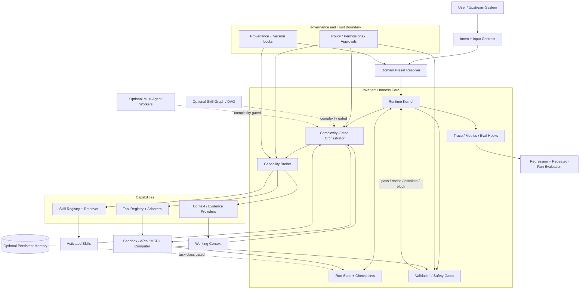

# deep_reasoning_analysis_report

## meta

- **Run:** HDBA-2026-09-18-001
- **Research cutoff:** 18 September 2026.
- **Goal:** derive a repeatable, evidence-bound Harness Design Base Architecture (HDBA) without assuming the proposed architecture is correct.
- **Research status:** release with explicit caveats. The exact standard schema remains a proposal.

## intake_scope

The supplied research brief asks for terminology normalization, H1-H15 hypothesis testing, architecture-family comparison, skill composition analysis, standardization, reproducibility, ablation logic and a final engineering-ready reference architecture. It explicitly requires evidence, counterevidence and separation of research findings from engineering practice and new proposals.

**Missing / limitation:** the web search interface does not expose a reproducible, deduplicated total count of all results screened. Therefore `number of sources screened` is **NOT_REPORTED**, not invented. This report retains **30 material agent/harness sources** plus three output-format standards.

## source_map

| ID | Type | Title | Evidence strength | Status |
| --- | --- | --- | --- | --- |
| S001 | primary_preprint | SkillsBench: Benchmarking How Well Agent Skills Work Across Diverse Tasks | 4 | verified_web_2026-09-18 |
| S002 | primary_preprint | Demystifying Agent Skills: Why They Work-Until They Do Not | 4 | verified_web_2026-09-18 |
| S003 | primary_preprint | SWE-Skills-Bench: Do Agent Skills Actually Help in Real-World Software Engineering? | 4 | verified_web_2026-09-18 |
| S004 | primary_preprint | Generative Skill Composition for LLM Agents | 3 | verified_web_2026-09-18_preprint |
| S005 | primary_preprint | Compositional Skill Routing for LLM Agents: Decompose, Retrieve, and Compose | 3 | verified_web_2026-09-18_preprint |
| S006 | official_specification | Agent Skills Specification | 5 | verified_web_2026-09-18 |
| S007 | official_specification | Model Context Protocol 2026-07-28 Architecture | 5 | verified_web_2026-09-18 |
| S008 | official_specification | Model Context Protocol 2026-07-28 Tools and Authorization | 5 | verified_web_2026-09-18 |
| S009 | official_vendor_documentation | OpenAI Agents SDK | 4 | verified_web_2026-09-18_engineering_evidence_only |
| S010 | peer_reviewed | ToolHop: A Query-Driven Benchmark for Evaluating Large Language Models in Multi-Hop Tool Use | 5 | verified_web_2026-09-18 |
| S011 | peer_reviewed | ToolSandbox: A Stateful, Conversational, Interactive Evaluation Benchmark for LLM Tool Use Capabilities | 5 | verified_web_2026-09-18 |
| S012 | peer_reviewed | HiAgent: Hierarchical Working Memory Management for Solving Long-Horizon Agent Tasks with Large Language Model | 5 | verified_web_2026-09-18 |
| S013 | peer_reviewed | Memory OS of AI Agent | 5 | verified_web_2026-09-18 |
| S014 | primary_preprint | Agent Workflow Memory | 4 | verified_web_2026-09-18 |
| S015 | peer_reviewed | StateFlow: Enhancing LLM Task-Solving through State-Driven Workflows | 5 | verified_web_2026-09-18 |
| S016 | primary_preprint | Agentless: Demystifying LLM-based Software Engineering Agents | 4 | verified_web_2026-09-18 |
| S017 | primary_research | SWE-agent: Agent-Computer Interfaces Enable Automated Software Engineering | 4 | verified_web_2026-09-18 |
| S018 | primary_preprint | tau-bench: A Benchmark for Tool-Agent-User Interaction in Real-World Domains | 4 | verified_web_2026-09-18 |
| S019 | primary_research | AgentRewardBench: Evaluating Automatic Evaluations of Web Agent Trajectories | 4 | verified_web_2026-09-18 |
| S020 | primary_preprint | The BrowserGym Ecosystem for Web Agent Research | 4 | verified_web_2026-09-18 |
| S021 | primary_preprint | Agent Security Bench: Formalizing and Benchmarking Attacks and Defenses in LLM-based Agents | 4 | verified_web_2026-09-18 |
| S022 | primary_preprint | LivePI: More Realistic Benchmarking of Agents Against Indirect Prompt Injection | 3 | verified_web_2026-09-18_preprint |
| S023 | primary_preprint | NetInjectBench: Benchmarking Indirect Prompt Injection in Tool-Using Large Language Model Agents for Network Operations | 3 | verified_web_2026-09-18_preprint |
| S024 | primary_preprint | Why Do Multi-Agent LLM Systems Fail? | 4 | verified_web_2026-09-18 |
| S025 | peer_reviewed | ReAct: Synergizing Reasoning and Acting in Language Models | 5 | verified_web_2026-09-18 |
| S026 | peer_reviewed | Re-Invoke: Tool Invocation Rewriting for Zero-Shot Tool Retrieval | 5 | verified_web_2026-09-18 |
| S027 | primary_preprint | LongFuncEval: Measuring the effectiveness of long context models for function calling | 4 | verified_web_2026-09-18 |
| S028 | primary_preprint | Agent Skills in the Wild: An Empirical Study of Security Vulnerabilities at Scale | 3 | verified_web_2026-09-18_preprint |
| S029 | peer_reviewed | Do Not Mention This to the User: Detecting and Understanding Malicious Agent Skills in the Wild | 5 | verified_web_2026-09-18 |
| S030 | primary_empirical | Agent Skills: A Data-Driven Analysis of Claude Skills for Extending Large Language Model Functionality | 3 | verified_web_2026-09-18_preprint |
| S031 | standard | RFC 8259 - The JavaScript Object Notation (JSON) Data Interchange Format | 5 | standard_reference |
| S032 | standard | CommonMark Specification 0.31.2 | 5 | standard_reference |
| S033 | standard | JSON Schema Draft 2020-12 | 5 | standard_reference |

## standards_alignment

- `analysis_report.md`: CommonMark-aligned.
- `analysis_report.json`: RFC 8259 JSON and validated against the installed Deep Reasoning Analysis Enterprise schema.
- Agent Skills and MCP are used as **current interface/engineering standards**, not as evidence of scientific superiority.
- No certification, formal conformance or identical cross-model behavior is claimed.

## risk_gate

**LOW.** This is technical research and architecture synthesis. The main epistemic risks are overgeneralization, preprint inflation, vendor-authority bias and source laundering.

## method_selection

- **PS+** for decomposition of the 24 research questions and 15 hypotheses.
- **Competing architecture paths** rather than a single favored design.
- **CoVe-style claim checks** against primary sources and counterexamples.
- **Ablation logic:** no component is called universal when marginal-value evidence is missing.
- **Bias review:** special attention to coding/web benchmark bias and 2026 preprint-heavy Agent Skills evidence.

## evidence_plan

Primary evidence was prioritized from ACL/NAACL/EMNLP/ICLR/USENIX and primary arXiv papers, then official Agent Skills/MCP/OpenAI documentation for implementation facts. Search families covered architecture, scaffold/harness, skills, routing/composition, memory/state, tools/runtime, evaluation, security, portability/standardization and counterevidence.

## evidence_ledger

| Claim | Architectural claim | Sources | Evidence type | Confidence |
| --- | --- | --- | --- | --- |
| C001 | No canonical academic definition of agent harness exists; use an operational definition that includes runtime/control around model interaction. | S007, S009, S020 | engineering synthesis | 4 |
| C002 | Agent-computer/tool interface design materially affects task success. | S010, S011, S017 | direct empirical | 5 |
| C003 | Skills can improve task performance but have heterogeneous and sometimes negative marginal utility. | S001, S003 | direct empirical | 5 |
| C004 | Large tool/skill catalogs create retrieval and context bottlenecks. | S002, S026, S027 | direct empirical | 5 |
| C005 | Complex multi-skill tasks require more than independent relevance ranking; order/decomposition/dependencies matter. | S004, S005, S010 | emerging empirical | 4 |
| C006 | State-machine workflows can outperform free-form loops on some structured long-horizon tasks. | S015 | direct empirical bounded domains | 5 |
| C007 | More autonomy or more agents is not inherently better. | S016, S024 | direct counterevidence | 4 |
| C008 | Working-memory management helps long-horizon tasks; long-term memory is task dependent. | S012, S013, S014 | direct empirical with domain limits | 5 |
| C009 | Reliability requires repeated-run and trajectory/end-state evaluation, not only single-output grading. | S018, S019, S020 | direct empirical | 5 |
| C010 | Execution-time trust boundaries are necessary for side-effectful agents; prompt-only defenses are insufficient. | S021, S022, S023 | security empirical | 5 |
| C011 | Skill provenance, permissions and security scanning are justified by observed skill supply-chain risks. | S028, S029 | security empirical | 5 |
| C012 | Progressive disclosure is a current skill engineering standard and is indirectly supported by long-context degradation evidence. | S006, S027 | spec plus indirect empirical | 4 |
| C013 | The exact proposed manifest schema is not scientifically validated. | S006, S007, S009 | negative evidence / absence | 5 |
| C014 | Deterministic validators add high value where objective success criteria exist, but can miss semantically valid outcomes. | S001, S016, S018, S019 | mixed empirical | 5 |
| C015 | Protocols and typed contracts improve interoperability as engineering mechanisms, but do not guarantee cross-model behavioral equivalence. | S007, S008, S009 | engineering evidence | 4 |
| C016 | Reproducibility for stochastic agents should be distributional and environment/version pinned rather than interpreted as identical text/trajectory. | S018, S020, S011 | methodological synthesis | 5 |

## tool_plan

1. Web search with independent query families and current-date verification.
2. Primary-source extraction for quantitative/material claims.
3. Local generation of canonical Markdown/JSON plus evidence exports.
4. Deterministic validation with the installed skill validators.
5. Static HTML rendering and audit-pack creation after validation.

## analysis

### 1. EXECUTIVE RESEARCH CONCLUSION

The strongest conclusion is **not** that one large universal agent architecture has been found. The evidence supports a different pattern: a **small invariant control kernel** plus **task-class/domain presets** and **complexity-gated extensions**.

Five mechanisms have comparatively strong support. First, the interface between model and environment matters: SWE-agent, ToolSandbox and ToolHop show that action spaces, tool dependencies and feedback structure materially change results. Second, large capability catalogs need retrieval/routing rather than indiscriminate exposure; Re-Invoke, LongFuncEval and 2026 skill studies show scaling and context bottlenecks. Third, state should be explicit: StateFlow and ToolSandbox support process/run-state modeling, while memory studies support richer memory only for long-horizon or long-conversation task classes. Fourth, evaluation must be architecture, not ceremony: tau-bench exposes repeated-run inconsistency, and AgentRewardBench shows that both deterministic rules and LLM judges have systematic blind spots. Fifth, security boundaries must be enforced at execution time: security benchmarks and skill supply-chain studies show that instructions alone are not a sufficient trust boundary.

The strongest counterevidence is equally important. Agentless demonstrates that a simple three-phase workflow can outperform more elaborate autonomous agents in a software benchmark. SWE-Skills-Bench finds only +1.2 percentage points average gain across 49 public software-engineering skills, with most skills yielding no pass-rate improvement and some actively degrading performance. Multi-agent failure research documents specification, coordination, verification and termination failures that are introduced by collaboration itself. Therefore **more agents, more memory, more graphs, more prompt text and more skills are not valid default upgrades**.

A standardized harness architecture is justified at the level of **contracts, lifecycle, security, versioning, state, capability discovery and evaluation**. It is **not** justified as a claim that a fixed ten-layer runtime, mandatory persistent memory, learned skill composer or supervisor-worker topology is universally optimal. The proposed HDBA v0.1 is therefore intentionally smaller than the candidate ten-layer model in the brief.

The evidence-backed core is:

1. **Governance / Trust Contract** -- permissions, approval policy, provenance and instruction authority.
2. **Runtime Kernel** -- lifecycle, step budget, retry, failure, termination and checkpoints.
3. **State / Context Manager** -- run state and artifact state are core; long-term memory is optional.
4. **Capability Broker** -- tool/skill/context-provider registry, discovery, routing and typed contracts.
5. **Complexity-Gated Orchestrator** -- direct execution by default; state machine, planner, DAG, skill composer or multi-agent only when task conditions justify them.
6. **Validation / Safety Gates** -- deterministic checks where possible, semantic/human checks where necessary, pre-execution authorization for side effects.
7. **Observability / Evaluation** -- trajectories, metrics, repeated runs, regression suites and cost/latency.

A **Domain Pack / Preset** configures those mechanisms rather than becoming another runtime layer. This keeps domain knowledge, risk policy, task taxonomy, allowed capabilities, output contracts and eval suites versionable and replaceable without redesigning the kernel.

### 2. TERMINOLOGY & ONTOLOGY MAP

| Term | Operational definition for this report | Relation to harness |
| --- | --- | --- |
| Agent | Model-driven policy that chooses or emits actions toward a task goal in an environment. | Runs inside or through a harness. |
| Harness | **Proposed operational definition:** the control/runtime substrate that turns intent into governed model/tool/skill/state transitions, with lifecycle, capability exposure, validation and observability. | Umbrella architecture. No single canonical academic definition was found. |
| Scaffold | Prompt/workflow/interface structure wrapped around a model to elicit agent behavior. | Usually narrower than harness; may be one implementation component. |
| Runtime | Concrete executor of the loop, state, tool calls and continuations. | Implements kernel semantics. |
| Workflow | Explicit sequence/graph/state machine of steps. | One orchestration mode, not synonymous with harness. |
| Skill | Reusable procedural capability package loaded on demand; in Agent Skills, a directory with SKILL.md plus optional resources. | Capability-level module managed by the harness. |
| Tool | Executable external capability with an invocation contract/schema. | Execution primitive; a skill may instruct use of one or more tools. |
| Memory | Stored state reused across steps/trials/sessions. | Optional beyond run state; policy must define write/read/retention. |
| Context | Information made available to the model for the current decision. | Budgeted and assembled by the harness. |
| Preset | Declarative versioned configuration selecting domain/task/risk behavior. | Instantiates the same kernel differently. |
| Domain Pack | Preset plus domain ontology, policies, skill set and evals. | Reusable domain specialization bundle. |
| Orchestrator | Component choosing direct execution, decomposition, routing, delegation, state transitions and recovery. | Core function whose sophistication is task-gated. |

**Relationship:** `Domain Pack -> configures Harness Kernel -> activates Skills/Tools/Context -> executes Workflow/State transitions -> validates -> records Eval/Trace`.

### 3. RESEARCH METHOD

- **Date range:** emphasis 2024-2026, with ReAct (2023) retained as foundational work.
- **Databases/sources actually reached through web search:** ACL Anthology, arXiv, USENIX, official Agent Skills specification, official MCP specification/blog, OpenAI Developers. Search also surfaced primary project/repository pages when needed for reproducibility context.
- **Search families:** architecture; harness/scaffold; skills; routing/composition; memory/state; tools/runtime; evaluation; security; portability/standardization; counterevidence.
- **Inclusion:** primary empirical research, peer-reviewed papers, primary benchmark papers, official specs, official implementation docs when needed to establish current interfaces.
- **Exclusion/downweight:** SEO summaries, marketing claims, unsourced benchmark claims, popularity as evidence of superiority.
- **Sources screened:** **NOT_REPORTED** because the search interface does not expose a complete deduplicated screening count.
- **Material retained:** 30 agent/harness sources, plus 3 artifact-format standards.
- **Quality rule:** peer-reviewed/primary evidence outranks vendor documentation; 2026 preprints are kept but explicitly downweighted where replication/venue review is absent.

### 4. HYPOTHESIS VERDICT TABLE

| Hypothesis | Status | Confidence 1-5 | Support | Counterevidence / gap | Boundary condition |
| --- | --- | --- | --- | --- | --- |
| H1 | PARTIALLY_SUPPORTED | 4 | A stable kernel plus domain/runtime configuration, skills and eval package is consistent with empirical component evidence and current specs, but the exact five-part partition has not been directly ablated as a whole. | No controlled study compares the exact proposed partition against alternatives. | Treat as reference architecture, not a scientifically proven universal decomposition. |
| H2 | PARTIALLY_SUPPORTED | 4 | Separation of lifecycle, state, tools, validation, security and observability is supported by failure isolation and engineering standards. | The proposed plane boundaries themselves are not empirically optimized. | Planes may be merged in small systems as long as contracts and trust boundaries remain explicit. |
| H3 | PARTIALLY_SUPPORTED | 3 | Declarative/versioned configuration has strong engineering rationale and indirect reproducibility support. | No direct head-to-head study shows domain presets beat monolithic system prompts across domains. | Use declarative presets for versioning and reproducibility, but do not claim intrinsic task-success superiority. |
| H4 | SUPPORTED | 4 | Skills are empirically useful as modular procedural packages in some settings and are standardized operationally as directory packages. | Benefits are heterogeneous; stale or broad skills can hurt. | Skills must be narrow, versioned, context-compatible and evaluated. |
| H5 | SUPPORTED | 5 | Large capability libraries require explicit retrieval/routing because exposing everything causes scaling and context failures. | Small libraries may not justify retrieval overhead. | Activate retrieval/reranking only above a complexity/catalog threshold. |
| H6 | PARTIALLY_SUPPORTED | 4 | Multi-skill tasks involve subset/count/order and decomposition; recent studies show structured composition benefits. | Key evidence is 2026 preprint-heavy and concentrated in coding/MCP-like tasks. | Use dependency/order contracts for complex compositions; keep simple top-k/direct routing for simple tasks. |
| H7 | PARTIALLY_SUPPORTED | 3 | Graphs/state machines improve control for tasks with known dependencies or state transitions. | Agentless and simple pipelines show graph complexity is not universally needed. | Use graph/DAG only when dependency structure or recoverable state transitions materially exist. |
| H8 | PARTIALLY_SUPPORTED | 5 | Executable validators and policy gates show strong value where success/safety conditions are machine-checkable. | Not every task has a deterministic oracle; rigid rules can reject valid outcomes. | Prefer deterministic checks for hard constraints and combine with semantic/human evaluation where needed. |
| H9 | PARTIALLY_SUPPORTED | 4 | Working/persistent memory helps long-horizon and long-conversation tasks, but persistent memory is not universally necessary. | Simple bounded pipelines succeed without long-term memory. | Kernel requires run/execution state; long-term episodic/semantic memory is an extension selected by task class. |
| H10 | SUPPORTED | 5 | Agent reliability cannot be established from prompt quality alone; repeated-run, trajectory and environment-grounded evaluation are necessary. | Evaluators themselves can be wrong. | Use mixed evaluators, repeat runs, pin versions and evaluate end state plus side effects. |
| H11 | SUPPORTED | 5 | Tool-using agents and skills require explicit trust boundaries and execution-time authorization. | Specific defenses have benchmark/environment assumptions. | Least privilege, provenance, sandboxing and pre-execution authorization should be core for side-effectful capabilities. |
| H12 | PARTIALLY_SUPPORTED | 3 | Separating tool/protocol/domain/runtime contracts improves portability as an engineering pattern. | Behavior remains model- and harness-dependent; cross-provider equivalence is not demonstrated. | Standardize contracts and lock versions, but preserve model-specific adapters and eval baselines. |
| H13 | INSUFFICIENT_EVIDENCE | 2 | A machine-readable preset is plausible and useful for deterministic assembly, but no evidence validates the exact manifest fields or automatic harness generation end-to-end. | No direct study of the proposed Harness Preset Specification as a whole. | Treat v0.1 manifest as a falsifiable engineering proposal. |
| H14 | SUPPORTED | 4 | Task classes exhibit materially different needs in state, memory, tools, risk, evaluation and orchestration. | No finite preset taxonomy is proven complete. | Use task-class profiles rather than one maximally agentic universal configuration. |
| H15 | PARTIALLY_SUPPORTED | 5 | Environment/interface, tools, validation, state and feedback can materially dominate prompt elaboration in measured settings. | The word more is not universally quantifiable across all domains. | Optimize harness/environment and evaluators before adding prompt complexity. |

### 5. EVIDENCE MATRIX

| Claim | Architectural claim | Sources | Evidence type | Confidence |
| --- | --- | --- | --- | --- |
| C001 | No canonical academic definition of agent harness exists; use an operational definition that includes runtime/control around model interaction. | S007, S009, S020 | engineering synthesis | 4 |
| C002 | Agent-computer/tool interface design materially affects task success. | S010, S011, S017 | direct empirical | 5 |
| C003 | Skills can improve task performance but have heterogeneous and sometimes negative marginal utility. | S001, S003 | direct empirical | 5 |
| C004 | Large tool/skill catalogs create retrieval and context bottlenecks. | S002, S026, S027 | direct empirical | 5 |
| C005 | Complex multi-skill tasks require more than independent relevance ranking; order/decomposition/dependencies matter. | S004, S005, S010 | emerging empirical | 4 |
| C006 | State-machine workflows can outperform free-form loops on some structured long-horizon tasks. | S015 | direct empirical bounded domains | 5 |
| C007 | More autonomy or more agents is not inherently better. | S016, S024 | direct counterevidence | 4 |
| C008 | Working-memory management helps long-horizon tasks; long-term memory is task dependent. | S012, S013, S014 | direct empirical with domain limits | 5 |
| C009 | Reliability requires repeated-run and trajectory/end-state evaluation, not only single-output grading. | S018, S019, S020 | direct empirical | 5 |
| C010 | Execution-time trust boundaries are necessary for side-effectful agents; prompt-only defenses are insufficient. | S021, S022, S023 | security empirical | 5 |
| C011 | Skill provenance, permissions and security scanning are justified by observed skill supply-chain risks. | S028, S029 | security empirical | 5 |
| C012 | Progressive disclosure is a current skill engineering standard and is indirectly supported by long-context degradation evidence. | S006, S027 | spec plus indirect empirical | 4 |
| C013 | The exact proposed manifest schema is not scientifically validated. | S006, S007, S009 | negative evidence / absence | 5 |
| C014 | Deterministic validators add high value where objective success criteria exist, but can miss semantically valid outcomes. | S001, S016, S018, S019 | mixed empirical | 5 |
| C015 | Protocols and typed contracts improve interoperability as engineering mechanisms, but do not guarantee cross-model behavioral equivalence. | S007, S008, S009 | engineering evidence | 4 |
| C016 | Reproducibility for stochastic agents should be distributional and environment/version pinned rather than interpreted as identical text/trajectory. | S018, S020, S011 | methodological synthesis | 5 |

### 6. ARCHITECTURAL FINDINGS

#### EMPIRICALLY SUPPORTED

- Tool/action interface design and state dependencies materially affect task success (SWE-agent, ToolSandbox, ToolHop).
- Large capability catalogs need retrieval/routing; long tool catalogs/context degrade function calling (Re-Invoke, LongFuncEval, Demystifying Agent Skills).
- Explicit state/process grounding can improve some structured multi-step tasks (StateFlow).
- Working-memory management can improve long-horizon tasks (HiAgent); persistent long-term memory can help long-conversation tasks (MemoryOS), but neither establishes universal necessity.
- Repeated-run reliability, end-state checks and trajectory evaluation expose failures missed by single-run success (tau-bench, AgentRewardBench).
- Prompt injection and malicious skills create real trust/supply-chain surfaces (ASB, LivePI, USENIX Security 2026 skill study).

#### STRONGLY INDICATED

- Skills should be activated selectively and validated against a no-skill baseline.
- Multi-skill composition should represent order/dependencies when tasks actually require them.
- Pre-execution authorization is preferable to trusting natural-language safety instructions for high-impact actions.
- Kernel/preset separation improves engineering reproducibility, but the exact partition is not experimentally optimized.

#### ENGINEERING BEST PRACTICE

- Versioned manifests and lockfiles.
- Typed tool/input/output contracts.
- Explicit provenance and permission declarations.
- Progressive disclosure of skills/resources.
- Traces and regression suites shipped with the harness.

#### PLAUSIBLE BUT UNVALIDATED

- The exact HDBA v0.1 manifest field set.
- A universal skill graph representation.
- Learned skill composition as a default router.
- A fixed number of architectural planes.
- Full behavioral portability across model providers.

### 7. HARNESS ARCHITECTURE COMPARISON

| Family | Architecture | Complexity | Evidence on success | Observability | Cost/latency | Best-supported use | Evidence |
| --- | --- | --- | --- | --- | --- | --- | --- |
| A | Monolithic Prompt + Tools | Low | Low-Medium | Low | Low | Good for small bounded tasks; degrades as tools/context grow. | S027,S016 |
| B | Single Agent + Modular Skills | Medium | Medium-High | Medium | Medium | Good default for reusable procedural expertise when skills are evaluated. | S001,S003,S006 |
| C | Router + Specialized Skills | Medium | High at scale if retrieval works | High | Medium | Useful for larger catalogs; routing itself becomes a failure surface. | S002,S026 |
| D | Planner -> Executor -> Validator | Medium-High | Medium-High | High | Medium-High | Useful when decomposition and objective validation are available; planning errors can compound. | S005,S014,S019 |
| E | Supervisor -> Worker Agents | High | Mixed | High | High | Use for truly heterogeneous/parallel work; not a default due coordination/termination failures. | S024 |
| F | Graph / DAG Workflow | High | Medium-High for explicit dependencies | High | High | Useful when dependency structure is known or discoverable; not justified for simple tasks. | S005,S011 |
| G | State-Machine / Event-Driven | Medium | High in structured processes | High | Medium | Strong fit for process-grounded tasks with known states and termination. | S015 |
| H | Retrieval-Driven Skill Architecture | Medium | High for large catalogs | High | Medium | Necessary scaling mechanism, but retriever quality is critical. | S002,S026,S027 |
| I | Learned Skill Composition | High | Promising, early | Medium-High | High | Emerging 2026 evidence; not mature enough for universal core. | S004 |
| J | Agent Loop + Executable Policy/Validation | Medium | High for verifiable/risky tasks | High | Medium | Strong fit for side effects and hard constraints; semantic outcomes still need flexible evaluation. | S018,S022,S023 |
| K | Complexity-Gated Hybrid | Variable | Design recommendation | High | Variable | Reference pattern: start simple, activate routing/state/graph/multi-agent only when task profile triggers it. | S001,S015,S016,S024 |

**Interpretation:** no family is the universal winner. Family K is a **design recommendation**, not a benchmark result: it combines simpler families conditionally instead of running every mechanism at all times.

### 8. HARNESS DESIGN BASE ARCHITECTURE

#### Proposed reference architecture: HDBA v0.1

**Invariant contracts**

- lifecycle/termination/retry/checkpoint contract;
- state and context contract;
- capability registry contract for tools/skills/context providers;
- trust/permission/provenance contract;
- validation contract;
- observability/evaluation contract;
- version/lock contract.

**Configurable domain concerns**

- objective and task taxonomy;
- domain ontology/knowledge sources;
- risk policy and approvals;
- skill set and allowed tools;
- output schema/quality criteria;
- memory mode;
- evaluation suite;
- orchestration escalation rules.

**Optional extensions**

- persistent episodic/semantic memory;
- skill dependency graph/DAG;
- learned skill composer;
- multi-agent workers;
- event bus/long-running task scheduler;
- human review queues.

**Core state transition**

`INTAKE -> RESOLVE_PRESET -> ASSEMBLE_CONTEXT -> SELECT_CAPABILITIES -> AUTHORIZE -> EXECUTE -> VALIDATE -> (REVISE | ESCALATE | COMPLETE | BLOCK) -> RECORD_EVAL`

The key constraint is that `AUTHORIZE` happens before side-effectful execution, while `VALIDATE` checks both task result and policy/side-effect conditions after execution. A failed validator does not automatically mean retry; retry policy must distinguish transient failures, bad plans, missing information and policy blocks.

### 9. MERMAID ARCHITECTURE DIAGRAM



### 10. HARNESS KERNEL SPECIFICATION

**Minimal domain-independent kernel**

1. `RunController`
   - create/resume/stop run;
   - step/time/cost budgets;
   - retry taxonomy;
   - explicit terminal states;
   - checkpoint IDs.
2. `StateContextManager`
   - working context;
   - execution/artifact state;
   - provenance tags for trusted vs untrusted context;
   - optional persistent-memory adapter, disabled by default.
3. `CapabilityBroker`
   - registry lookup;
   - capability/schema compatibility;
   - progressive disclosure;
   - routing/retrieval hook;
   - dependency resolver hook.
4. `PolicyGate`
   - allowed/forbidden actions;
   - permission scope;
   - approval state;
   - pre-execution authorization.
5. `Validator`
   - schemas/tests/end-state checks;
   - semantic reviewer hook;
   - postconditions;
   - failure classification.
6. `TraceEvalHook`
   - event trace;
   - tool calls and outcomes;
   - skill activations;
   - latency/cost;
   - repeated-run evaluation identifiers.

**Not mandatory in kernel:** persistent vector memory, knowledge graph, DAG planner, supervisor agent, worker pool, learned router. Those are extensions.

### 11. DOMAIN PRESET SPECIFICATION

```yaml
apiVersion: hdba/v0.1
kind: HarnessPreset
metadata:
  id: example-domain
  version: 0.1.0
  owner: team-name
  provenance: repo-or-registry-ref
objective:
  statement: "..."
  success_contract: "..."
domain:
  name: "..."
  task_taxonomy: ["..."]
  risk_profile: low|medium|high
orchestration:
  default_mode: direct
  escalation_rules:
    - when: multi_step_state_dependency
      use: state_machine
    - when: multi_skill_dependencies
      use: skill_plan
    - when: heterogeneous_parallel_subtasks
      use: multi_agent   # optional, gated
context:
  sources: []
  untrusted_content_policy: isolate
  max_context_strategy: progressive_disclosure
memory:
  run_state: required
  persistent: none|episodic|semantic|hybrid
  write_policy: "..."
tools:
  registry: tools.lock.yaml
  least_privilege: true
  side_effect_approval: required_by_risk
skills:
  registry: skills.lock.yaml
  discovery: metadata
  routing: direct|retrieval|rerank|composer
  dependency_resolution: optional
policies:
  instruction_hierarchy: "..."
  forbidden_actions: []
  approval_gates: []
outputs:
  schema: schemas/output.schema.json
  validators: []
evaluation:
  suites: []
  repeated_runs: 3
  metrics: [task_success, constraint_adherence, tool_correctness, latency, cost]
observability:
  trace_schema: "..."
  redact_secrets: true
release_gates:
  - no_critical_security_findings
  - regression_suite_passes
  - negative_skill_delta_within_budget
runtime:
  model_lock: models.lock.yaml
  environment_lock: environment.lock.yaml
experimental:
  learned_skill_composer: false
```

**Evidence status:** the need to externalize domain/risk/tool/eval configuration is strongly indicated; the exact YAML keys are **PROPOSED**, not an existing scientific standard.

### 12. SKILL SPECIFICATION

| Skill field | Classification | Evidence rationale | Sources |
| --- | --- | --- | --- |
| name/id | ESSENTIAL | Official Agent Skills requires name; required for registries and references. | S006 |
| description + activation cues | ESSENTIAL | Required by Agent Skills; retrieval/routing evidence makes discriminative descriptions operationally important. | S006,S002,S026 |
| instructions/procedure | ESSENTIAL | Core content of skills; empirical gains are primarily procedural anchoring. | S001,S002 |
| inputs/outputs contract | STRONGLY_RECOMMENDED | Needed for reliable composition and validation, though exact schema is proposed. | S004,S005,S010 |
| compatibility/environment constraints | STRONGLY_RECOMMENDED | Version/context mismatch can degrade performance. | S003,S006 |
| version/provenance/digest | STRONGLY_RECOMMENDED | Supports reproducibility and mitigates skill supply-chain risk. | S028,S029 |
| permissions/allowed capabilities | STRONGLY_RECOMMENDED | High importance for executable/state-changing skills. | S021,S028,S029 |
| validators/postconditions | STRONGLY_RECOMMENDED | High value where outcomes are machine-checkable. | S001,S018,S019 |
| dependencies/requires/provides | CONTEXT_DEPENDENT | Needed for multi-skill composition; overkill for atomic independent skills. | S004,S005 |
| preconditions/conflicts | CONTEXT_DEPENDENT | Useful when state/dependency constraints exist; exact representation remains proposed. | S005,S011,S015 |
| scripts | CONTEXT_DEPENDENT | Can make procedures deterministic but increases attack surface and environment dependencies. | S006,S028 |
| references/assets | CONTEXT_DEPENDENT | Useful for progressive disclosure and domain resources. | S006 |
| examples | CONTEXT_DEPENDENT | Often useful, but direct marginal-value evidence for a universal requirement is missing. | S006 |
| evals/test cases | STRONGLY_RECOMMENDED | Necessary for reusable release gating and for detecting negative skill deltas. | S001,S003 |
| learned routing weights/model | OPTIONAL_EXPERIMENTAL | Promising for large catalogs, but 2026 evidence is early and task concentrated. | S004 |

**Compatibility decision:** keep the canonical `SKILL.md` structure intact for portability, and add an optional harness-grade `skill.contract.yaml` rather than overloading prose with execution semantics.

```yaml
apiVersion: hdba/v0.1
kind: SkillContract
metadata:
  id: example-skill
  version: 1.2.0
  provenance: "registry/repo/commit"
  digest: "sha256:..."
activation:
  description: "What it does and when to use it"
  exclusions: []
io:
  inputs: []
  outputs: []
requires: []
provides: []
conflicts_with: []
preconditions: []
postconditions: []
permissions:
  tools: []
  network: none|allowlisted|open
  filesystem: none|read|write
execution:
  sandbox: required|optional|none
  timeout_s: 120
validators: []
evals: []
compatibility:
  models: []
  runtime: []
```

The contract schema is a **DESIGN PROPOSAL**. Its motivation is evidence-backed; its exact field names are not.

### 13. SKILL COMPOSITION MODEL

`DISCOVER -> ROUTE -> DECOMPOSE (if needed) -> RESOLVE DEPENDENCIES -> COMPOSE -> AUTHORIZE -> EXECUTE -> VALIDATE -> UPDATE TRACE/EVAL`

Rules:

- If exactly one high-confidence capability satisfies the contract, skip decomposition.
- If the catalog is small and unambiguous, direct metadata matching may be cheaper than retrieval.
- For large catalogs, retrieve/rerank before loading full skill bodies.
- If multiple skills share state or have ordering constraints, produce an explicit skill plan.
- Run preconditions before each skill and postconditions after it.
- Never infer that a skill succeeded solely because it was invoked.
- Store composition traces so routing can be evaluated separately from task success.

### 14. SKILL GRAPH MODEL

**Formal proposed node/edge contract:**

- `SKILL_ID`: immutable logical identifier plus version.
- `INPUTS`: typed or schema-referenced requirements.
- `OUTPUTS`: typed/artifact outputs.
- `REQUIRES`: capabilities/state that must already exist.
- `PROVIDES`: capabilities/state produced.
- `CONFLICTS_WITH`: incompatible skills/versions/policies.
- `PRECONDITIONS`: executable or declarative guards.
- `POSTCONDITIONS`: expected state assertions.
- `PERMISSIONS`: maximum capability scope.
- `VALIDATORS`: success checks.

**Evidence-backed:** order/decomposition/dependency matter for some compositional tasks (S004/S005) and state dependencies matter for tool use (S011). **Proposed:** this exact graph vocabulary and edge schema.

### 15. DIRECTORY / PACKAGE ARCHITECTURE

```text
harness/
├── HARNESS.yaml
├── kernel/
│   ├── lifecycle/
│   ├── orchestration/
│   ├── validation/
│   └── tracing/
├── domain-packs/
│   └── <domain>/
│       ├── preset.yaml
│       ├── ontology/
│       ├── policies/
│       ├── skill-set.yaml
│       └── evals/
├── skills/
│   └── <skill>/
│       ├── SKILL.md
│       ├── skill.contract.yaml
│       ├── scripts/
│       ├── references/
│       └── assets/
├── tools/
│   ├── contracts/
│   └── adapters/
├── schemas/
├── evaluators/
├── tests/
├── benchmarks/
├── state/
├── observability/
└── lock/
    ├── models.lock.yaml
    ├── tools.lock.yaml
    ├── skills.lock.yaml
    └── environment.lock.yaml
```

Rationale: separate domain packs and lockfiles from executable kernel code; preserve Agent Skills compatibility inside each skill; keep evals and observability first-class rather than embedding them in prose prompts.

### 16. HARNESS GENERATION PIPELINE

1. **DOMAIN** -- identify task classes, actions, risk and objective evidence.
2. **REQUIREMENTS** -- derive hard constraints, side effects, state needs and evaluation oracles.
3. **PRESET** -- create versioned domain preset and lockfile references.
4. **SKILL SELECTION** -- choose only skills with positive/acceptable eval evidence for the task family.
5. **HARNESS ASSEMBLY** -- compile preset into a resolved manifest: model, capabilities, permissions, orchestration mode, validators, trace policy.
6. **VALIDATION** -- static contract checks, security scan, negative routing tests, task evals, repeated runs.
7. **RELEASE** -- sign/version the resolved manifest and dependency locks; release only if regression/security gates pass.

**Deterministic construction target:** same preset version + same registry snapshots + same compiler version => same resolved manifest/dependency graph. This is stronger and more realistic than demanding identical stochastic model trajectories.

### 17. EVALUATION FRAMEWORK

| Metric | Definition | Preferred evaluator |
| --- | --- | --- |
| Task success | Goal/end-state achieved | deterministic end state/test when possible; otherwise expert-calibrated semantic evaluator |
| Accuracy | Correct factual/structured result | reference/test/schema depending task |
| Constraint adherence | Hard policy/output constraints obeyed | deterministic rule/schema |
| Skill routing precision/recall | Required skills selected, irrelevant skills avoided | labeled routing set + activation trace |
| Skill composition quality | Correct subset/count/order/dependencies | gold/accepted plan where available + downstream task result |
| Tool-call correctness | Correct tool/schema/arguments/sequence | execution trace and environment state |
| Context utilization | Required evidence used without avoidable overload | trace + attribution + token metrics |
| Failure recovery | Correct classification and recovery without loops | seeded failure scenarios |
| Reproducibility | distribution of success/cost/violations over repeated pinned runs | pass^k/reliability-style repeated trials |
| Security | unsafe action/ASR, overblocking, approval bypass | adversarial benchmark + policy-gate logs |
| Latency | end-to-end and per-stage | runtime trace |
| Cost | model/tool/token/runtime cost | runtime accounting |

Do not collapse these into one score unless weights and failure vetoes are explicit.

### 18. MINIMUM VIABLE HARNESS

The smallest architecture justified by the evidence is:

- one agent/model loop or deterministic step pipeline;
- explicit run state and termination;
- typed tools/capability registry;
- domain preset with allowed actions and output contract;
- pre-execution authorization for side effects;
- deterministic validator where a hard oracle exists;
- trace + repeated-run regression test;
- version locks for model/tools/skills/environment.

A skill system is not mandatory if the task has no reusable procedural modules. Persistent memory is not mandatory. A DAG is not mandatory. Multi-agent is not mandatory.

### 19. ADVANCED HARNESS

Enable extensions by trigger:

- **Long-horizon:** checkpoints, hierarchical working memory, explicit state machine, recovery taxonomy.
- **High-risk:** strict permission scopes, human approval, sandbox, provenance verification, dual pre/post policy checks.
- **Multi-tool / large catalog:** retriever+rerranker, progressive disclosure, tool/skill cache, context budgeter.
- **Multi-skill:** dependency plan/DAG and explicit pre/postconditions.
- **Multi-agent:** supervisor only when subtasks are genuinely heterogeneous or parallelizable; shared artifact state, handoff contracts, termination guard and per-agent budget.
- **Self-improving skills:** allow revision only through a quarantined candidate -> eval -> security scan -> versioned promotion pipeline. Never let execution traces silently overwrite production skills.

### 20. FAILURE MODES

- **Over-orchestration:** complexity adds failure/cost without marginal task value.
- **Router errors:** correct capability never enters context.
- **Skill collisions:** instructions or side effects conflict.
- **Context overload:** too many tool schemas/results crowd out task-relevant information.
- **Stale skills:** old guidance conflicts with current runtime/project state.
- **Tool misuse:** wrong tool/arguments/order or unauthorized side effect.
- **Memory poisoning:** untrusted content persists into future runs.
- **Prompt injection:** retrieved/tool content overrides intended policy.
- **False evaluator confidence:** judge accepts bad trajectory or deterministic rule rejects a valid one.
- **Recursive agent loops:** retries/delegation continue without progress.
- **State drift:** model belief and actual environment/artifact state diverge.
- **Hidden dependencies:** tool/skill preconditions are discovered too late.
- **Non-reproducible execution:** model/tool/skill/environment drift invalidates comparisons.
- **Coordination loss:** multi-agent handoff drops constraints or context.
- **Termination failure:** system does not know when success/failure is final.

### 21. OPEN RESEARCH QUESTIONS

- What is the marginal value of each HDBA plane under controlled ablation across research, coding, support, data-analysis and computer-use tasks?
- At what catalog size and ambiguity level does skill retrieval outperform exposing all skill metadata for each model family?
- Do skill dependency graphs transfer across model providers, or are optimal graphs harness/model specific?
- Can pre-execution authorization remain effective under adversarial metadata or compromised provenance channels?
- Which memory policy gives the best task-success/privacy/poisoning trade-off by task class?
- How stable are skill benefits over skill/version drift and changing tools?
- Can a standardized preset compiler produce behaviorally equivalent harnesses across runtimes, or only structurally equivalent ones?
- Which evaluator ensembles best predict human judgments without false-green bias on long trajectories?
- What complexity threshold justifies supervisor-worker or multi-agent orchestration over a single-agent/state-machine baseline?
- How should learned skill composition be evaluated against simple deterministic planners under distribution shift?

### 22. RESEARCH-BACKED DESIGN PRINCIPLES

| ID | Principle | Evidence basis | Confidence | When to apply | When not to apply |
| --- | --- | --- | --- | --- | --- |
| P01 | Default to the least-agentic architecture that satisfies the task. | S016,S024 | high | Small/medium tasks and any new domain baseline. | When empirical evidence shows additional orchestration has positive marginal value. |
| P02 | Treat the harness as a runtime/control system, not as a long system prompt. | S007,S009,S017 | medium-high | Any tool-using or stateful agent. | Pure text transformation with no state/tools may not need a harness. |
| P03 | Separate privileged policy from untrusted context, skills and tool outputs. | S021,S022,S023,S029 | high | Any external content or side-effectful tool use. | No exception for convenience; only risk level may change approval strictness. |
| P04 | Use progressive disclosure; do not flood the context with all capabilities. | S006,S027 | high | Large tool/skill catalogs. | Tiny stable catalogs where retrieval overhead exceeds benefit. |
| P05 | Evaluate each skill against a no-skill baseline. | S001,S003 | high | Reusable skills intended for release. | Exploratory one-off instructions may skip formal release gating. |
| P06 | For multi-skill tasks, model composition, not only relevance. | S004,S005 | medium | Tasks with dependencies, multiple capabilities or ordering constraints. | Independent single-skill tasks. |
| P07 | Make run/execution state explicit; add persistent memory only when the task class benefits. | S011,S012,S013,S014 | high | Long-horizon/stateful systems. | Bounded stateless generation does not need persistent memory. |
| P08 | Represent known processes as states/transitions when this reduces ambiguity. | S015 | high | Structured workflows, approvals, transactions, long multi-step tasks. | Open-ended research where rigid states would block useful adaptation. |
| P09 | Use deterministic validators for deterministic constraints. | S001,S016,S018 | high | Schemas, tests, database end states, policy checks. | Subjective quality without a stable oracle. |
| P10 | Do not rely on a single evaluator for semantic trajectory quality. | S019 | high | Web/research/advisory agents. | Hard machine-verifiable checks can remain deterministic. |
| P11 | Measure reliability over repeated runs. | S018 | high | Stochastic agents in production or release tests. | Deterministic non-LLM steps may use standard test repeatability. |
| P12 | Pin model, skill, tool, environment and evaluator versions for reproducibility. | S020,S003 | high | Any comparative benchmark or release gate. | No meaningful exception for claims of reproducibility. |
| P13 | Treat skills and tool servers as supply-chain dependencies. | S028,S029 | high | Third-party skills/scripts/MCP servers. | First-party assets still need provenance, but risk is lower. |
| P14 | Use pre-execution authorization for impactful actions. | S022,S023,S008 | high | Write/delete/pay/send/deploy/credential/security actions. | Read-only low-risk actions may use lighter controls. |
| P15 | Keep orchestration complexity proportional to dependency complexity. | S015,S016,S024 | high | All harness design decisions. | No exception; complexity must earn its cost. |
| P16 | Separate portability of contracts from equivalence of behavior. | S006,S007,S009 | medium-high | Cross-model/provider harnesses. | Never assume protocol compatibility yields identical outcomes. |
| P17 | Make negative evidence and ablation gaps first-class release metadata. | S003,S019 | medium-high | Research-backed architecture and skill releases. | None when making scientific/reliability claims. |
| P18 | Promote new architectural layers only after marginal-value evidence exists. | S016,S003 | high | Evolution of the standard. | Emergency security controls may be added before efficacy studies when risk justifies them, but must be evaluated afterward. |

### 23. FINAL HARNESS DESIGN BASIS

# Evidence-Based Harness Design Base Architecture v0.1

**Status:** engineering reference architecture grounded in current evidence; **not** a scientifically proven universal optimum.

**Invariant base:** trust/governance contract + runtime lifecycle + run state/context + capability broker + complexity-gated orchestrator + validation/safety + observability/evaluation.

**Variable by preset:** domain ontology, task taxonomy, risk level, tools, skills, memory mode, orchestration escalation, approvals, outputs, eval suites.

**Complexity rule:** every optional subsystem must have a task-specific trigger and an eval demonstrating non-negative marginal value against a simpler baseline.

**Release rule:** no harness is release-ready unless its resolved manifest, dependency versions, capability permissions, validators and regression suite are known. For side-effectful tools, pre-execution authorization is mandatory by default.

**Skill rule:** Agent Skills-compatible packaging is acceptable for procedural content, but production harnesses should add explicit contract/provenance/eval metadata outside the free-form prose body.

**Reproducibility rule:** same preset and locks should compile to the same resolved architecture; behavior is evaluated statistically across repeated runs rather than assumed deterministic.

### 24. SOURCE MAP

| Decision | Decision type | Supporting sources | Revision trigger |
| --- | --- | --- | --- |
| D01 Minimal complexity-gated kernel | DESIGN RECOMMENDATION | S015,S016,S024 | A broad multi-domain study shows always-on richer orchestration has higher reliability/cost-adjusted success. |
| D02 Run state is core; persistent memory optional | DESIGN RECOMMENDATION | S011,S012,S013,S014 | Bounded tasks consistently require persistent memory, or memory-free long-horizon methods dominate. |
| D03 Progressive capability disclosure | ENGINEERING BEST PRACTICE + indirect empirical | S006,S027 | Large-context models cease to degrade with large catalogs, or all-capability exposure outperforms retrieval. |
| D04 Routing required for large catalogs | EMPIRICALLY SUPPORTED | S002,S026,S027 | Retrieval/routing shows no marginal value at scale across strong current models. |
| D05 Dependency-aware multi-skill planning is optional extension | STRONGLY INDICATED | S004,S005,S010 | Independent replication fails or simple top-k retrieval matches composition under realistic shifts. |
| D06 State-machine preset for structured processes | EMPIRICALLY SUPPORTED bounded domains | S015,S011 | State-machine advantage disappears across matched process tasks or cost becomes prohibitive. |
| D07 Multi-agent is not default | EMPIRICALLY SUPPORTED counterevidence | S024,S016 | Repeated cross-domain evidence shows consistent gains over single-agent baselines after cost normalization. |
| D08 Pre-execution authorization for side effects | EMPIRICALLY SUPPORTED security + practice | S021,S022,S023,S008 | Robust adversarial studies show prompt-only controls match authorization gates without utility loss. |
| D09 Mixed evaluation stack | EMPIRICALLY SUPPORTED | S018,S019,S020 | A single evaluator demonstrates calibrated, cross-domain agreement with humans and hard-state checks. |
| D10 Skill provenance/version/security metadata | EMPIRICALLY SUPPORTED risk + engineering | S028,S029,S003 | Supply-chain incidence falls to negligible levels under other mechanisms, or metadata yields no mitigation value. |
| D11 HDBA preset schema | PROPOSED STANDARD | S006,S007,S009 | Ablation shows fields add no reproducibility or portability value; schema proves too rigid across task classes. |
| D12 Lockfiles for reproducibility | DESIGN RECOMMENDATION | S003,S018,S020 | Cross-version drift proves immaterial, or runtime can reproduce behavior without pinned dependencies. |

### 25. BIBLIOGRAPHY

- **S001**. SkillsBench: Benchmarking How Well Agent Skills Work Across Diverse Tasks. https://arxiv.org/abs/2602.12670 (primary_preprint).
- **S002**. Demystifying Agent Skills: Why They Work-Until They Do Not. https://arxiv.org/abs/2608.14036 (primary_preprint).
- **S003**. SWE-Skills-Bench: Do Agent Skills Actually Help in Real-World Software Engineering?. https://arxiv.org/abs/2603.15401 (primary_preprint).
- **S004**. Generative Skill Composition for LLM Agents. https://arxiv.org/abs/2606.32025 (primary_preprint).
- **S005**. Compositional Skill Routing for LLM Agents: Decompose, Retrieve, and Compose. https://arxiv.org/abs/2606.18051 (primary_preprint).
- **S006**. Agent Skills Specification. https://agentskills.io/specification (official_specification).
- **S007**. Model Context Protocol 2026-07-28 Architecture. https://modelcontextprotocol.io/specification/2026-07-28/architecture (official_specification).
- **S008**. Model Context Protocol 2026-07-28 Tools and Authorization. https://modelcontextprotocol.io/specification/2026-07-28/server/tools (official_specification).
- **S009**. OpenAI Agents SDK. https://developers.openai.com/api/docs/guides/agents/sdk (official_vendor_documentation).
- **S010**. ToolHop: A Query-Driven Benchmark for Evaluating Large Language Models in Multi-Hop Tool Use. https://aclanthology.org/2025.acl-long.150/ (peer_reviewed).
- **S011**. ToolSandbox: A Stateful, Conversational, Interactive Evaluation Benchmark for LLM Tool Use Capabilities. https://aclanthology.org/2025.findings-naacl.65/ (peer_reviewed).
- **S012**. HiAgent: Hierarchical Working Memory Management for Solving Long-Horizon Agent Tasks with Large Language Model. https://aclanthology.org/2025.acl-long.1575/ (peer_reviewed).
- **S013**. Memory OS of AI Agent. https://aclanthology.org/2025.emnlp-main.1318/ (peer_reviewed).
- **S014**. Agent Workflow Memory. https://arxiv.org/abs/2409.07429 (primary_preprint).
- **S015**. StateFlow: Enhancing LLM Task-Solving through State-Driven Workflows. https://arxiv.org/abs/2403.11322 (peer_reviewed).
- **S016**. Agentless: Demystifying LLM-based Software Engineering Agents. https://arxiv.org/abs/2407.01489 (primary_preprint).
- **S017**. SWE-agent: Agent-Computer Interfaces Enable Automated Software Engineering. https://arxiv.org/abs/2405.15793 (primary_research).
- **S018**. tau-bench: A Benchmark for Tool-Agent-User Interaction in Real-World Domains. https://arxiv.org/abs/2406.12045 (primary_preprint).
- **S019**. AgentRewardBench: Evaluating Automatic Evaluations of Web Agent Trajectories. https://arxiv.org/abs/2504.08942 (primary_research).
- **S020**. The BrowserGym Ecosystem for Web Agent Research. https://arxiv.org/abs/2412.05467 (primary_preprint).
- **S021**. Agent Security Bench: Formalizing and Benchmarking Attacks and Defenses in LLM-based Agents. https://arxiv.org/abs/2410.02644 (primary_preprint).
- **S022**. LivePI: More Realistic Benchmarking of Agents Against Indirect Prompt Injection. https://arxiv.org/abs/2605.17986 (primary_preprint).
- **S023**. NetInjectBench: Benchmarking Indirect Prompt Injection in Tool-Using Large Language Model Agents for Network Operations. https://arxiv.org/abs/2607.10490 (primary_preprint).
- **S024**. Why Do Multi-Agent LLM Systems Fail?. https://arxiv.org/abs/2503.13657 (primary_preprint).
- **S025**. ReAct: Synergizing Reasoning and Acting in Language Models. https://arxiv.org/abs/2210.03629 (peer_reviewed).
- **S026**. Re-Invoke: Tool Invocation Rewriting for Zero-Shot Tool Retrieval. https://aclanthology.org/2024.findings-emnlp.270/ (peer_reviewed).
- **S027**. LongFuncEval: Measuring the effectiveness of long context models for function calling. https://arxiv.org/abs/2505.10570 (primary_preprint).
- **S028**. Agent Skills in the Wild: An Empirical Study of Security Vulnerabilities at Scale. https://arxiv.org/abs/2601.10338 (primary_preprint).
- **S029**. Do Not Mention This to the User: Detecting and Understanding Malicious Agent Skills in the Wild. https://www.usenix.org/conference/usenixsecurity26/presentation/liu-yi (peer_reviewed).
- **S030**. Agent Skills: A Data-Driven Analysis of Claude Skills for Extending Large Language Model Functionality. https://arxiv.org/abs/2602.08004 (primary_empirical).

## findings

The principal findings are F001-F007 in `analysis_report.json`. The most important release constraint is F001: **do not promote optional complexity into the invariant kernel without marginal-value evidence.**

## verification

### Quality gates

| Gate | Result | Notes |
| --- | --- | --- |
| 1 Source quality | PASS WITH CAVEAT | Central mechanisms use primary/peer-reviewed evidence; 2026 skill composition is preprint-heavy. |
| 2 Recency | PASS | Sources actively searched through 18 Sep 2026; MCP 2026-07-28 and Aug 2026 research included. |
| 3 Counterevidence | PASS | Agentless, SWE-Skills-Bench and MAS failure work materially changed the architecture. |
| 4 Source laundering | PASS | Vendor/spec sources establish interfaces/practice only. |
| 5 Generalization | PASS WITH CAVEAT | Coding/web/tool evidence is not generalized without task-class qualifiers. |
| 6 Architecture traceability | PASS | D01-D12 map decisions to retained sources and revision triggers. |
| 7 Ablation | **PARTIAL / FAIL FOR UNIVERSAL CLAIMS** | There is no complete ablation of every proposed HDBA component. `ABLATION_EVIDENCE_MISSING` for exact plane count/manifest fields. |
| 8 Complexity | PASS | Optional layers are complexity-gated; minimal harness explicitly defined. |
| 9 Reproducibility | PASS WITH LIMITATION | Exact retained corpus is listed; total screened count is NOT_REPORTED because tool did not expose reproducible deduplicated count. |
| 10 Falsifiability | PASS | Source-map decisions include revision triggers. |

## bias_and_failure_modes

Primary biases controlled: confirmation bias toward modular architecture, novelty bias toward 2026 skill papers, benchmark-domain bias, vendor-authority bias, and complexity/elegance bias. Remaining uncertainty is material: the exact HDBA schema has not been independently validated across all requested task classes.

## synthesis

**Bottom line:** build a **small, observable, permissioned runtime kernel** and let presets activate only the state, memory, routing, graph or multi-agent complexity the task actually needs. Standardize contracts and evaluation before standardizing orchestration topology.

## artifact_policy

Canonical: `analysis_report.md` and `analysis_report.json`. Auto-selected: static HTML, evidence JSONL, claim matrix CSV, standalone HDBA v0.1 Markdown and audit pack. No SARIF because there are no code findings. No certification claims.

## optional_artifacts

- `analysis_report.html` -- static interactive rendering.
- `evidence_ledger.jsonl` -- machine-readable evidence.
- `claim_matrix.csv` -- review matrix.
- `Evidence-Based_Harness_Design_Base_Architecture_v0.1.md` -- implementation handoff.
- `audit_pack.zip` -- bundled artifact set.

## machine_readable_json

The canonical machine-readable representation is delivered separately as `analysis_report.json` and validated locally.

## adaptive_output_selection

Mode: `auto`. Selected because this analysis contains >8 material claims, >5 sources, disputed evidence and a technical reference architecture. HTML is static; no live AI document chat is claimed.

## human_readable_summary

The strongest evidence supports a minimal runtime kernel, explicit tool/skill contracts, scalable routing, run state, validation/evaluation and trust boundaries. The weakest parts are the exact manifest fields, universal layer boundaries, learned skill composition and universal multi-agent claims. HDBA v0.1 is therefore a falsifiable engineering reference, not a claim of settled scientific optimality.

## open_questions

- What is the marginal value of each HDBA plane under controlled ablation across research, coding, support, data-analysis and computer-use tasks?
- At what catalog size and ambiguity level does skill retrieval outperform exposing all skill metadata for each model family?
- Do skill dependency graphs transfer across model providers, or are optimal graphs harness/model specific?
- Can pre-execution authorization remain effective under adversarial metadata or compromised provenance channels?
- Which memory policy gives the best task-success/privacy/poisoning trade-off by task class?
- How stable are skill benefits over skill/version drift and changing tools?
- Can a standardized preset compiler produce behaviorally equivalent harnesses across runtimes, or only structurally equivalent ones?
- Which evaluator ensembles best predict human judgments without false-green bias on long trajectories?
- What complexity threshold justifies supervisor-worker or multi-agent orchestration over a single-agent/state-machine baseline?
- How should learned skill composition be evaluated against simple deterministic planners under distribution shift?

## ultrathink_craftsmanship_gate

- Intent match: PASS.
- Evidence integrity: PASS WITH CAVEAT (2026 skill literature contains important preprints).
- Logical coherence: PASS.
- Constraint adherence: PASS.
- Hallucination scan: PASS WITH CAVEAT; no unreported fields were invented, and screened count is explicitly missing.
- Portability check: PASS WITH CAVEAT; structural portability is proposed, behavioral equivalence is not claimed.
- Final decision: **RELEASE**.
